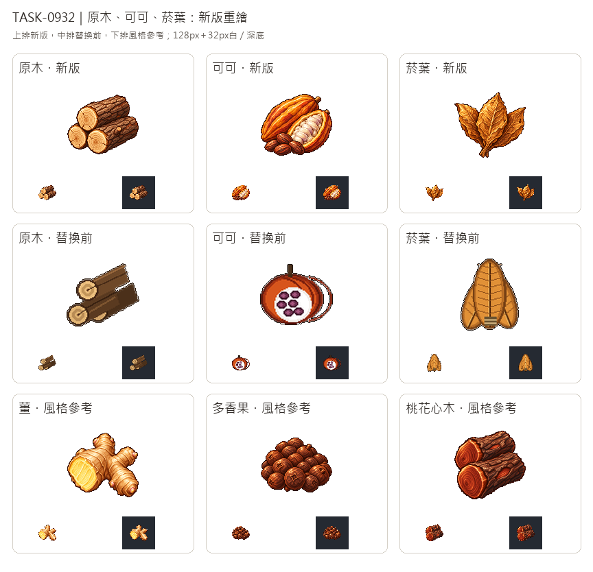

# 🖼️ 《Blocksail》木紋、果莢與葉脈｜三種原料重繪 (Grain, Pods and Veins)

Tim圈選舊原木、可可、菸葉，要求參考新版薑、多香果與桃花心木。三張都重新生成：原木以淺蜜色圓端、深棕樹皮與裂紋表現一般木材，和紅褐桃花心木保持差別；可可以長果莢的縱肋、剖面的白色果肉與幾粒種子交代內容；乾菸葉則用三片重疊葉、葉脈和捲邊增加厚度。

生成時三張都實際附上上述三張獨立白底原稿，只借像素材質、左上光源與色階，沒有把舊圖送去當構圖參考。白底原稿另存新館藏檔，遊戲版另整理為128×128透明圖，主體最大邊104px，替換原本三個貨物key的圖片。

總覽上排為新版、中排是替換前的遊戲圖、下排是風格參考的遊戲版，均並列原寸及32px白／深底。舊館藏與歷史批次總覽保留原樣，這件新版另開展出；替換前三張遊戲圖亦保留於驗收資料夾作比對。這次只換美術，不增加貨物或有圖數。

## 完整實際提示詞

工具：內建image_gen；逐張參考路徑、SHA與派生參數見Blocksail `docs/evidence/goods-refresh932/generation.json`。

### 原木 (logs)

```text
Create ONE icon of COMMON UNPROCESSED TIMBER: three short round logs in a compact triangular stack, cut ends facing lower left and lengths extending upper right. Deep neutral brown rough bark with detailed shallow fissures, pale honey-tan cut wood with visible concentric growth rings and a few small radial cracks. The circular end grain is LIGHT TAN, clearly different from the reddish-brown mahogany reference. A small broken branch nub on one log; no foliage, rope, tools, boards, furniture or sawdust ground. Strong cylindrical depth and clear three-log silhouette readable at32px. Use attached ginger, allspice and mahogany white masters ONLY as pixel-art style references: rich material-specific colours, upper-left highlights, detailed discrete shaded clusters, crisp stair-step contours, restrained dark brown outlines, tactile dimensional depth. Do not copy their subjects or impose mahogany-red on unrelated materials. Highly polished16/32-bit inventory sprite, not flat vector, photo or soft painting. Centered compact three-quarter composition, generous empty margins, complete object. Pure solid white #FFFFFF background, no ground plane, external cast shadow, text, labels, numbers, border, watermark, checkerboard, box, sack or barrel. White master preserved; separate transparent128px sprite derived.
```

### 可可 (cocoa)

```text
Create ONE icon of HARVESTED CACAO: one whole elongated ridged ochre-orange cacao pod behind, a matching split half pod tilted forward to show rows of cream-white pulpy seeds nested in its thick shell, and four loose rich brown cacao beans at the base. Clearly lengthwise ribbed pod form, botanical fruit rather than round cut orange, coconut or mixed berries. Warm amber to reddish ochre pod with deep brown furrow shadows, ivory pulp and restrained violet-brown seed undertones. No chocolate bar, powder, bowl, drink, flowers, leaves, sack or basket. Compact connected fruit group, recognizable at32px. Use attached ginger, allspice and mahogany white masters ONLY as pixel-art style references: rich material-specific colours, upper-left highlights, detailed discrete shaded clusters, crisp stair-step contours, restrained dark brown outlines, tactile dimensional depth. Do not copy their subjects or impose mahogany-red on unrelated materials. Highly polished16/32-bit inventory sprite, not flat vector, photo or soft painting. Centered compact three-quarter composition, generous empty margins, complete object. Pure solid white #FFFFFF background, no ground plane, external cast shadow, text, labels, numbers, border, watermark, checkerboard, box, sack or barrel. White master preserved; separate transparent128px sprite derived.
```

### 菸葉 (tobacco)

```text
Create ONE inventory icon of CURED TOBACCO LEAVES for Blocksail: three broad elongated pointed dried leaves in a compact fan, stems gathered naturally at the base, one leaf overlaps in front and two angle outward behind. Rich golden-brown, ochre and warm umber cured leaf colour, fine branching veins from a prominent central midrib, tactile crinkled papery surfaces, edges curled slightly inward and a few natural irregularities. Leaves are whole and uncut, not rolled cigars, not a flat symmetrical emblem, no pipe or flame. Clear depth between overlapping leaves, readable leaf silhouette at32px. Use attached ginger, allspice and mahogany white masters ONLY as pixel-art style references: rich material-specific colours, upper-left highlights, detailed discrete shaded clusters, crisp stair-step contours, restrained dark brown outlines, tactile dimensional depth. Do not copy their subjects or impose mahogany-red on unrelated materials. Highly polished16/32-bit inventory sprite, not flat vector, photo or soft painting. Centered compact three-quarter composition, generous empty margins, complete object. Pure solid white #FFFFFF background, no ground plane, external cast shadow, text, labels, numbers, border, watermark, checkerboard, box, sack or barrel. White master preserved; separate transparent128px sprite derived.
```


