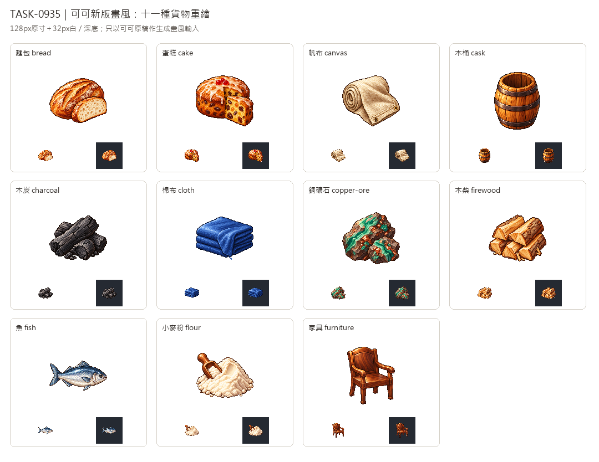

# 🖼️ 《Blocksail》可可畫風的新貨架｜十一種素材重繪

Tim要求以剛重畫的可可圖作風格參考，替換十一張舊素材。每張都重新設計，生成時唯一附圖是新版可可的獨立白底原稿；沒有讀舊圖來模仿構圖，也沒有把舊圖送入工具。借的是左上高光、離散像素色階、深色階梯輪廓與材質厚度，不是將所有物件染成可可的橙色。

麵包用橢圓裂口與切片，蛋糕用圓形果乾糕與切角；帆布是厚實米白卷布，棉布是藍色摺層。木桶本身就是貨物，所以保留空桶內側；木柴畫出劈面，木炭保留焦木縱紋以區分礦物煤。銅礦以綠藍礦帶與銅斑呈現，魚保留完整銀藍魚身，麵粉直接畫粉堆與木量勺，家具用完整木椅代表成品。

十一張由內建image_gen各自生成，完整白底原稿另存，遊戲版裁切去背至128×128、主體最大邊104px。木椅的白色孔洞一併去背，麵粉、帆布、魚腹的淺色高光保留；每張同時檢查32px白／深底。這是遊戲美術設定，不自行改貨物或配方。

新版總覽只展示這十一張；替換前後比較圖在完成新圖後製作，舊圖僅用來驗收差別。舊館藏與歷史總覽保留，新版另開此展，替換不增加貨物或有圖數。

## 完整實際提示詞

工具：內建image_gen。唯一畫風輸入：`RawImages/sirius_blocksail_goods_refresh932_cocoa_master.png`；SHA與處理參數見Blocksail `docs/evidence/goods-refresh935/generation.json`。

### 麵包 (bread)

```text
Create ONE icon for Blocksail: freshly baked rustic WHEAT BREAD. One plump oval golden-brown loaf with three diagonal scored crust splits and fine blistered crust, one thick slice leaning against the front side to reveal pale cream airy crumb with small irregular pores. Warm caramel edges, ivory flour dusting sparingly, strong rounded silhouette. No plate, cloth, wheat ears, basket, butter, herbs or packaging. Bread itself dominates the composition; no modern branding.  Use the attached NEW CACAO icon ONLY as a pixel-art rendering style reference: rich material-specific colour, upper-left highlights, fine discrete shaded clusters, crisp stair-step contours, restrained deep brown outlines, tactile dimensional depth. Design this subject independently; do not draw cacao or copy its orange palette onto unrelated materials. Highly polished16/32-bit inventory sprite, not vector, photo or soft painting. One compact centered three-quarter object or group, generous empty margin, all parts visible. Pure solid white #FFFFFF background, no floor, external cast shadow, text, labels, numbers, border, watermark or checkerboard. No unrelated packaging or scenery. Readable at32px; white master retained separately from transparent128px game icon.
```

### 蛋糕 (cake)

```text
Create ONE icon for Blocksail: a small round golden FRUIT CAKE with a single triangular slice cut and pulled slightly forward, showing dense warm yellow crumb dotted with dark raisins and tiny amber fruit pieces. Gently domed baked top with a thin ivory sugar glaze drizzled sparingly and three small red candied fruit pieces near the center, no elaborate modern frosting towers. Clear round cake plus wedge silhouette, visually distinct from an oval bread loaf. No plate, stand, wrapper, candles, letters, fork or background props.  Use the attached NEW CACAO icon ONLY as a pixel-art rendering style reference: rich material-specific colour, upper-left highlights, fine discrete shaded clusters, crisp stair-step contours, restrained deep brown outlines, tactile dimensional depth. Design this subject independently; do not draw cacao or copy its orange palette onto unrelated materials. Highly polished16/32-bit inventory sprite, not vector, photo or soft painting. One compact centered three-quarter object or group, generous empty margin, all parts visible. Pure solid white #FFFFFF background, no floor, external cast shadow, text, labels, numbers, border, watermark or checkerboard. No unrelated packaging or scenery. Readable at32px; white master retained separately from transparent128px game icon.
```

### 帆布 (canvas)

```text
Create ONE inventory icon for Blocksail: heavy SAIL CANVAS, a compact roll of thick natural ivory-beige woven cloth with one squared flap unfolding toward the front. Visible coarse crossweave, substantial edge thickness, reinforced double-stitched hem and two small brass grommet eyelets along the exposed corner. The rolled end is clearly visible at upper left, broad cream fabric mass readable at32px. Soft tan folds and muted ochre shadows, deep warm outlines. No ship, mast, sail emblem, painted symbol, rope coil, paper scroll, bag or wrapping. This is strong raw sailcloth, not a finished triangular sail.  Use the attached NEW CACAO icon ONLY as a pixel-art rendering style reference: rich material-specific colour, upper-left highlights, fine discrete shaded clusters, crisp stair-step contours, restrained deep brown outlines, tactile dimensional depth. Design this subject independently; do not draw cacao or copy its orange palette onto unrelated materials. Highly polished16/32-bit inventory sprite, not vector, photo or soft painting. One compact centered three-quarter object or group, generous empty margin, all parts visible. Pure solid white #FFFFFF background, no floor, external cast shadow, text, labels, numbers, border, watermark or checkerboard. No unrelated packaging or scenery. Readable at32px; white master retained separately from transparent128px game icon.
```

### 木桶 (cask)

```text
Create ONE inventory icon for Blocksail: an EMPTY OPEN WOODEN CASK, the barrel itself is the traded product. Upright compact bulging coopered barrel, warm honey-brown oak staves with grain and beveled rims, three dark wrought-iron hoops, top opening tilted toward viewer revealing a clearly EMPTY shadowed wooden interior. No lid covering it, no liquid, food, sacks, spigot, rope handles, logos or labels. One small side seam and iron rivets, sturdy dimensional construction. Strong barrel silhouette readable at32px. No other goods around it.  Use the attached NEW CACAO icon ONLY as a pixel-art rendering style reference: rich material-specific colour, upper-left highlights, fine discrete shaded clusters, crisp stair-step contours, restrained deep brown outlines, tactile dimensional depth. Design this subject independently; do not draw cacao or copy its orange palette onto unrelated materials. Highly polished16/32-bit inventory sprite, not vector, photo or soft painting. One compact centered three-quarter object or group, generous empty margin, all parts visible. Pure solid white #FFFFFF background, no floor, external cast shadow, text, labels, numbers, border, watermark or checkerboard. No unrelated packaging or scenery. Readable at32px; white master retained separately from transparent128px game icon.
```

### 木炭 (charcoal)

```text
Create ONE inventory icon for Blocksail: WOOD CHARCOAL, four short irregular charred wood pieces in a low compact pile. Matte deep charcoal-grey to black surfaces with muted ash-grey highlights, visible lengthwise burnt wood grain, fine cracked fibres and one broken end showing faint tree-ring texture. A few tiny dull grey chips nestle directly at the base. Clearly charred timber, NOT shiny mineral coal, no broad mirror-like highlights, metallic ore, orange embers, flames or smoke. Use a partly elongated split-stick silhouette with warm neutral dark greys, readable at32px. No tools, bowl or sacks.  Use the attached NEW CACAO icon ONLY as a pixel-art rendering style reference: rich material-specific colour, upper-left highlights, fine discrete shaded clusters, crisp stair-step contours, restrained deep brown outlines, tactile dimensional depth. Design this subject independently; do not draw cacao or copy its orange palette onto unrelated materials. Highly polished16/32-bit inventory sprite, not vector, photo or soft painting. One compact centered three-quarter object or group, generous empty margin, all parts visible. Pure solid white #FFFFFF background, no floor, external cast shadow, text, labels, numbers, border, watermark or checkerboard. No unrelated packaging or scenery. Readable at32px; white master retained separately from transparent128px game icon.
```

### 棉布 (cloth)

```text
Create ONE inventory icon for Blocksail: a folded bolt of soft INDIGO-BLUE COTTON CLOTH, three broad rectangular layers stacked loosely with one short corner draping over the front edge. Fine plain weave, smooth supple folds, deep blue shadows and muted sky-blue upper-left highlights. Squared folded silhouette and blue colour clearly distinguish it from cream rolled sail canvas at32px. A very small loose thread on the lower edge is enough, no fringe decoration, grommets, metal, needle, scissors, ribbon, wrapping, rolls, labels or containers. The cloth itself fills a compact horizontal group.  Use the attached NEW CACAO icon ONLY as a pixel-art rendering style reference: rich material-specific colour, upper-left highlights, fine discrete shaded clusters, crisp stair-step contours, restrained deep brown outlines, tactile dimensional depth. Design this subject independently; do not draw cacao or copy its orange palette onto unrelated materials. Highly polished16/32-bit inventory sprite, not vector, photo or soft painting. One compact centered three-quarter object or group, generous empty margin, all parts visible. Pure solid white #FFFFFF background, no floor, external cast shadow, text, labels, numbers, border, watermark or checkerboard. No unrelated packaging or scenery. Readable at32px; white master retained separately from transparent128px game icon.
```

### 銅礦石 (copper-ore)

```text
Create ONE inventory icon for Blocksail: RAW COPPER ORE, two irregular rugged host-rock chunks with natural green MALACHITE bands, small blue-green mineral patches and scattered reddish-copper metallic flecks embedded in dark grey-brown stone. One larger angular specimen behind, smaller broken piece at front, showing mineral colour through fractured facets. Distinct broad turquoise-green mineral streaks rather than neon drawn symbols, restrained warm copper glints, dark earthy matrix. Not refined copper ingots, coins, jewellery, a pure green crystal or a fantasy glowing rune. Natural raw mineral silhouette and green/copper palette readable at32px.  Use the attached NEW CACAO icon ONLY as a pixel-art rendering style reference: rich material-specific colour, upper-left highlights, fine discrete shaded clusters, crisp stair-step contours, restrained deep brown outlines, tactile dimensional depth. Design this subject independently; do not draw cacao or copy its orange palette onto unrelated materials. Highly polished16/32-bit inventory sprite, not vector, photo or soft painting. One compact centered three-quarter object or group, generous empty margin, all parts visible. Pure solid white #FFFFFF background, no floor, external cast shadow, text, labels, numbers, border, watermark or checkerboard. No unrelated packaging or scenery. Readable at32px; white master retained separately from transparent128px game icon.
```

### 木柴 (firewood)

```text
Create ONE inventory icon for Blocksail: a compact stack of six short SPLIT FIREWOOD pieces, rough half-round and wedge-shaped billets laid in two crossed layers. Pale honey-tan freshly split faces with fibrous grain, rough neutral-brown bark left on curved outer edges, angular triangular cut ends prominently visible at front. A few short small splinters directly against the pile, no scattered ground debris. Clearly split kindling, not full cylindrical logs, sawn boards, charcoal or a lit fire. No twine, container, axe, leaves, flames or smoke. Warm natural wood colours, broad clear angular silhouette at32px.  Use the attached NEW CACAO icon ONLY as a pixel-art rendering style reference: rich material-specific colour, upper-left highlights, fine discrete shaded clusters, crisp stair-step contours, restrained deep brown outlines, tactile dimensional depth. Design this subject independently; do not draw cacao or copy its orange palette onto unrelated materials. Highly polished16/32-bit inventory sprite, not vector, photo or soft painting. One compact centered three-quarter object or group, generous empty margin, all parts visible. Pure solid white #FFFFFF background, no floor, external cast shadow, text, labels, numbers, border, watermark or checkerboard. No unrelated packaging or scenery. Readable at32px; white master retained separately from transparent128px game icon.
```

### 魚 (fish)

```text
Create ONE inventory icon for Blocksail: a freshly caught WHOLE SILVERY SEA FISH, compact oval-to-tapered body lying horizontally with head facing right and forked tail to left, complete fins and tail. Deep slate-blue back grading to iridescent silver-grey sides and an ivory belly, orderly tiny scale clusters, one dark clear eye, subtle gill plate and a restrained blue fin edge. Body is thick and dimensional, not a flat symbol. No gore, cut fillet, plate, hooks, fishing line, water, ice, garnish, cooking marks, smoke or other seafood. Recognizable clean fish silhouette at32px, no anatomical exaggeration.  Use the attached NEW CACAO icon ONLY as a pixel-art rendering style reference: rich material-specific colour, upper-left highlights, fine discrete shaded clusters, crisp stair-step contours, restrained deep brown outlines, tactile dimensional depth. Design this subject independently; do not draw cacao or copy its orange palette onto unrelated materials. Highly polished16/32-bit inventory sprite, not vector, photo or soft painting. One compact centered three-quarter object or group, generous empty margin, all parts visible. Pure solid white #FFFFFF background, no floor, external cast shadow, text, labels, numbers, border, watermark or checkerboard. No unrelated packaging or scenery. Readable at32px; white master retained separately from transparent128px game icon.
```

### 小麥粉 (flour)

```text
Create ONE inventory icon for Blocksail: WHEAT FLOUR itself, a soft compact mound of finely milled ivory-cream powder with gentle irregular ridges, one shallow scoop indentation and a few tiny powder clumps touching the base. A small simple dark honey-brown wooden measuring scoop leans into one side, its shallow bowl holding a little flour, short handle angled upward left. The powder mound dominates and remains clearly visible, not hidden inside a sack or barrel. Warm off-white powder, subtle beige-grey shading and restrained warm dark edge definition so it reads on white and dark backgrounds; avoid pure-white featureless blob. No grain ears, bread, labels, bag, bowl, crate or ground shadow.  Use the attached NEW CACAO icon ONLY as a pixel-art rendering style reference: rich material-specific colour, upper-left highlights, fine discrete shaded clusters, crisp stair-step contours, restrained deep brown outlines, tactile dimensional depth. Design this subject independently; do not draw cacao or copy its orange palette onto unrelated materials. Highly polished16/32-bit inventory sprite, not vector, photo or soft painting. One compact centered three-quarter object or group, generous empty margin, all parts visible. Pure solid white #FFFFFF background, no floor, external cast shadow, text, labels, numbers, border, watermark or checkerboard. No unrelated packaging or scenery. Readable at32px; white master retained separately from transparent128px game icon.
```

### 家具 (furniture)

```text
Create ONE inventory icon for Blocksail: a handsome SIMPLE WOODEN ARMCHAIR representing crafted FURNITURE, age-of-sail town workshop product. Three-quarter view facing slightly screen right, a solid gently curved broad back panel with a shallow carved border, thick square wooden seat, two modest curved armrests and four sturdy tapering legs, all feet fully visible. Warm reddish walnut-brown polished hardwood with subtle grain, honey-copper edge highlights and dark umber joints. Keep joinery plausible and silhouette compact; no upholstery, cushions, ornate gilding, heraldry, throne shapes or background room. No cabinet, table, crate, tools, nails floating around or ground shadow. Use a solid back panel rather than thin many-spindle construction so it reads clearly at32px. Leg and armrest gaps are plain white background, no painted white inserts.  Use the attached NEW CACAO icon ONLY as a pixel-art rendering style reference: rich material-specific colour, upper-left highlights, fine discrete shaded clusters, crisp stair-step contours, restrained deep brown outlines, tactile dimensional depth. Design this subject independently; do not draw cacao or copy its orange palette onto unrelated materials. Highly polished16/32-bit inventory sprite, not vector, photo or soft painting. One compact centered three-quarter object or group, generous empty margin, all parts visible. Pure solid white #FFFFFF background, no floor, external cast shadow, text, labels, numbers, border, watermark or checkerboard. No unrelated packaging or scenery. Readable at32px; white master retained separately from transparent128px game icon.
```



[替換前後比較圖](../RawImages/sirius_blocksail_goods_refresh935_comparison.png)
