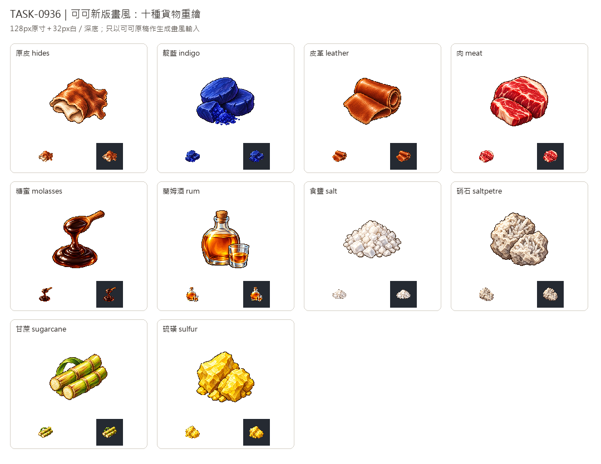

# 🖼️ 《Blocksail》皮料、染料與糖酒｜十種貨物重繪

Tim要求直接重新設計這十種貨物。唯一送入生成工具的參考是新版可可白底原稿；借用左上光源、細緻像素色階與階梯輪廓，各物件保留自己的材質配色。舊圖只在生成完成後製作比較，不作構圖參考。

原皮以毛面、米白內側及不規則邊緣，和整齊光滑的成品皮革分開；靛藍呈現壓製染料餅與碎粉。肉保留紅色肌理和脂肪紋，糖蜜用深褐濃稠流線，蘭姆酒則用能看清琥珀酒液的玻璃瓶杯。

食鹽是粗粒方晶，硝石是淺色多孔礦塊與晶簇，硫磺用亮黃脆裂礦面；甘蔗保留節點、葉片與纖維切面。十張由內建image_gen獨立生成，白底原稿完整保留，遊戲版去背為128×128、主體最大邊104px；另驗32px白深底及淺色高光。

新版另展並保留舊館藏，只替換遊戲圖，不改貨物、配方或有圖數。完整提示詞與雜湊可從Blocksail docs/evidence/goods-refresh936/generation.json追溯。

## 完整實際提示詞

工具：內建image_gen。唯一畫風輸入：`RawImages/sirius_blocksail_goods_refresh932_cocoa_master.png`。

### 原皮 (hides)

```text
Create ONE Blocksail inventory icon of RAW UNTANNED ANIMAL HIDE: one loosely folded supple cowhide, cream underside curling at the front and warm russet-brown short fur on top, irregular natural scalloped edge with broad short limb lobes. Compact folded skin silhouette, no animal head or body, no blood, no rolled finished leather, no belt, buckle, rope or packaging. Use attached NEW CACAO solely as pixel-art rendering STYLE reference: saturated material-specific colours, upper-left highlights, discrete fine shaded pixel clusters, crisp stair-step contour, restrained dark outlines, tactile dimensional depth. Design subject independently, no cacao and no forcing orange onto unrelated materials. Polished 16/32-bit inventory sprite, readable at32px. ONE compact centered three-quarter object or group, complete silhouette and generous margins, pure solid WHITE #FFFFFF background, no ground plane or external cast shadow, no text, labels, watermark, checkerboard or scenery. White original retained; separate transparent128px game version derived.
```

### 靛藍 (indigo)

```text
Create ONE Blocksail inventory icon of INDIGO DYE itself: three compact deep indigo-blue pressed pigment cakes, one broken angular piece showing crumbly powdery interior and a small touching mound of ultramarine-indigo powder. Matte rich blue surfaces with violet shadows, not glossy gemstones, not coal, not leaves or flowers, no bowl, sack or labels. Use attached NEW CACAO solely as pixel-art rendering STYLE reference: saturated material-specific colours, upper-left highlights, discrete fine shaded pixel clusters, crisp stair-step contour, restrained dark outlines, tactile dimensional depth. Design subject independently, no cacao and no forcing orange onto unrelated materials. Polished 16/32-bit inventory sprite, readable at32px. ONE compact centered three-quarter object or group, complete silhouette and generous margins, pure solid WHITE #FFFFFF background, no ground plane or external cast shadow, no text, labels, watermark, checkerboard or scenery. White original retained; separate transparent128px game version derived.
```

### 皮革 (leather)

```text
Create ONE Blocksail inventory icon of TANNED LEATHER: one thick smooth cognac-brown leather sheet partly rolled back, with a broad rectangular folded flap in front and clean cut edges exposing the lighter tan thickness. Subtle fine pores, supple curved highlights, no fur, irregular animal outline, belt, buckles, stitching, container or tools. Clearly finished leather rather than raw hide. Use attached NEW CACAO solely as pixel-art rendering STYLE reference: saturated material-specific colours, upper-left highlights, discrete fine shaded pixel clusters, crisp stair-step contour, restrained dark outlines, tactile dimensional depth. Design subject independently, no cacao and no forcing orange onto unrelated materials. Polished 16/32-bit inventory sprite, readable at32px. ONE compact centered three-quarter object or group, complete silhouette and generous margins, pure solid WHITE #FFFFFF background, no ground plane or external cast shadow, no text, labels, watermark, checkerboard or scenery. White original retained; separate transparent128px game version derived.
```

### 肉 (meat)

```text
Create ONE Blocksail inventory icon of FRESH RAW MEAT: a thick boneless red cut of meat with restrained cream fat marbling and a narrow ivory fat edge, one smaller cut leaning at front. Deep burgundy underside, warm red muscle fibres and muted pink highlights, appetizing clean butcher cut. No gore, blood puddle, animal, plate, herbs, cooked grill marks or packaging. Use attached NEW CACAO solely as pixel-art rendering STYLE reference: saturated material-specific colours, upper-left highlights, discrete fine shaded pixel clusters, crisp stair-step contour, restrained dark outlines, tactile dimensional depth. Design subject independently, no cacao and no forcing orange onto unrelated materials. Polished 16/32-bit inventory sprite, readable at32px. ONE compact centered three-quarter object or group, complete silhouette and generous margins, pure solid WHITE #FFFFFF background, no ground plane or external cast shadow, no text, labels, watermark, checkerboard or scenery. White original retained; separate transparent128px game version derived.
```

### 糖蜜 (molasses)

```text
Create ONE Blocksail inventory icon of MOLASSES itself: a compact very thick dark mahogany-brown glossy syrup pool with a short wooden spoon tilted above it, a thick slow ribbon of syrup curling from spoon into a mound at center. Dark almost-black body, amber-brown edge translucency and small cream highlights. No bowl, jar, barrel, sack, label, sugarcane or background puddle beyond the compact icon. Clearly viscous syrup, not water or rum. Use attached NEW CACAO solely as pixel-art rendering STYLE reference: saturated material-specific colours, upper-left highlights, discrete fine shaded pixel clusters, crisp stair-step contour, restrained dark outlines, tactile dimensional depth. Design subject independently, no cacao and no forcing orange onto unrelated materials. Polished 16/32-bit inventory sprite, readable at32px. ONE compact centered three-quarter object or group, complete silhouette and generous margins, pure solid WHITE #FFFFFF background, no ground plane or external cast shadow, no text, labels, watermark, checkerboard or scenery. White original retained; separate transparent128px game version derived.
```

### 蘭姆酒 (rum)

```text
Create ONE Blocksail inventory icon of RUM: a small simple squat clear glass spirit bottle three-quarters full of luminous amber-gold rum, rounded shoulders and a short narrow neck closed by a plain cork, no label. A small clear drinking glass beside it with a shallow amber measure makes the liquid visible. Restrained icy pale-blue glass edge and warm honey drink, darker brown at base. Bottle is specific serving vessel necessary to show liquid, not a barrel/crate. No text, skull, logo, decoration or scenery. Use attached NEW CACAO solely as pixel-art rendering STYLE reference: saturated material-specific colours, upper-left highlights, discrete fine shaded pixel clusters, crisp stair-step contour, restrained dark outlines, tactile dimensional depth. Design subject independently, no cacao and no forcing orange onto unrelated materials. Polished 16/32-bit inventory sprite, readable at32px. ONE compact centered three-quarter object or group, complete silhouette and generous margins, pure solid WHITE #FFFFFF background, no ground plane or external cast shadow, no text, labels, watermark, checkerboard or scenery. White original retained; separate transparent128px game version derived.
```

### 食鹽 (salt)

```text
Create ONE Blocksail inventory icon of SEA SALT itself: compact low mound of coarse ivory-white irregular cubic salt grains, a few larger translucent blocky grains at front. Cool neutral pale grey shadows, clean cream-white top highlights and thin warm-grey outline, readable on white. Modest granular silhouette, not long needles, gemstone cluster, snow or flour, no spoon, bowl, sack, packaging or labels. Use attached NEW CACAO solely as pixel-art rendering STYLE reference: saturated material-specific colours, upper-left highlights, discrete fine shaded pixel clusters, crisp stair-step contour, restrained dark outlines, tactile dimensional depth. Design subject independently, no cacao and no forcing orange onto unrelated materials. Polished 16/32-bit inventory sprite, readable at32px. ONE compact centered three-quarter object or group, complete silhouette and generous margins, pure solid WHITE #FFFFFF background, no ground plane or external cast shadow, no text, labels, watermark, checkerboard or scenery. White original retained; separate transparent128px game version derived.
```

### 硝石 (saltpetre)

```text
Create ONE Blocksail inventory icon of SALTPETRE raw mineral: two pale cream-grey porous crusty rock nodules with a few small elongated off-white crystalline needles growing in a crust on their broken surfaces. Slight cool beige-grey mineral shadows, restrained ivory highlights, rugged asymmetrical solid rock silhouette distinct from loose salt grains and vivid yellow sulfur. No magical glow, large quartz spikes, bag, bowl, tools or labels. Use attached NEW CACAO solely as pixel-art rendering STYLE reference: saturated material-specific colours, upper-left highlights, discrete fine shaded pixel clusters, crisp stair-step contour, restrained dark outlines, tactile dimensional depth. Design subject independently, no cacao and no forcing orange onto unrelated materials. Polished 16/32-bit inventory sprite, readable at32px. ONE compact centered three-quarter object or group, complete silhouette and generous margins, pure solid WHITE #FFFFFF background, no ground plane or external cast shadow, no text, labels, watermark, checkerboard or scenery. White original retained; separate transparent128px game version derived.
```

### 甘蔗 (sugarcane)

```text
Create ONE Blocksail inventory icon of SUGARCANE: three short thick green-gold segmented cane stalks lying diagonally in a compact bundle, visibly jointed nodes and thin reddish-brown streaks. Two freshly cut ends show pale cream fibrous interiors; one restrained narrow green leaf curls behind. Sturdy cylindrical stalks, not bamboo, wheat or corn. No twine, container, soil, text or tools. Use attached NEW CACAO solely as pixel-art rendering STYLE reference: saturated material-specific colours, upper-left highlights, discrete fine shaded pixel clusters, crisp stair-step contour, restrained dark outlines, tactile dimensional depth. Design subject independently, no cacao and no forcing orange onto unrelated materials. Polished 16/32-bit inventory sprite, readable at32px. ONE compact centered three-quarter object or group, complete silhouette and generous margins, pure solid WHITE #FFFFFF background, no ground plane or external cast shadow, no text, labels, watermark, checkerboard or scenery. White original retained; separate transparent128px game version derived.
```

### 硫磺 (sulfur)

```text
Create ONE Blocksail inventory icon of NATIVE SULFUR: a compact cluster of two rough golden-lemon-yellow sulfur mineral chunks, brittle angular broken faces with pale straw highlights, deep ochre crevices, a few small yellow chips touching base. Matte waxy mineral texture, not gold metal, cheese, gemstone, ore with glowing runes or orange fire. Strong lumpy mineral silhouette, no container, labels, smoke or tools. Use attached NEW CACAO solely as pixel-art rendering STYLE reference: saturated material-specific colours, upper-left highlights, discrete fine shaded pixel clusters, crisp stair-step contour, restrained dark outlines, tactile dimensional depth. Design subject independently, no cacao and no forcing orange onto unrelated materials. Polished 16/32-bit inventory sprite, readable at32px. ONE compact centered three-quarter object or group, complete silhouette and generous margins, pure solid WHITE #FFFFFF background, no ground plane or external cast shadow, no text, labels, watermark, checkerboard or scenery. White original retained; separate transparent128px game version derived.
```



[替換前後比較圖](../RawImages/sirius_blocksail_goods_refresh936_comparison.png)
