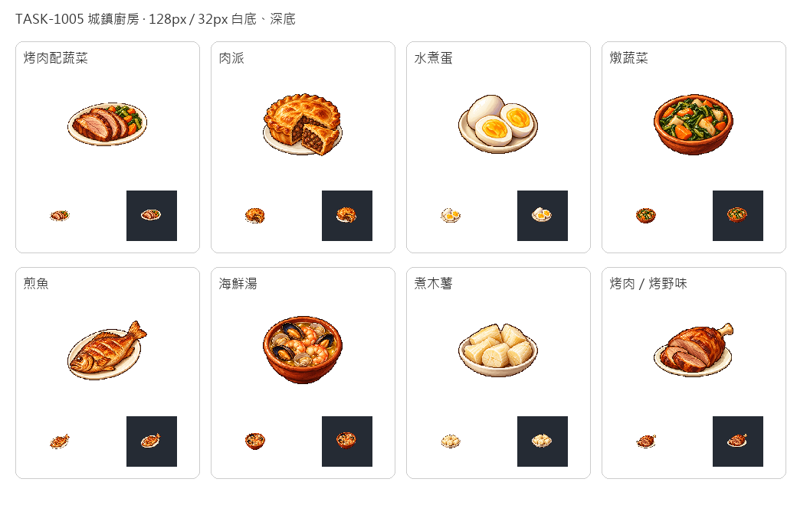

# 廚房端出的家常

從市場所取的魚、海產、蛋與木薯，如今各有一份端上桌的樣子。煎魚不再搭麵包，純肉盤不再搭蔬菜，藉此和餐館大餐及家常複合食譜區分；肉派與烤肉配蔬菜則補齊既有兩道家常菜。食材欄仍顯示真正扣掉的物資，圖上的烹調外觀不增加耗料、工人或熱量。

八張逐一用內建image_gen生成，只借新版可可原稿的像素風格，保留深色階梯輪廓與左上高光。白底原稿完整保留，另整理128px透明圖及32px白深底驗收。白餐盤、蛋白和木薯內部高光保留，不把淺色食物一併擦掉。

先在藝廊展出，再匯入遊戲。其他已畫的粥、玉米糊與魚配木薯沿用原成品圖；麵包、蛋糕、鮮奶與鮮果維持即食成品。這是菜單與資訊的整理，不改既有經濟選菜規則。



## 完整生成提示詞

### 烤肉配蔬菜

```text
ONE town kitchen meal icon for an age-of-sail Caribbean game: one simple ivory oval dinner plate holding three thick slices of cooked browned roast meat and a small side of cooked green vegetables and orange carrot pieces. NO bread, wine, raw meat, cutlery or extra side dishes. Use attached new CACAO only as pixel-art rendering STYLE reference, not content. Exquisite16/32-bit sprite, rich natural material colours, discrete shaded pixel clusters, upper-left light, crisp stair-step silhouettes, restrained dark brown outline and tactile depth. Compact centered three-quarter view with generous blank margins, readable at32px. Pure SOLID WHITE #FFFFFF background. No table or scenery, external cast shadow, text, letters, label, watermark, border or checkerboard. White master retained; separate128px transparent game sprite prepared later.
```

[白底原稿](../RawImages/sirius_blocksail_home1005_roast_meat_master.png)

### 肉派

```text
ONE town kitchen meal icon for an age-of-sail Caribbean game: one rustic round golden savoury meat pie on a small plain ivory plate, one wedge removed and leaning in front to expose dark cooked minced meat filling. Crisp crimped pastry edge, distinct pie silhouette, no fruits, bread rolls, drinks or silverware. Use attached new CACAO only as pixel-art rendering STYLE reference, not content. Exquisite16/32-bit sprite, rich natural material colours, discrete shaded pixel clusters, upper-left light, crisp stair-step silhouettes, restrained dark brown outline and tactile depth. Compact centered three-quarter view with generous blank margins, readable at32px. Pure SOLID WHITE #FFFFFF background. No table or scenery, external cast shadow, text, letters, label, watermark, border or checkerboard. White master retained; separate128px transparent game sprite prepared later.
```

[白底原稿](../RawImages/sirius_blocksail_home1005_meat_pie_master.png)

### 水煮蛋

```text
ONE town kitchen meal icon for an age-of-sail Caribbean game: one small simple ivory plate holding one peeled hard-boiled egg and two half eggs with firm golden yolks. Compact grouping, clean white shaded egg surfaces, no bread, garnish, raw shells, salt shaker or drinks. Use attached new CACAO only as pixel-art rendering STYLE reference, not content. Exquisite16/32-bit sprite, rich natural material colours, discrete shaded pixel clusters, upper-left light, crisp stair-step silhouettes, restrained dark brown outline and tactile depth. Compact centered three-quarter view with generous blank margins, readable at32px. Pure SOLID WHITE #FFFFFF background. No table or scenery, external cast shadow, text, letters, label, watermark, border or checkerboard. White master retained; separate128px transparent game sprite prepared later.
```

[白底原稿](../RawImages/sirius_blocksail_home1005_boiled_egg_master.png)

### 燉蔬菜

```text
ONE town kitchen meal icon for an age-of-sail Caribbean game: one low rustic terracotta bowl containing cooked leafy greens, thick orange carrot chunks and pale cooked root vegetable pieces. Vegetable-only meal, visibly cooked and moist but not soup. NO meat, eggs, bread or utensils. Use attached new CACAO only as pixel-art rendering STYLE reference, not content. Exquisite16/32-bit sprite, rich natural material colours, discrete shaded pixel clusters, upper-left light, crisp stair-step silhouettes, restrained dark brown outline and tactile depth. Compact centered three-quarter view with generous blank margins, readable at32px. Pure SOLID WHITE #FFFFFF background. No table or scenery, external cast shadow, text, letters, label, watermark, border or checkerboard. White master retained; separate128px transparent game sprite prepared later.
```

[白底原稿](../RawImages/sirius_blocksail_home1005_stewed_vegetables_master.png)

### 煎魚

```text
ONE town kitchen meal icon for an age-of-sail Caribbean game: one crisp golden pan-fried whole fish diagonally across a plain small ivory oval plate. Complete head, tail and fins visible, appetizing cooked skin with a few browning scores. NO bread, citrus, garnish, vegetables, utensils or other ingredients. Use attached new CACAO only as pixel-art rendering STYLE reference, not content. Exquisite16/32-bit sprite, rich natural material colours, discrete shaded pixel clusters, upper-left light, crisp stair-step silhouettes, restrained dark brown outline and tactile depth. Compact centered three-quarter view with generous blank margins, readable at32px. Pure SOLID WHITE #FFFFFF background. No table or scenery, external cast shadow, text, letters, label, watermark, border or checkerboard. White master retained; separate128px transparent game sprite prepared later.
```

[白底原稿](../RawImages/sirius_blocksail_home1005_pan_fish_master.png)

### 海鮮湯

```text
ONE town kitchen meal icon for an age-of-sail Caribbean game: one rustic terracotta bowl of clear golden seafood broth with curled cooked pink shrimp, several open mussels and clam shells. Clearly cooked seafood meal, compact high three-quarter view. NO bread, noodles, vegetables, dairy, utensils or drinks. Use attached new CACAO only as pixel-art rendering STYLE reference, not content. Exquisite16/32-bit sprite, rich natural material colours, discrete shaded pixel clusters, upper-left light, crisp stair-step silhouettes, restrained dark brown outline and tactile depth. Compact centered three-quarter view with generous blank margins, readable at32px. Pure SOLID WHITE #FFFFFF background. No table or scenery, external cast shadow, text, letters, label, watermark, border or checkerboard. White master retained; separate128px transparent game sprite prepared later.
```

[白底原稿](../RawImages/sirius_blocksail_home1005_seafood_bowl_master.png)

### 煮木薯

```text
ONE town kitchen meal icon for an age-of-sail Caribbean game: one simple ivory shallow dish holding five thick short boiled cassava chunks: creamy white tender cut cylinders and irregular wedges, subtle pale gold shading and tiny fibrous cracks. NO brown raw peel, green garnish, meat, bread, utensils or drinks. Use attached new CACAO only as pixel-art rendering STYLE reference, not content. Exquisite16/32-bit sprite, rich natural material colours, discrete shaded pixel clusters, upper-left light, crisp stair-step silhouettes, restrained dark brown outline and tactile depth. Compact centered three-quarter view with generous blank margins, readable at32px. Pure SOLID WHITE #FFFFFF background. No table or scenery, external cast shadow, text, letters, label, watermark, border or checkerboard. White master retained; separate128px transparent game sprite prepared later.
```

[白底原稿](../RawImages/sirius_blocksail_home1005_cassava_plate_master.png)

### 烤肉／烤野味

```text
ONE town kitchen meal icon for an age-of-sail Caribbean game: one simple ivory oval plate holding a single cooked brown roasted haunch portion with a short ivory bone end, and two thick slices in front with warm brown cooked interiors. Rustic plain roasted meat meal. NO vegetables, bread, wine, raw red meat, gravy boat or utensils. Use attached new CACAO only as pixel-art rendering STYLE reference, not content. Exquisite16/32-bit sprite, rich natural material colours, discrete shaded pixel clusters, upper-left light, crisp stair-step silhouettes, restrained dark brown outline and tactile depth. Compact centered three-quarter view with generous blank margins, readable at32px. Pure SOLID WHITE #FFFFFF background. No table or scenery, external cast shadow, text, letters, label, watermark, border or checkerboard. White master retained; separate128px transparent game sprite prepared later.
```

[白底原稿](../RawImages/sirius_blocksail_home1005_roast_cut_master.png)
