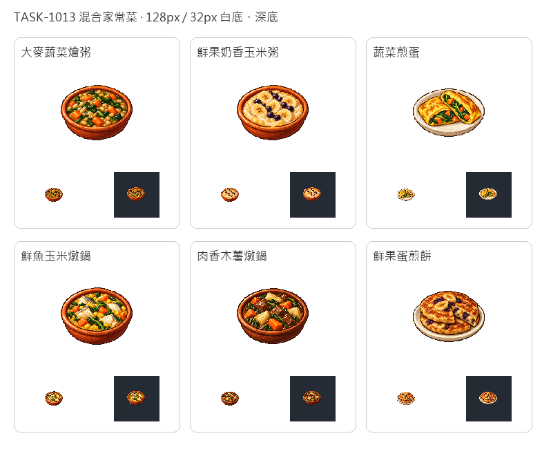

# 🖼️ 一鍋一餐的家常

大麥與蔬菜在同一口鍋裡煮濃，玉米粥添上牛奶和鮮果，蛋皮包住葉菜；海邊的魚與內陸的肉，分別和玉米、木薯配成一餐。最後留一道鮮果蛋煎餅，讓麵粉除了肉派，也有親近日常的去處。這六道菜採目前已有的貨物，不靠尚未投產的香料或食材。

逐張以內建image_gen獨立生成，只借TASK-1005燉蔬菜原稿的新版像素畫風：離散的細緻色階、深色階梯輪廓、左上高光與飽滿材質。碗與餐盤仍是食物的襯托；透明遊戲版留下完整白餐盤與白肉高光，並以32px白深底檢查輪廓。

六道皆為家常等級，產出不超過食材熱量，奶粥與煎餅的半份向下取整。肉鍋可用肉或野味，介面食材表記實際吃掉的物產。圖示不改菜單選用規則，新的配方會參與既有的預算、價格與缺料選菜；本展先完成上架，之後才匯入遊戲。



## 完整生成提示詞

### 大麥蔬菜燴粥

```text
Create ONE game meal inventory icon: a deep rustic terracotta bowl of thick barley and vegetable potage, visibly plump pearly barley grains mixed with orange carrot pieces and dark leafy greens, generous barley texture, no meat, no fish, no bread. Use the attached existing home-kitchen vegetable dish ONLY as a pixel-art style reference, not as a content template. Rich material-specific colours, crisp discrete pixel clusters and stair-step contours, restrained deep brown outlines, dimensional 16/32-bit RPG sprite shading, highlights from upper left. Readable compact silhouette at 32px. Centered three-quarter view, complete vessel with generous white margins. Pure solid white #FFFFFF background, no ground plane, no external cast shadow, no scene, no text, no letters, no border, no checkerboard. Only the prepared food and serving vessel. Match the refined cocoa-era Blocksail icon style. This is a standalone new design.
```

[白底原稿](../RawImages/sirius_blocksail_home1013_barley_vegetable_pot_master.png)

### 鮮果奶香玉米粥

```text
Create ONE game meal inventory icon: a shallow ochre earthenware bowl of creamy pale golden maize porridge, visibly creamy milk swirls and several banana slices with small dark purple tropical sea grapes on top, no spoon, no red berries, no added garnish. Use the attached existing home-kitchen vegetable dish ONLY as a pixel-art style reference, not as a content template. Rich material-specific colours, crisp discrete pixel clusters and stair-step contours, restrained deep brown outlines, dimensional 16/32-bit RPG sprite shading, highlights from upper left. Readable compact silhouette at 32px. Centered three-quarter view, complete vessel with generous white margins. Pure solid white #FFFFFF background, no ground plane, no external cast shadow, no scene, no text, no letters, no border, no checkerboard. Only the prepared food and serving vessel. Match the refined cocoa-era Blocksail icon style. This is a standalone new design.
```

[白底原稿](../RawImages/sirius_blocksail_home1013_fruit_milk_maize_master.png)

### 蔬菜煎蛋

```text
Create ONE game meal inventory icon: a compact folded golden omelette cut in two to show dark leafy greens and orange vegetable pieces inside, on a simple ivory ceramic plate, golden browned egg folds, no bread, no cheese, no meat. Use the attached existing home-kitchen vegetable dish ONLY as a pixel-art style reference, not as a content template. Rich material-specific colours, crisp discrete pixel clusters and stair-step contours, restrained deep brown outlines, dimensional 16/32-bit RPG sprite shading, highlights from upper left. Readable compact silhouette at 32px. Centered three-quarter view, complete vessel with generous white margins. Pure solid white #FFFFFF background, no ground plane, no external cast shadow, no scene, no text, no letters, no border, no checkerboard. Only the prepared food and serving vessel. Match the refined cocoa-era Blocksail icon style. This is a standalone new design.
```

[白底原稿](../RawImages/sirius_blocksail_home1013_garden_omelette_master.png)

### 鮮魚玉米燉鍋

```text
Create ONE game meal inventory icon: a rustic terracotta bowl filled with thick golden maize stew, several large recognizable white fish flakes with small silver skin edges, yellow corn kernels and orange carrot pieces with green leafy vegetables; no shellfish, no bread, no whole fish. Use the attached existing home-kitchen vegetable dish ONLY as a pixel-art style reference, not as a content template. Rich material-specific colours, crisp discrete pixel clusters and stair-step contours, restrained deep brown outlines, dimensional 16/32-bit RPG sprite shading, highlights from upper left. Readable compact silhouette at 32px. Centered three-quarter view, complete vessel with generous white margins. Pure solid white #FFFFFF background, no ground plane, no external cast shadow, no scene, no text, no letters, no border, no checkerboard. Only the prepared food and serving vessel. Match the refined cocoa-era Blocksail icon style. This is a standalone new design.
```

[白底原稿](../RawImages/sirius_blocksail_home1013_fish_maize_pot_master.png)

### 肉香木薯燉鍋

```text
Create ONE game meal inventory icon: a deep dark brown earthenware bowl filled with chunky brown meat stew, large ivory cassava wedges with starchy texture, orange carrot chunks and dark leafy vegetables; rich brown gravy, no potatoes, no bread, no side items. Use the attached existing home-kitchen vegetable dish ONLY as a pixel-art style reference, not as a content template. Rich material-specific colours, crisp discrete pixel clusters and stair-step contours, restrained deep brown outlines, dimensional 16/32-bit RPG sprite shading, highlights from upper left. Readable compact silhouette at 32px. Centered three-quarter view, complete vessel with generous white margins. Pure solid white #FFFFFF background, no ground plane, no external cast shadow, no scene, no text, no letters, no border, no checkerboard. Only the prepared food and serving vessel. Match the refined cocoa-era Blocksail icon style. This is a standalone new design.
```

[白底原稿](../RawImages/sirius_blocksail_home1013_meat_cassava_pot_master.png)

### 鮮果蛋煎餅

```text
Create ONE game meal inventory icon: two thick rustic golden pan cooked flour-and-egg flatcakes on a small ivory ceramic plate, one cut wedge revealing banana pieces and dark purple tropical sea grapes baked inside, a few visible fruit pieces on top; no syrup, no honey, no cream, no sugar dust, no cutlery. Use the attached existing home-kitchen vegetable dish ONLY as a pixel-art style reference, not as a content template. Rich material-specific colours, crisp discrete pixel clusters and stair-step contours, restrained deep brown outlines, dimensional 16/32-bit RPG sprite shading, highlights from upper left. Readable compact silhouette at 32px. Centered three-quarter view, complete vessel with generous white margins. Pure solid white #FFFFFF background, no ground plane, no external cast shadow, no scene, no text, no letters, no border, no checkerboard. Only the prepared food and serving vessel. Match the refined cocoa-era Blocksail icon style. This is a standalone new design.
```

[白底原稿](../RawImages/sirius_blocksail_home1013_fruit_egg_flatbread_master.png)
