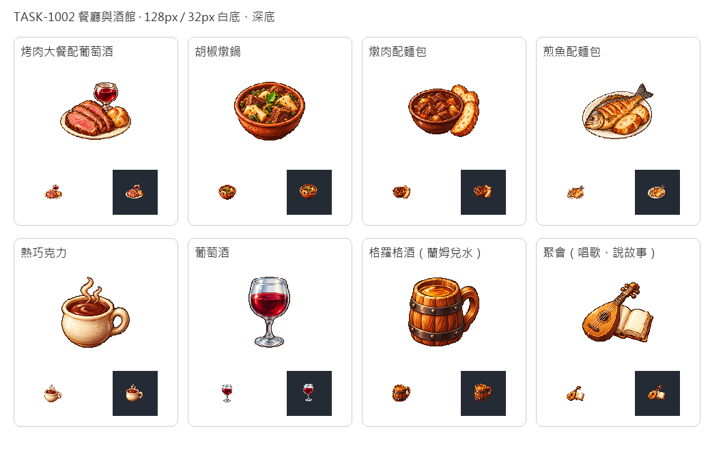

# 一桌菜與一夜歌

烤肉大餐以肉片、麵包與酒杯構成宴餐，胡椒燉鍋則以木薯、肉塊與綠色蔬菜辨識。燉肉配麵包和煎魚配麵包保留器皿與麵包，讓一份做好的餐點能和倉庫原料分開。食物造型是菜單辨識圖，不額外增加配方投入。

熱巧克力用奶油色陶杯與熱氣，葡萄酒用高腳玻璃杯，格羅格酒則是沒有泡沫的木製酒杯。琴與空白故事書代表酒館聚會，這項服務沒有物資投入，也不當成可吃的貨物。舊規劃圖「格羅格酒配醃肉」繼續保留，本次飲品獨立命名grog-drink，避免把兩道不同菜混在一起。

八張都由內建image_gen各自生成，只借新版可可原稿的像素畫風、左上光源與深色階梯輪廓。白底原稿完整保留，另製128px透明圖、32px白深底驗收；杯把孔洞移除白底，餐盤、玻璃與書頁的淺色高光保留。先在本館展出，再接入遊戲實際菜單。



## 完整生成提示詞

### 烤肉大餐配葡萄酒

```text
ONE distinct age-of-sail Caribbean game menu icon: a generous plated roast meat dinner: three thick slices of browned roast beef with pinkish cooked centers, a small golden bread roll, and a squat clear stemmed goblet of ruby red wine behind the plate. Compact festive triangular group on a simple ivory ceramic oval plate. No vegetables or extra sides. Use attached new CACAO solely as pixel-art STYLE reference, not content. Exquisite16/32-bit sprite, rich natural material colours, light from upper left, discrete pixel clusters and crisp stair-step silhouette, restrained dark brown contours, tactile dimensional depth. Centered compact three-quarter view, ample blank margin, readable at32px. PURE SOLID WHITE #FFFFFF background. No table or scenery, no external cast shadow, no lettering, labels, watermark, border or checkerboard. Preserve white master; separate128px transparent sprite will be prepared.
```

[白底原稿](../RawImages/sirius_blocksail_menu1002_roast_dinner_master.png)

### 胡椒燉鍋

```text
ONE distinct age-of-sail Caribbean game menu icon: a small rustic earthenware bowl of deep reddish-brown Caribbean pepperpot stew, clearly visible chunky cooked beef, ivory cassava root chunks and green vegetables. Tiny dark pepper specks; one short green leaf on top. No bread, silverware or side drinks. Use attached new CACAO solely as pixel-art STYLE reference, not content. Exquisite16/32-bit sprite, rich natural material colours, light from upper left, discrete pixel clusters and crisp stair-step silhouette, restrained dark brown contours, tactile dimensional depth. Centered compact three-quarter view, ample blank margin, readable at32px. PURE SOLID WHITE #FFFFFF background. No table or scenery, no external cast shadow, no lettering, labels, watermark, border or checkerboard. Preserve white master; separate128px transparent sprite will be prepared.
```

[白底原稿](../RawImages/sirius_blocksail_menu1002_pepper_pot_master.png)

### 燉肉配麵包

```text
ONE distinct age-of-sail Caribbean game menu icon: a rustic shallow dark-brown ceramic bowl of rich brown meat stew with chunky cooked beef, paired with two thick golden crusty bread slices leaning against the bowl. Compact filling everyday supper, distinct from pepperpot: no green vegetables or cassava, no drink. Use attached new CACAO solely as pixel-art STYLE reference, not content. Exquisite16/32-bit sprite, rich natural material colours, light from upper left, discrete pixel clusters and crisp stair-step silhouette, restrained dark brown contours, tactile dimensional depth. Centered compact three-quarter view, ample blank margin, readable at32px. PURE SOLID WHITE #FFFFFF background. No table or scenery, no external cast shadow, no lettering, labels, watermark, border or checkerboard. Preserve white master; separate128px transparent sprite will be prepared.
```

[白底原稿](../RawImages/sirius_blocksail_menu1002_tavern_stew_master.png)

### 煎魚配麵包

```text
ONE distinct age-of-sail Caribbean game menu icon: one appetizing whole pan-fried fish with golden crisp skin and dark blue-grey tail, lying diagonally on a plain ivory oval ceramic plate, with two thick slices of golden crusty bread tucked alongside. Full fish silhouette unmistakable at small scale. No citrus, garnish, cutlery or drink. Use attached new CACAO solely as pixel-art STYLE reference, not content. Exquisite16/32-bit sprite, rich natural material colours, light from upper left, discrete pixel clusters and crisp stair-step silhouette, restrained dark brown contours, tactile dimensional depth. Centered compact three-quarter view, ample blank margin, readable at32px. PURE SOLID WHITE #FFFFFF background. No table or scenery, no external cast shadow, no lettering, labels, watermark, border or checkerboard. Preserve white master; separate128px transparent sprite will be prepared.
```

[白底原稿](../RawImages/sirius_blocksail_menu1002_fish_supper_master.png)

### 熱巧克力

```text
ONE distinct age-of-sail Caribbean game menu icon: one short cream glazed earthenware cup with a round handle, filled with thick dark brown hot chocolate, with two short curled warm steam wisps outlined in brown. Plain cup, no marshmallows, cream topping, cocoa pods, saucer or decorations. Use attached new CACAO solely as pixel-art STYLE reference, not content. Exquisite16/32-bit sprite, rich natural material colours, light from upper left, discrete pixel clusters and crisp stair-step silhouette, restrained dark brown contours, tactile dimensional depth. Centered compact three-quarter view, ample blank margin, readable at32px. PURE SOLID WHITE #FFFFFF background. No table or scenery, no external cast shadow, no lettering, labels, watermark, border or checkerboard. Preserve white master; separate128px transparent sprite will be prepared.
```

[白底原稿](../RawImages/sirius_blocksail_menu1002_chocolate_cup_master.png)

### 葡萄酒

```text
ONE distinct age-of-sail Caribbean game menu icon: one elegant clear thick glass stemmed wine goblet, filled halfway with translucent ruby-red wine. Readable pale blue-grey glass rim and sturdy foot, discrete bright highlights, dark burgundy liquid. No grapes, bottle, saucer, jewels or gold metal. Use attached new CACAO solely as pixel-art STYLE reference, not content. Exquisite16/32-bit sprite, rich natural material colours, light from upper left, discrete pixel clusters and crisp stair-step silhouette, restrained dark brown contours, tactile dimensional depth. Centered compact three-quarter view, ample blank margin, readable at32px. PURE SOLID WHITE #FFFFFF background. No table or scenery, no external cast shadow, no lettering, labels, watermark, border or checkerboard. Preserve white master; separate128px transparent sprite will be prepared.
```

[白底原稿](../RawImages/sirius_blocksail_menu1002_wine_cup_master.png)

### 格羅格酒（蘭姆兌水）

```text
ONE distinct age-of-sail Caribbean game menu icon: one squat wooden tavern tankard with a sturdy side handle and two dark iron hoops, filled with translucent pale amber diluted rum. Visible amber liquid surface, no foam or beer head. No bread, meat, citrus, barrel, bottle or writing. Use attached new CACAO solely as pixel-art STYLE reference, not content. Exquisite16/32-bit sprite, rich natural material colours, light from upper left, discrete pixel clusters and crisp stair-step silhouette, restrained dark brown contours, tactile dimensional depth. Centered compact three-quarter view, ample blank margin, readable at32px. PURE SOLID WHITE #FFFFFF background. No table or scenery, no external cast shadow, no lettering, labels, watermark, border or checkerboard. Preserve white master; separate128px transparent sprite will be prepared.
```

[白底原稿](../RawImages/sirius_blocksail_menu1002_grog_drink_master.png)

### 聚會（唱歌、說故事）

```text
ONE distinct age-of-sail Caribbean game menu icon: one small warm honey-brown Renaissance lute leaning diagonally against a tiny open ivory storybook with blank pages. A coherent compact tavern song-and-story activity emblem. Strings and dark round sound hole clear; no people, faces, musical notes, writing, paper letters, food or drinks. Use attached new CACAO solely as pixel-art STYLE reference, not content. Exquisite16/32-bit sprite, rich natural material colours, light from upper left, discrete pixel clusters and crisp stair-step silhouette, restrained dark brown contours, tactile dimensional depth. Centered compact three-quarter view, ample blank margin, readable at32px. PURE SOLID WHITE #FFFFFF background. No table or scenery, no external cast shadow, no lettering, labels, watermark, border or checkerboard. Preserve white master; separate128px transparent sprite will be prepared.
```

[白底原稿](../RawImages/sirius_blocksail_menu1002_gather_master.png)
