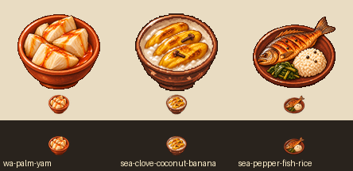

# 🖼️ 《Blocksail》1666 風味三席

這批圖為西非黃金海岸和海洋東南亞兩套區域菜單繪製。紅油與白山藥靠明亮色差辨識，丁香椰香香蕉把花蕾的釘狀輪廓留在表面，烤魚與米飯則用並列的金銅和米白色塊區分主菜與主食。

三道菜都是以已有食材組合的遊戲設計。原稿參考既有香煎魚佐柑橘的階梯外緣與左上光，逐道用內建 ImageGen 生成。遊戲圖使用 128×128 RGBA，實際比對 32px 的明、暗底縮圖。完整提示詞和雜湊置於 Blocksail 的 TASK-1370 生成紀錄。

[白山藥原稿](../RawImages/sirius_blocksail_regional1370_wa-palm-yam_master.png) · [丁香香蕉原稿](../RawImages/sirius_blocksail_regional1370_sea-clove-coconut-banana_master.png) · [黑胡椒烤魚飯原稿](../RawImages/sirius_blocksail_regional1370_sea-pepper-fish-rice_master.png)