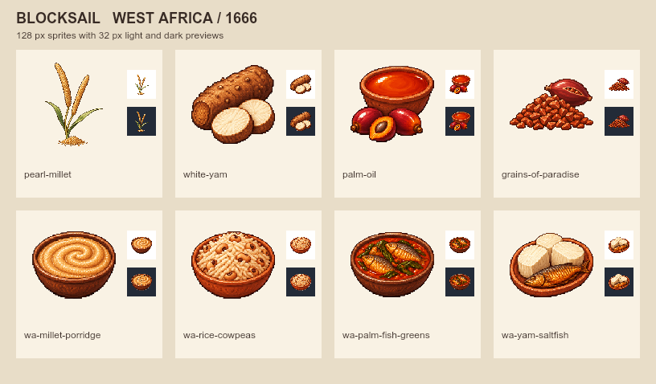

# Blocksail · 1666 年西非物產與餐桌

這批圖把乾地、河谷及濕潤沿岸的供應差異畫進同一張圖板。第一排畫珍珠粟穗、白山藥切面、紅棕櫚油與天堂椒種子。第二排以珍珠粟粥、非洲稻豇豆飯、棕櫚油葉菜燉魚和白山藥配保存魚，對應家庭灶與港口餐館的玩法草案。

圖示採左上光、深色外輪廓和離散像素色階。圖板並列 128 px 與 32 px 白底、深底縮圖。生成提示詞、參考圖雜湊與白底原稿在 Blocksail 的 TASK-1279 交付資料夾。

