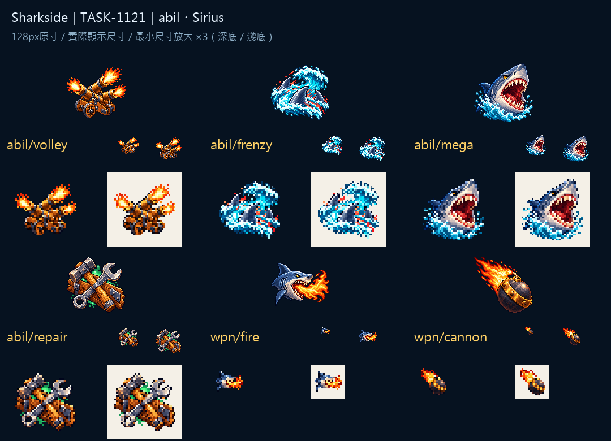

# 🖼️ Sharkside：齊射、狂潮與搶修 (Volley, Frenzy and Repair)

六種動作各自先留下剪影。齊射的三個砲口同時亮起，狂潮讓三片背鰭穿過浪，巨齒鯊則把張口的牙與紅色口腔推到最前面。搶修保留交叉工具與木板，少量綠色讓它和攻擊的火焰分開。

特殊武器還必須待在軍火箱的20px角標裡。噴火由鯊魚側臉與朝外的火舌組成；天降砲擊讓深色彈體與金色箍帶留下重量，再用斜向火尾交代方向。技能的44／56px與武器的20／40px分開檢視，避免把大圖的細節誤當成小角標已經清楚。

六張都是內建image_gen獨立生成的原創物件，沿用核准的木、金屬與海色筆觸，無既有角色參考。交付128×128 RGBA、主體最大邊104px、留邊至少12px、alpha0／255；來源透明圖與白底master分存。檔名已對當前ABIL／WEAPONS資料表。遊戲整合與缺圖回退仍在任務單等gura簽核。

完整來源、參考與輸出SHA-256：Sharkside `art/evidence/abil/generation.json`；機械匯出：`art/export_icon_set.py`。

## 實際生成提示詞

```json
{
  "abil/volley": "Create ONE original game inventory icon for Sharkside. Attached images are ONLY approved fine pixel-art style references: rich material color, discrete pixel shade clusters, crisp stair-step edges, restrained deep navy outline, dimensional depth and upper-left light. Subject: THREE short bronze naval cannon muzzles arranged as a compact fan, each with a bright coral-orange muzzle flash, three dark iron barrels remain clearly visible. Synchronized broadside firing, no whole ship, bold action silhouette. Centered compact three-quarter composition, generous transparent margin all sides; intended native128x128 with object104px. TRUE transparent background, no ground, no external cast shadow, no border or frame, no text, letters, numbers or watermark. Strong simple distinctive silhouette; no smooth vector gradients or painterly blur.",
  "abil/frenzy": "Create ONE original game inventory icon for Sharkside. Attached images are ONLY approved fine pixel-art style references: rich material color, discrete pixel shade clusters, crisp stair-step edges, restrained deep navy outline, dimensional depth and upper-left light. Subject: THREE blue-gray shark dorsal fins sweeping through ONE bright turquoise curling wave, coral-red speed accents. Frenzied shark pack surge, dynamic broad S-shaped wave silhouette. No whole sharks or characters. Centered compact three-quarter composition, generous transparent margin all sides; intended native128x128 with object104px. TRUE transparent background, no ground, no external cast shadow, no border or frame, no text, letters, numbers or watermark. Strong simple distinctive silhouette; no smooth vector gradients or painterly blur.",
  "abil/mega": "Create ONE original game inventory icon for Sharkside. Attached images are ONLY approved fine pixel-art style references: rich material color, discrete pixel shade clusters, crisp stair-step edges, restrained deep navy outline, dimensional depth and upper-left light. Subject: ONE immense original blue-gray shark head bursting upward, enormous open red mouth with two clear rows of ivory triangular teeth, amber eye and a compact turquoise splash below. Bold frightening but playful shark silhouette, not any existing character. Centered compact three-quarter composition, generous transparent margin all sides; intended native128x128 with object104px. TRUE transparent background, no ground, no external cast shadow, no border or frame, no text, letters, numbers or watermark. Strong simple distinctive silhouette; no smooth vector gradients or painterly blur.",
  "abil/repair": "Create ONE original game inventory icon for Sharkside. Attached images are ONLY approved fine pixel-art style references: rich material color, discrete pixel shade clusters, crisp stair-step edges, restrained deep navy outline, dimensional depth and upper-left light. Subject: ONE short oak-handled shipwright hammer crossing a bright metal wrench over a thick patched brown timber plank, a small emerald-green glow behind. Emergency ship repair, compact crossed-tools silhouette. No plus signs or letters. Centered compact three-quarter composition, generous transparent margin all sides; intended native128x128 with object104px. TRUE transparent background, no ground, no external cast shadow, no border or frame, no text, letters, numbers or watermark. Strong simple distinctive silhouette; no smooth vector gradients or painterly blur.",
  "wpn/fire": "Create ONE original game inventory icon for Sharkside. Attached images are ONLY approved fine pixel-art style references: rich material color, discrete pixel shade clusters, crisp stair-step edges, restrained deep navy outline, dimensional depth and upper-left light. Subject: ONE original blue-gray shark head in profile breathing a single large coral-orange and golden flame toward the right. Teeth and short snout remain visible, bold simple head-and-flame silhouette readable at20px. No humanoid character. Centered compact three-quarter composition, generous transparent margin all sides; intended native128x128 with object104px. TRUE transparent background, no ground, no external cast shadow, no border or frame, no text, letters, numbers or watermark. Strong simple distinctive silhouette; no smooth vector gradients or painterly blur.",
  "wpn/cannon": "Create ONE original game inventory icon for Sharkside. Attached images are ONLY approved fine pixel-art style references: rich material color, discrete pixel shade clusters, crisp stair-step edges, restrained deep navy outline, dimensional depth and upper-left light. Subject: ONE huge dark iron explosive cannonball with a thick brass band and a coral-orange fiery comet tail trailing upper-left, a short sparking fuse. Bold round shell silhouette and downward-right motion, readable at20px, no cannon barrel. Centered compact three-quarter composition, generous transparent margin all sides; intended native128x128 with object104px. TRUE transparent background, no ground, no external cast shadow, no border or frame, no text, letters, numbers or watermark. Strong simple distinctive silhouette; no smooth vector gradients or painterly blur."
}
```



