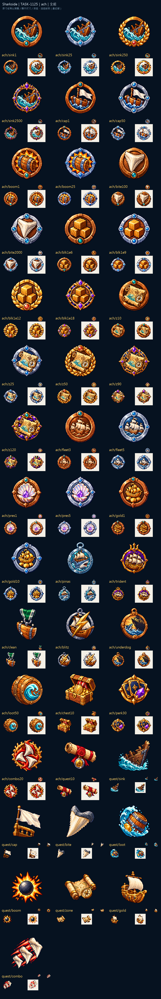

# Sharkside：航海勳章與委託

三十五枚成就依家族保留主題，層級提高時增加材質與輪廓上的榮譽，而非只換顏色。砲擊、航行、財富與生存各自留下可辨識的象徵。

八枚委託圖示延續同一套木、鐵與金色筆觸。圖板把原稿、遊戲尺寸與深淺底放在一起，檢查家族差異與單枚縮小後的辨識度。

來源、實際參考與輸出SHA-256：Sharkside `art/evidence/ach/generation.json`。完整尺寸圖板分頁存於同目錄的 `review/`。所有素材透過內建image_gen生成，匯出腳本只做尺寸、透明與檢視圖板整理。遊戲整合與缺圖回退仍須gura驗收；藝廊瀏覽器預覽未驗證，索引以build／check驗證。

## 實際生成提示詞

```json
{
  "ach/sink1": "Original refined 16/32-bit PIXEL ART for Sharkside, rich material colors, upper-left highlights, discrete shaded pixel clusters, crisp stepped contours and restrained dark navy outline. Attached images guide ONLY pixel-art material/style, never copy their objects or composition. ONE compact standalone inventory icon, centered three-quarter view, simple bold silhouette, generous clear margin, native128x128 with main object104px, readable at20-40px. No ground, cast shadow, border or surrounding frame. Subject: ONE compact round achievement MEDAL. Central motif: A broken wooden ship bow sinking beneath a turquoise wave. Tier design: plain bronze ring with one small turquoise gem. Keep the same core motif and silhouette as lower-tier reference; make tier recognizable from material/ornament alone, never text or digits. TRUE clean transparent background, no vignette, no halo. NO letters, words, numbers, captions, logo, watermark or existing franchise design.",
  "ach/bite100": "Original refined 16/32-bit PIXEL ART for Sharkside, rich material colors, upper-left highlights, discrete shaded pixel clusters, crisp stepped contours and restrained dark navy outline. Attached images guide ONLY pixel-art material/style, never copy their objects or composition. ONE compact standalone inventory icon, centered three-quarter view, simple bold silhouette, generous clear margin, native128x128 with main object104px, readable at20-40px. No ground, cast shadow, border or surrounding frame. Subject: ONE compact round achievement MEDAL. Central motif: A single huge ivory shark tooth. Tier design: plain bronze ring with one small turquoise gem. Keep the same core motif and silhouette as lower-tier reference; make tier recognizable from material/ornament alone, never text or digits. TRUE clean transparent background, no vignette, no halo. NO letters, words, numbers, captions, logo, watermark or existing franchise design.",
  "ach/z10": "Original refined 16/32-bit PIXEL ART for Sharkside, rich material colors, upper-left highlights, discrete shaded pixel clusters, crisp stepped contours and restrained dark navy outline. Attached images guide ONLY pixel-art material/style, never copy their objects or composition. ONE compact standalone inventory icon, centered three-quarter view, simple bold silhouette, generous clear margin, native128x128 with main object104px, readable at20-40px. No ground, cast shadow, border or surrounding frame. Subject: ONE compact round achievement MEDAL. Central motif: A rolled parchment sea chart with a tiny compass and turquoise wave. Tier design: plain bronze ring with one small turquoise gem. Keep the same core motif and silhouette as lower-tier reference; make tier recognizable from material/ornament alone, never text or digits. TRUE clean transparent background, no vignette, no halo. NO letters, words, numbers, captions, logo, watermark or existing franchise design.",
  "ach/boom1": "Original refined 16/32-bit PIXEL ART for Sharkside, rich material colors, upper-left highlights, discrete shaded pixel clusters, crisp stepped contours and restrained dark navy outline. Attached images guide ONLY pixel-art material/style, never copy their objects or composition. ONE compact standalone inventory icon, centered three-quarter view, simple bold silhouette, generous clear margin, native128x128 with main object104px, readable at20-40px. No ground, cast shadow, border or surrounding frame. Subject: ONE compact round achievement MEDAL. Central motif: A gunpowder barrel within a compact orange starburst. Tier design: plain bronze ring with one small turquoise gem. Keep the same core motif and silhouette as lower-tier reference; make tier recognizable from material/ornament alone, never text or digits. TRUE clean transparent background, no vignette, no halo. NO letters, words, numbers, captions, logo, watermark or existing franchise design.",
  "ach/cap1": "Original refined 16/32-bit PIXEL ART for Sharkside, rich material colors, upper-left highlights, discrete shaded pixel clusters, crisp stepped contours and restrained dark navy outline. Attached images guide ONLY pixel-art material/style, never copy their objects or composition. ONE compact standalone inventory icon, centered three-quarter view, simple bold silhouette, generous clear margin, native128x128 with main object104px, readable at20-40px. No ground, cast shadow, border or surrounding frame. Subject: ONE compact round achievement MEDAL. Central motif: A pale surrender pennant above a captured miniature wooden ship. Tier design: plain bronze ring with one small turquoise gem. Keep the same core motif and silhouette as lower-tier reference; make tier recognizable from material/ornament alone, never text or digits. TRUE clean transparent background, no vignette, no halo. NO letters, words, numbers, captions, logo, watermark or existing franchise design.",
  "ach/pres1": "Original refined 16/32-bit PIXEL ART for Sharkside, rich material colors, upper-left highlights, discrete shaded pixel clusters, crisp stepped contours and restrained dark navy outline. Attached images guide ONLY pixel-art material/style, never copy their objects or composition. ONE compact standalone inventory icon, centered three-quarter view, simple bold silhouette, generous clear margin, native128x128 with main object104px, readable at20-40px. No ground, cast shadow, border or surrounding frame. Subject: ONE compact round achievement MEDAL. Central motif: A pearlescent sea shell around a small violet crystal. Tier design: plain bronze ring with one small turquoise gem. Keep the same core motif and silhouette as lower-tier reference; make tier recognizable from material/ornament alone, never text or digits. TRUE clean transparent background, no vignette, no halo. NO letters, words, numbers, captions, logo, watermark or existing franchise design.",
  "ach/blk1e6": "Original refined 16/32-bit PIXEL ART for Sharkside, rich material colors, upper-left highlights, discrete shaded pixel clusters, crisp stepped contours and restrained dark navy outline. Attached images guide ONLY pixel-art material/style, never copy their objects or composition. ONE compact standalone inventory icon, centered three-quarter view, simple bold silhouette, generous clear margin, native128x128 with main object104px, readable at20-40px. No ground, cast shadow, border or surrounding frame. Subject: ONE compact round achievement MEDAL. Central motif: Three solid golden timber cubes stacked compactly. Tier design: plain bronze ring with one small turquoise gem. Keep the same core motif and silhouette as lower-tier reference; make tier recognizable from material/ornament alone, never text or digits. TRUE clean transparent background, no vignette, no halo. NO letters, words, numbers, captions, logo, watermark or existing franchise design.",
  "ach/fleet3": "Original refined 16/32-bit PIXEL ART for Sharkside, rich material colors, upper-left highlights, discrete shaded pixel clusters, crisp stepped contours and restrained dark navy outline. Attached images guide ONLY pixel-art material/style, never copy their objects or composition. ONE compact standalone inventory icon, centered three-quarter view, simple bold silhouette, generous clear margin, native128x128 with main object104px, readable at20-40px. No ground, cast shadow, border or surrounding frame. Subject: ONE compact round achievement MEDAL. Central motif: A compact formation of cream-sailed wooden ships. Tier design: plain bronze ring with one small turquoise gem. Keep the same core motif and silhouette as lower-tier reference; make tier recognizable from material/ornament alone, never text or digits. TRUE clean transparent background, no vignette, no halo. NO letters, words, numbers, captions, logo, watermark or existing franchise design.",
  "ach/pinas": "Original refined 16/32-bit PIXEL ART for Sharkside, rich material colors, upper-left highlights, discrete shaded pixel clusters, crisp stepped contours and restrained dark navy outline. Attached images guide ONLY pixel-art material/style, never copy their objects or composition. ONE compact standalone inventory icon, centered three-quarter view, simple bold silhouette, generous clear margin, native128x128 with main object104px, readable at20-40px. No ground, cast shadow, border or surrounding frame. Subject: ONE compact achievement MEDAL: A beautiful compact blue-gray shark crest in front of a small Dutch-style cream-sailed merchant ship, turquoise silver medal ring. TRUE clean transparent background, no vignette, no halo. NO letters, words, numbers, captions, logo, watermark or existing franchise design.",
  "ach/trident": "Original refined 16/32-bit PIXEL ART for Sharkside, rich material colors, upper-left highlights, discrete shaded pixel clusters, crisp stepped contours and restrained dark navy outline. Attached images guide ONLY pixel-art material/style, never copy their objects or composition. ONE compact standalone inventory icon, centered three-quarter view, simple bold silhouette, generous clear margin, native128x128 with main object104px, readable at20-40px. No ground, cast shadow, border or surrounding frame. Subject: ONE compact achievement MEDAL: An original majestic three-masted sailing ship with a golden three-pronged crest, violet gold medal ring. TRUE clean transparent background, no vignette, no halo. NO letters, words, numbers, captions, logo, watermark or existing franchise design.",
  "ach/clean": "Original refined 16/32-bit PIXEL ART for Sharkside, rich material colors, upper-left highlights, discrete shaded pixel clusters, crisp stepped contours and restrained dark navy outline. Attached images guide ONLY pixel-art material/style, never copy their objects or composition. ONE compact standalone inventory icon, centered three-quarter view, simple bold silhouette, generous clear margin, native128x128 with main object104px, readable at20-40px. No ground, cast shadow, border or surrounding frame. Subject: ONE compact achievement MEDAL: An intact shiny oak ship-hull plate with three small ivory diamond sparkles, silver and emerald medal ring. TRUE clean transparent background, no vignette, no halo. NO letters, words, numbers, captions, logo, watermark or existing franchise design.",
  "ach/underdog": "Original refined 16/32-bit PIXEL ART for Sharkside, rich material colors, upper-left highlights, discrete shaded pixel clusters, crisp stepped contours and restrained dark navy outline. Attached images guide ONLY pixel-art material/style, never copy their objects or composition. ONE compact standalone inventory icon, centered three-quarter view, simple bold silhouette, generous clear margin, native128x128 with main object104px, readable at20-40px. No ground, cast shadow, border or surrounding frame. Subject: ONE compact achievement MEDAL: A tiny brave blue-gray shark facing a much larger dark ship silhouette, bronze medal ring. TRUE clean transparent background, no vignette, no halo. NO letters, words, numbers, captions, logo, watermark or existing franchise design.",
  "ach/gold1": "Original refined 16/32-bit PIXEL ART for Sharkside, rich material colors, upper-left highlights, discrete shaded pixel clusters, crisp stepped contours and restrained dark navy outline. Attached images guide ONLY pixel-art material/style, never copy their objects or composition. ONE compact standalone inventory icon, centered three-quarter view, simple bold silhouette, generous clear margin, native128x128 with main object104px, readable at20-40px. No ground, cast shadow, border or surrounding frame. Subject: ONE compact round achievement MEDAL. Central motif: A tiny golden treasure galleon above three gold coins. Tier design: plain bronze ring with one small turquoise gem. Keep the same core motif and silhouette as lower-tier reference; make tier recognizable from material/ornament alone, never text or digits. TRUE clean transparent background, no vignette, no halo. NO letters, words, numbers, captions, logo, watermark or existing franchise design.",
  "ach/loot50": "Original refined 16/32-bit PIXEL ART for Sharkside, rich material colors, upper-left highlights, discrete shaded pixel clusters, crisp stepped contours and restrained dark navy outline. Attached images guide ONLY pixel-art material/style, never copy their objects or composition. ONE compact standalone inventory icon, centered three-quarter view, simple bold silhouette, generous clear margin, native128x128 with main object104px, readable at20-40px. No ground, cast shadow, border or surrounding frame. Subject: ONE compact achievement MEDAL: A stout floating oak barrel with a turquoise wave, bronze medal ring. TRUE clean transparent background, no vignette, no halo. NO letters, words, numbers, captions, logo, watermark or existing franchise design.",
  "ach/blitz": "Original refined 16/32-bit PIXEL ART for Sharkside, rich material colors, upper-left highlights, discrete shaded pixel clusters, crisp stepped contours and restrained dark navy outline. Attached images guide ONLY pixel-art material/style, never copy their objects or composition. ONE compact standalone inventory icon, centered three-quarter view, simple bold silhouette, generous clear margin, native128x128 with main object104px, readable at20-40px. No ground, cast shadow, border or surrounding frame. Subject: ONE compact achievement MEDAL: A golden lightning bolt crossing a tiny cream-sailed ship, sharp silver medal ring. TRUE clean transparent background, no vignette, no halo. NO letters, words, numbers, captions, logo, watermark or existing franchise design.",
  "ach/chest10": "Original refined 16/32-bit PIXEL ART for Sharkside, rich material colors, upper-left highlights, discrete shaded pixel clusters, crisp stepped contours and restrained dark navy outline. Attached images guide ONLY pixel-art material/style, never copy their objects or composition. ONE compact standalone inventory icon, centered three-quarter view, simple bold silhouette, generous clear margin, native128x128 with main object104px, readable at20-40px. No ground, cast shadow, border or surrounding frame. Subject: ONE compact achievement MEDAL: An open gold-filled treasure chest, warm gold medal ring. TRUE clean transparent background, no vignette, no halo. NO letters, words, numbers, captions, logo, watermark or existing franchise design.",
  "ach/perk30": "Original refined 16/32-bit PIXEL ART for Sharkside, rich material colors, upper-left highlights, discrete shaded pixel clusters, crisp stepped contours and restrained dark navy outline. Attached images guide ONLY pixel-art material/style, never copy their objects or composition. ONE compact standalone inventory icon, centered three-quarter view, simple bold silhouette, generous clear margin, native128x128 with main object104px, readable at20-40px. No ground, cast shadow, border or surrounding frame. Subject: ONE compact achievement MEDAL: Three small overlapping blank navy-gold enhancement cards with a purple crystal, ornate gold medal ring. TRUE clean transparent background, no vignette, no halo. NO letters, words, numbers, captions, logo, watermark or existing franchise design.",
  "ach/combo20": "Original refined 16/32-bit PIXEL ART for Sharkside, rich material colors, upper-left highlights, discrete shaded pixel clusters, crisp stepped contours and restrained dark navy outline. Attached images guide ONLY pixel-art material/style, never copy their objects or composition. ONE compact standalone inventory icon, centered three-quarter view, simple bold silhouette, generous clear margin, native128x128 with main object104px, readable at20-40px. No ground, cast shadow, border or surrounding frame. Subject: ONE compact achievement MEDAL: Three ivory shark teeth sweeping through a scarlet flame arc, gold coral medal ring. TRUE clean transparent background, no vignette, no halo. NO letters, words, numbers, captions, logo, watermark or existing franchise design.",
  "quest/cap": "Original refined 16/32-bit PIXEL ART for Sharkside, rich material colors, upper-left highlights, discrete shaded pixel clusters, crisp stepped contours and restrained dark navy outline. Attached images guide ONLY pixel-art material/style, never copy their objects or composition. ONE compact standalone inventory icon, centered three-quarter view, simple bold silhouette, generous clear margin, native128x128 with main object104px, readable at20-40px. No ground, cast shadow, border or surrounding frame. Subject: A simple cream surrender flag held above a short golden ship rail. TRUE clean transparent background, no vignette, no halo. NO letters, words, numbers, captions, logo, watermark or existing franchise design.",
  "ach/quest10": "Original refined 16/32-bit PIXEL ART for Sharkside, rich material colors, upper-left highlights, discrete shaded pixel clusters, crisp stepped contours and restrained dark navy outline. Attached images guide ONLY pixel-art material/style, never copy their objects or composition. ONE compact standalone inventory icon, centered three-quarter view, simple bold silhouette, generous clear margin, native128x128 with main object104px, readable at20-40px. No ground, cast shadow, border or surrounding frame. Subject: ONE compact achievement MEDAL: A rolled bounty parchment with a plain red seal and simple ship silhouette, silver gold medal ring. TRUE clean transparent background, no vignette, no halo. NO letters, words, numbers, captions, logo, watermark or existing franchise design.",
  "quest/boom": "Original refined 16/32-bit PIXEL ART for Sharkside, rich material colors, upper-left highlights, discrete shaded pixel clusters, crisp stepped contours and restrained dark navy outline. Attached images guide ONLY pixel-art material/style, never copy their objects or composition. ONE compact standalone inventory icon, centered three-quarter view, simple bold silhouette, generous clear margin, native128x128 with main object104px, readable at20-40px. No ground, cast shadow, border or surrounding frame. Subject: A round dark cannonball inside a compact orange explosion star. TRUE clean transparent background, no vignette, no halo. NO letters, words, numbers, captions, logo, watermark or existing franchise design.",
  "quest/bite": "Original refined 16/32-bit PIXEL ART for Sharkside, rich material colors, upper-left highlights, discrete shaded pixel clusters, crisp stepped contours and restrained dark navy outline. Attached images guide ONLY pixel-art material/style, never copy their objects or composition. ONE compact standalone inventory icon, centered three-quarter view, simple bold silhouette, generous clear margin, native128x128 with main object104px, readable at20-40px. No ground, cast shadow, border or surrounding frame. Subject: One bold ivory shark tooth with a short blue-gray root. TRUE clean transparent background, no vignette, no halo. NO letters, words, numbers, captions, logo, watermark or existing franchise design.",
  "quest/gold": "Original refined 16/32-bit PIXEL ART for Sharkside, rich material colors, upper-left highlights, discrete shaded pixel clusters, crisp stepped contours and restrained dark navy outline. Attached images guide ONLY pixel-art material/style, never copy their objects or composition. ONE compact standalone inventory icon, centered three-quarter view, simple bold silhouette, generous clear margin, native128x128 with main object104px, readable at20-40px. No ground, cast shadow, border or surrounding frame. Subject: A tiny golden treasure ship with one clear cream sail. TRUE clean transparent background, no vignette, no halo. NO letters, words, numbers, captions, logo, watermark or existing franchise design.",
  "quest/sink": "Original refined 16/32-bit PIXEL ART for Sharkside, rich material colors, upper-left highlights, discrete shaded pixel clusters, crisp stepped contours and restrained dark navy outline. Attached images guide ONLY pixel-art material/style, never copy their objects or composition. ONE compact standalone inventory icon, centered three-quarter view, simple bold silhouette, generous clear margin, native128x128 with main object104px, readable at20-40px. No ground, cast shadow, border or surrounding frame. Subject: A broken dark wooden ship bow sinking in one turquoise wave. TRUE clean transparent background, no vignette, no halo. NO letters, words, numbers, captions, logo, watermark or existing franchise design.",
  "quest/combo": "Original refined 16/32-bit PIXEL ART for Sharkside, rich material colors, upper-left highlights, discrete shaded pixel clusters, crisp stepped contours and restrained dark navy outline. Attached images guide ONLY pixel-art material/style, never copy their objects or composition. ONE compact standalone inventory icon, centered three-quarter view, simple bold silhouette, generous clear margin, native128x128 with main object104px, readable at20-40px. No ground, cast shadow, border or surrounding frame. Subject: Three ivory shark teeth arranged as a tight diagonal streak with coral-red speed lines. TRUE clean transparent background, no vignette, no halo. NO letters, words, numbers, captions, logo, watermark or existing franchise design.",
  "quest/zone": "Original refined 16/32-bit PIXEL ART for Sharkside, rich material colors, upper-left highlights, discrete shaded pixel clusters, crisp stepped contours and restrained dark navy outline. Attached images guide ONLY pixel-art material/style, never copy their objects or composition. ONE compact standalone inventory icon, centered three-quarter view, simple bold silhouette, generous clear margin, native128x128 with main object104px, readable at20-40px. No ground, cast shadow, border or surrounding frame. Subject: A rolled parchment map with one gold compass point, no lettering. TRUE clean transparent background, no vignette, no halo. NO letters, words, numbers, captions, logo, watermark or existing franchise design.",
  "quest/loot": "Original refined 16/32-bit PIXEL ART for Sharkside, rich material colors, upper-left highlights, discrete shaded pixel clusters, crisp stepped contours and restrained dark navy outline. Attached images guide ONLY pixel-art material/style, never copy their objects or composition. ONE compact standalone inventory icon, centered three-quarter view, simple bold silhouette, generous clear margin, native128x128 with main object104px, readable at20-40px. No ground, cast shadow, border or surrounding frame. Subject: A small oak barrel and one gold coin within a turquoise wave. TRUE clean transparent background, no vignette, no halo. NO letters, words, numbers, captions, logo, watermark or existing franchise design.",
  "ach/sink2500": "Original refined 16/32-bit PIXEL ART for Sharkside, rich material colors, upper-left highlights, discrete shaded pixel clusters, crisp stepped contours and restrained dark navy outline. Attached images guide ONLY pixel-art material/style, never copy their objects or composition. ONE compact standalone inventory icon, centered three-quarter view, simple bold silhouette, generous clear margin, native128x128 with main object104px, readable at20-40px. No ground, cast shadow, border or surrounding frame. Subject: ONE compact round achievement MEDAL. Central motif: A broken wooden ship bow sinking beneath a turquoise wave. Tier design: dark navy-gold ornate ring with a large violet crystal crown. Keep the same core motif and silhouette as lower-tier reference; make tier recognizable from material/ornament alone, never text or digits. TRUE clean transparent background, no vignette, no halo. NO letters, words, numbers, captions, logo, watermark or existing franchise design.",
  "ach/z50": "Original refined 16/32-bit PIXEL ART for Sharkside, rich material colors, upper-left highlights, discrete shaded pixel clusters, crisp stepped contours and restrained dark navy outline. Attached images guide ONLY pixel-art material/style, never copy their objects or composition. ONE compact standalone inventory icon, centered three-quarter view, simple bold silhouette, generous clear margin, native128x128 with main object104px, readable at20-40px. No ground, cast shadow, border or surrounding frame. Subject: ONE compact round achievement MEDAL. Central motif: A rolled parchment sea chart with a tiny compass and turquoise wave. Tier design: gold laurel ring with a coral gemstone. Keep the same core motif and silhouette as lower-tier reference; make tier recognizable from material/ornament alone, never text or digits. TRUE clean transparent background, no vignette, no halo. NO letters, words, numbers, captions, logo, watermark or existing franchise design.",
  "ach/sink250": "Original refined 16/32-bit PIXEL ART for Sharkside, rich material colors, upper-left highlights, discrete shaded pixel clusters, crisp stepped contours and restrained dark navy outline. Attached images guide ONLY pixel-art material/style, never copy their objects or composition. ONE compact standalone inventory icon, centered three-quarter view, simple bold silhouette, generous clear margin, native128x128 with main object104px, readable at20-40px. No ground, cast shadow, border or surrounding frame. Subject: ONE compact round achievement MEDAL. Central motif: A broken wooden ship bow sinking beneath a turquoise wave. Tier design: gold laurel ring with a coral gemstone. Keep the same core motif and silhouette as lower-tier reference; make tier recognizable from material/ornament alone, never text or digits. TRUE clean transparent background, no vignette, no halo. NO letters, words, numbers, captions, logo, watermark or existing franchise design.",
  "ach/z25": "Original refined 16/32-bit PIXEL ART for Sharkside, rich material colors, upper-left highlights, discrete shaded pixel clusters, crisp stepped contours and restrained dark navy outline. Attached images guide ONLY pixel-art material/style, never copy their objects or composition. ONE compact standalone inventory icon, centered three-quarter view, simple bold silhouette, generous clear margin, native128x128 with main object104px, readable at20-40px. No ground, cast shadow, border or surrounding frame. Subject: ONE compact round achievement MEDAL. Central motif: A rolled parchment sea chart with a tiny compass and turquoise wave. Tier design: silver ring with blue crystal corner studs. Keep the same core motif and silhouette as lower-tier reference; make tier recognizable from material/ornament alone, never text or digits. TRUE clean transparent background, no vignette, no halo. NO letters, words, numbers, captions, logo, watermark or existing franchise design.",
  "ach/sink25": "Original refined 16/32-bit PIXEL ART for Sharkside, rich material colors, upper-left highlights, discrete shaded pixel clusters, crisp stepped contours and restrained dark navy outline. Attached images guide ONLY pixel-art material/style, never copy their objects or composition. ONE compact standalone inventory icon, centered three-quarter view, simple bold silhouette, generous clear margin, native128x128 with main object104px, readable at20-40px. No ground, cast shadow, border or surrounding frame. Subject: ONE compact round achievement MEDAL. Central motif: A broken wooden ship bow sinking beneath a turquoise wave. Tier design: silver ring with blue crystal corner studs. Keep the same core motif and silhouette as lower-tier reference; make tier recognizable from material/ornament alone, never text or digits. TRUE clean transparent background, no vignette, no halo. NO letters, words, numbers, captions, logo, watermark or existing franchise design.",
  "ach/bite2000": "Original refined 16/32-bit PIXEL ART for Sharkside, rich material colors, upper-left highlights, discrete shaded pixel clusters, crisp stepped contours and restrained dark navy outline. Attached images guide ONLY pixel-art material/style, never copy their objects or composition. ONE compact standalone inventory icon, centered three-quarter view, simple bold silhouette, generous clear margin, native128x128 with main object104px, readable at20-40px. No ground, cast shadow, border or surrounding frame. Subject: ONE compact round achievement MEDAL. Central motif: A single huge ivory shark tooth. Tier design: silver ring with blue crystal corner studs. Keep the same core motif and silhouette as lower-tier reference; make tier recognizable from material/ornament alone, never text or digits. TRUE clean transparent background, no vignette, no halo. NO letters, words, numbers, captions, logo, watermark or existing franchise design.",
  "ach/z90": "Original refined 16/32-bit PIXEL ART for Sharkside, rich material colors, upper-left highlights, discrete shaded pixel clusters, crisp stepped contours and restrained dark navy outline. Attached images guide ONLY pixel-art material/style, never copy their objects or composition. ONE compact standalone inventory icon, centered three-quarter view, simple bold silhouette, generous clear margin, native128x128 with main object104px, readable at20-40px. No ground, cast shadow, border or surrounding frame. Subject: ONE compact round achievement MEDAL. Central motif: A rolled parchment sea chart with a tiny compass and turquoise wave. Tier design: dark navy-gold ornate ring with a large violet crystal crown. Keep the same core motif and silhouette as lower-tier reference; make tier recognizable from material/ornament alone, never text or digits. TRUE clean transparent background, no vignette, no halo. NO letters, words, numbers, captions, logo, watermark or existing franchise design.",
  "ach/z120": "Original refined 16/32-bit PIXEL ART for Sharkside, rich material colors, upper-left highlights, discrete shaded pixel clusters, crisp stepped contours and restrained dark navy outline. Attached images guide ONLY pixel-art material/style, never copy their objects or composition. ONE compact standalone inventory icon, centered three-quarter view, simple bold silhouette, generous clear margin, native128x128 with main object104px, readable at20-40px. No ground, cast shadow, border or surrounding frame. Subject: ONE compact round achievement MEDAL. Central motif: A rolled parchment sea chart with a tiny compass and turquoise wave. Tier design: obsidian-violet luminous ring with golden laurel and a teal crystal crown. Keep the same core motif and silhouette as lower-tier reference; make tier recognizable from material/ornament alone, never text or digits. TRUE clean transparent background, no vignette, no halo. NO letters, words, numbers, captions, logo, watermark or existing franchise design.",
  "ach/boom25": "Original refined 16/32-bit PIXEL ART for Sharkside, rich material colors, upper-left highlights, discrete shaded pixel clusters, crisp stepped contours and restrained dark navy outline. Attached images guide ONLY pixel-art material/style, never copy their objects or composition. ONE compact standalone inventory icon, centered three-quarter view, simple bold silhouette, generous clear margin, native128x128 with main object104px, readable at20-40px. No ground, cast shadow, border or surrounding frame. Subject: ONE compact round achievement MEDAL. Central motif: A gunpowder barrel within a compact orange starburst. Tier design: silver ring with blue crystal corner studs. Keep the same core motif and silhouette as lower-tier reference; make tier recognizable from material/ornament alone, never text or digits. TRUE clean transparent background, no vignette, no halo. NO letters, words, numbers, captions, logo, watermark or existing franchise design.",
  "ach/blk1e18": "Original refined 16/32-bit PIXEL ART for Sharkside, rich material colors, upper-left highlights, discrete shaded pixel clusters, crisp stepped contours and restrained dark navy outline. Attached images guide ONLY pixel-art material/style, never copy their objects or composition. ONE compact standalone inventory icon, centered three-quarter view, simple bold silhouette, generous clear margin, native128x128 with main object104px, readable at20-40px. No ground, cast shadow, border or surrounding frame. Subject: ONE compact round achievement MEDAL. Central motif: Three solid golden timber cubes stacked compactly. Tier design: dark navy-gold ornate ring with a large violet crystal crown. Keep the same core motif and silhouette as lower-tier reference; make tier recognizable from material/ornament alone, never text or digits. TRUE clean transparent background, no vignette, no halo. NO letters, words, numbers, captions, logo, watermark or existing franchise design.",
  "ach/pres5": "Original refined 16/32-bit PIXEL ART for Sharkside, rich material colors, upper-left highlights, discrete shaded pixel clusters, crisp stepped contours and restrained dark navy outline. Attached images guide ONLY pixel-art material/style, never copy their objects or composition. ONE compact standalone inventory icon, centered three-quarter view, simple bold silhouette, generous clear margin, native128x128 with main object104px, readable at20-40px. No ground, cast shadow, border or surrounding frame. Subject: ONE compact round achievement MEDAL. Central motif: A pearlescent sea shell around a small violet crystal. Tier design: silver ring with blue crystal corner studs. Keep the same core motif and silhouette as lower-tier reference; make tier recognizable from material/ornament alone, never text or digits. TRUE clean transparent background, no vignette, no halo. NO letters, words, numbers, captions, logo, watermark or existing franchise design.",
  "ach/blk1e9": "Original refined 16/32-bit PIXEL ART for Sharkside, rich material colors, upper-left highlights, discrete shaded pixel clusters, crisp stepped contours and restrained dark navy outline. Attached images guide ONLY pixel-art material/style, never copy their objects or composition. ONE compact standalone inventory icon, centered three-quarter view, simple bold silhouette, generous clear margin, native128x128 with main object104px, readable at20-40px. No ground, cast shadow, border or surrounding frame. Subject: ONE compact round achievement MEDAL. Central motif: Three solid golden timber cubes stacked compactly. Tier design: silver ring with blue crystal corner studs. Keep the same core motif and silhouette as lower-tier reference; make tier recognizable from material/ornament alone, never text or digits. TRUE clean transparent background, no vignette, no halo. NO letters, words, numbers, captions, logo, watermark or existing franchise design.",
  "ach/cap50": "Original refined 16/32-bit PIXEL ART for Sharkside, rich material colors, upper-left highlights, discrete shaded pixel clusters, crisp stepped contours and restrained dark navy outline. Attached images guide ONLY pixel-art material/style, never copy their objects or composition. ONE compact standalone inventory icon, centered three-quarter view, simple bold silhouette, generous clear margin, native128x128 with main object104px, readable at20-40px. No ground, cast shadow, border or surrounding frame. Subject: ONE compact round achievement MEDAL. Central motif: A pale surrender pennant above a captured miniature wooden ship. Tier design: silver ring with blue crystal corner studs. Keep the same core motif and silhouette as lower-tier reference; make tier recognizable from material/ornament alone, never text or digits. TRUE clean transparent background, no vignette, no halo. NO letters, words, numbers, captions, logo, watermark or existing franchise design.",
  "ach/fleet5": "Original refined 16/32-bit PIXEL ART for Sharkside, rich material colors, upper-left highlights, discrete shaded pixel clusters, crisp stepped contours and restrained dark navy outline. Attached images guide ONLY pixel-art material/style, never copy their objects or composition. ONE compact standalone inventory icon, centered three-quarter view, simple bold silhouette, generous clear margin, native128x128 with main object104px, readable at20-40px. No ground, cast shadow, border or surrounding frame. Subject: ONE compact round achievement MEDAL. Central motif: A compact formation of cream-sailed wooden ships. Tier design: silver ring with blue crystal corner studs. Keep the same core motif and silhouette as lower-tier reference; make tier recognizable from material/ornament alone, never text or digits. TRUE clean transparent background, no vignette, no halo. NO letters, words, numbers, captions, logo, watermark or existing franchise design.",
  "ach/blk1e12": "Original refined 16/32-bit PIXEL ART for Sharkside, rich material colors, upper-left highlights, discrete shaded pixel clusters, crisp stepped contours and restrained dark navy outline. Attached images guide ONLY pixel-art material/style, never copy their objects or composition. ONE compact standalone inventory icon, centered three-quarter view, simple bold silhouette, generous clear margin, native128x128 with main object104px, readable at20-40px. No ground, cast shadow, border or surrounding frame. Subject: ONE compact round achievement MEDAL. Central motif: Three solid golden timber cubes stacked compactly. Tier design: gold laurel ring with a coral gemstone. Keep the same core motif and silhouette as lower-tier reference; make tier recognizable from material/ornament alone, never text or digits. TRUE clean transparent background, no vignette, no halo. NO letters, words, numbers, captions, logo, watermark or existing franchise design.",
  "ach/gold10": "Original refined 16/32-bit PIXEL ART for Sharkside, rich material colors, upper-left highlights, discrete shaded pixel clusters, crisp stepped contours and restrained dark navy outline. Attached images guide ONLY pixel-art material/style, never copy their objects or composition. ONE compact standalone inventory icon, centered three-quarter view, simple bold silhouette, generous clear margin, native128x128 with main object104px, readable at20-40px. No ground, cast shadow, border or surrounding frame. Subject: ONE compact round achievement MEDAL. Central motif: A tiny golden treasure galleon above three gold coins. Tier design: silver ring with blue crystal corner studs. Keep the same core motif and silhouette as lower-tier reference; make tier recognizable from material/ornament alone, never text or digits. TRUE clean transparent background, no vignette, no halo. NO letters, words, numbers, captions, logo, watermark or existing franchise design."
}
```


