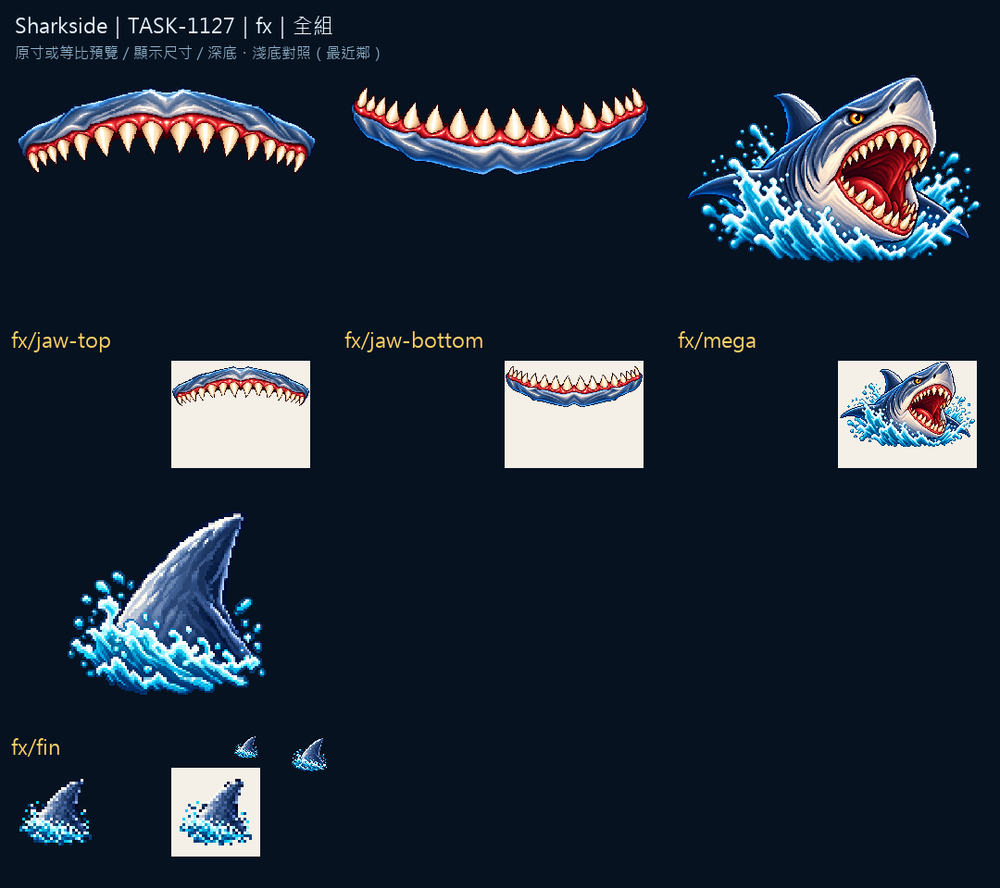

# Sharkside：巨齒與狂潮

上下顎分成兩張獨立素材，保留齒列與牙齦的厚度；配對檢視圖記錄它們的定位方式。大特效的輪廓延續圖示的海色與象牙色，但讓動作面積更容易閱讀。

其餘特效用背鰭與巨鯊的主輪廓交代方向。素材本身的檢視與遊戲動態整合分別記錄；覆蓋介面與動畫時序由遊戲整合驗收。

來源、實際參考與輸出SHA-256：Sharkside `art/evidence/fx/generation.json`。完整尺寸圖板分頁存於同目錄的 `review/`。所有素材透過內建image_gen生成，匯出腳本只做尺寸、透明與檢視圖板整理。遊戲整合與缺圖回退仍須gura驗收；藝廊瀏覽器預覽未驗證，索引以build／check驗證。

## 實際生成提示詞

```json
{
  "fx/jaw-top": "Original refined 16/32-bit PIXEL ART for Sharkside, rich material colors, upper-left highlights, discrete shaded pixel clusters, crisp stepped contours and restrained dark navy outline. Attached images guide ONLY pixel-art material/style, never copy their objects or composition. ONE standalone transparent full-screen effect sprite, native512x192, complete silhouette with safe empty margins, no backdrop, no floor or cast shadow. Subject: ONLY the UPPER JAW BAR of an original blue-gray shark, very wide horizontal mouth rim, ivory triangular teeth pointing DOWN, thick blue-gray skin along top edge, coral gums, no lower jaw, no eyes or head. Front-facing symmetrical mouth arc, teeth span almost full width, outer corners complete. TRUE clean transparent background, no vignette, no halo. NO letters, words, numbers, captions, logo, watermark or existing franchise design.",
  "fx/fin": "Original refined 16/32-bit PIXEL ART for Sharkside, rich material colors, upper-left highlights, discrete shaded pixel clusters, crisp stepped contours and restrained dark navy outline. Attached images guide ONLY pixel-art material/style, never copy their objects or composition. ONE compact standalone inventory icon, centered three-quarter view, simple bold silhouette, generous clear margin, native128x128 with main object104px, readable at20-40px. No ground, cast shadow, border or surrounding frame. Subject: ONE original blue-gray shark dorsal fin emerging diagonally from a compact turquoise ripple, clearly triangular silhouette, no whole shark or extra fins. TRUE clean transparent background, no vignette, no halo. NO letters, words, numbers, captions, logo, watermark or existing franchise design.",
  "fx/mega": "Original refined 16/32-bit PIXEL ART for Sharkside, rich material colors, upper-left highlights, discrete shaded pixel clusters, crisp stepped contours and restrained dark navy outline. Attached images guide ONLY pixel-art material/style, never copy their objects or composition. ONE standalone transparent full-screen effect sprite, native1024x640, complete silhouette with safe empty margins, no backdrop, no floor or cast shadow. Subject: ONE enormous original blue-gray megalodon lunging upward toward the viewer, full powerful head and short body visible, huge open red mouth with ivory teeth, amber eyes, fins intact, bright turquoise splash below. Same original shark design as references, dynamic wide sprite, no scenery. TRUE clean transparent background, no vignette, no halo. NO letters, words, numbers, captions, logo, watermark or existing franchise design.",
  "fx/jaw-bottom": "Original refined 16/32-bit PIXEL ART for Sharkside, rich material colors, upper-left highlights, discrete shaded pixel clusters, crisp stepped contours and restrained dark navy outline. Attached images guide ONLY pixel-art material/style, never copy their objects or composition. ONE standalone transparent full-screen effect sprite, native512x192, complete silhouette with safe empty margins, no backdrop, no floor or cast shadow. Subject: ONLY the LOWER JAW BAR matching the attached upper jaw exactly in width, tooth style, skin and gum palette. Ivory triangular teeth point UP, coral gums and thick blue-gray skin along BOTTOM edge. No upper jaw, no face. Front-facing symmetrical mouth arc; interlocking teeth should close tightly with the upper-jaw reference. TRUE clean transparent background, no vignette, no halo. NO letters, words, numbers, captions, logo, watermark or existing franchise design."
}
```


