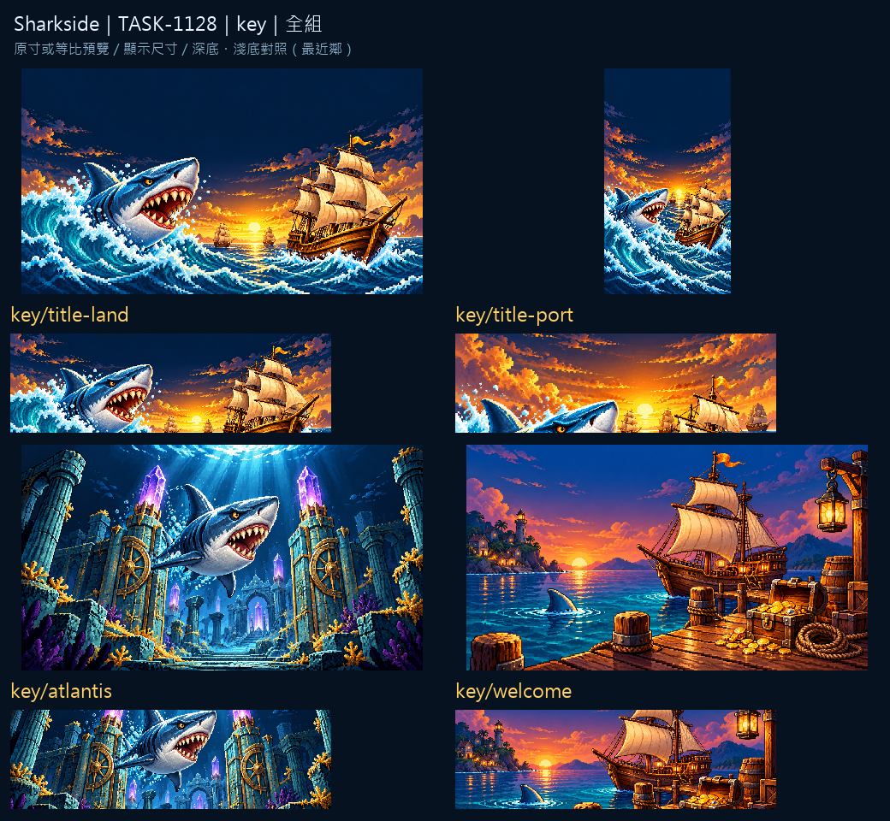

# Sharkside：啟航與歸港

四張主視覺把海水、帆船與巨鯊放進同一個冒險世界。夕光與深藍海面建立冷暖層次，中央天空留給標題與遊戲訊息。

主視覺以完整場景生成，依交付比例裁切而不拉伸。圖板保留完整原稿與交付版本，手機裁切與實際文字疊放仍由遊戲整合驗收。

來源、實際參考與輸出SHA-256：Sharkside `art/evidence/key/generation.json`。完整尺寸圖板分頁存於同目錄的 `review/`。所有素材透過內建image_gen生成，匯出腳本只做尺寸、透明與檢視圖板整理。遊戲整合與缺圖回退仍須gura驗收；藝廊瀏覽器預覽未驗證，索引以build／check驗證。

## 實際生成提示詞

```json
{
  "key/title-land": "Original refined 16/32-bit PIXEL ART for Sharkside, rich material colors, upper-left highlights, discrete shaded pixel clusters, crisp stepped contours and restrained dark navy outline. Attached images guide ONLY pixel-art material/style, never copy their objects or composition. ONE original full-scene pixel-art key visual, native1920x1080, opaque edge-to-edge scene. Main subjects central60percent horizontally, deliberate negative space for game UI. No mascot or humanoid people. Subject: Original shark fleet at dawn: a blue-gray shark rises from a curling turquoise wave at lower-left within central60percent, a beautiful original ivory-sailed wooden flagship at lower-right within central60percent, tiny companion sails on horizon, gold sunrise and deep navy sky. Leave central upper-middle40percent QUIET DARK SKY for title/UI; hero subjects occupy lower third and do not cross title area. NO letters, words, numbers, captions, logo, watermark or existing franchise design.",
  "key/atlantis": "Original refined 16/32-bit PIXEL ART for Sharkside, rich material colors, upper-left highlights, discrete shaded pixel clusters, crisp stepped contours and restrained dark navy outline. Attached images guide ONLY pixel-art material/style, never copy their objects or composition. ONE original full-scene pixel-art key visual, native1280x720, opaque edge-to-edge scene. Main subjects central60percent horizontally, deliberate negative space for game UI. No mascot or humanoid people. Subject: A blue-gray shark descending through deep navy water toward ancient ORIGINAL sunken city gates, luminous violet crystal obelisks, weathered turquoise stone columns, golden coral traces, shafts of cool light from above. Center60percent contains the gate and shark, mystical welcoming return-home scene, no humanoid people or mascot. NO letters, words, numbers, captions, logo, watermark or existing franchise design.",
  "key/welcome": "Original refined 16/32-bit PIXEL ART for Sharkside, rich material colors, upper-left highlights, discrete shaded pixel clusters, crisp stepped contours and restrained dark navy outline. Attached images guide ONLY pixel-art material/style, never copy their objects or composition. ONE original full-scene pixel-art key visual, native960x540, opaque edge-to-edge scene. Main subjects central60percent horizontally, deliberate negative space for game UI. No mascot or humanoid people. Subject: A cozy warm lantern-lit age-of-sail harbor at evening, one small original ivory-sailed ship moored at a weathered oak pier, a neat treasure chest and golden coins beside a coiled rope in foreground, a small friendly blue-gray shark fin in calm turquoise water. Main objects central60percent, quiet upper-middle for offline-reward UI, no people or mascot. NO letters, words, numbers, captions, logo, watermark or existing franchise design.",
  "key/title-port": "Original refined 16/32-bit PIXEL ART for Sharkside, rich material colors, upper-left highlights, discrete shaded pixel clusters, crisp stepped contours and restrained dark navy outline. Attached images guide ONLY pixel-art material/style, never copy their objects or composition. ONE original full-scene pixel-art key visual, native1080x1920, opaque edge-to-edge scene. Main subjects central60percent horizontally, deliberate negative space for game UI. No mascot or humanoid people. Subject: PORTRAIT composition of the same original dawn shark fleet world as reference: a playful powerful blue-gray shark at lower-left, ivory-sailed original flagship lower-center-right, turquoise waves sweeping upward, golden dawn horizon. Leave center upper-middle quiet dark sky for title/menu overlay; all important subjects in central60percent width and lower half. No text or mascot. NO letters, words, numbers, captions, logo, watermark or existing franchise design."
}
```


