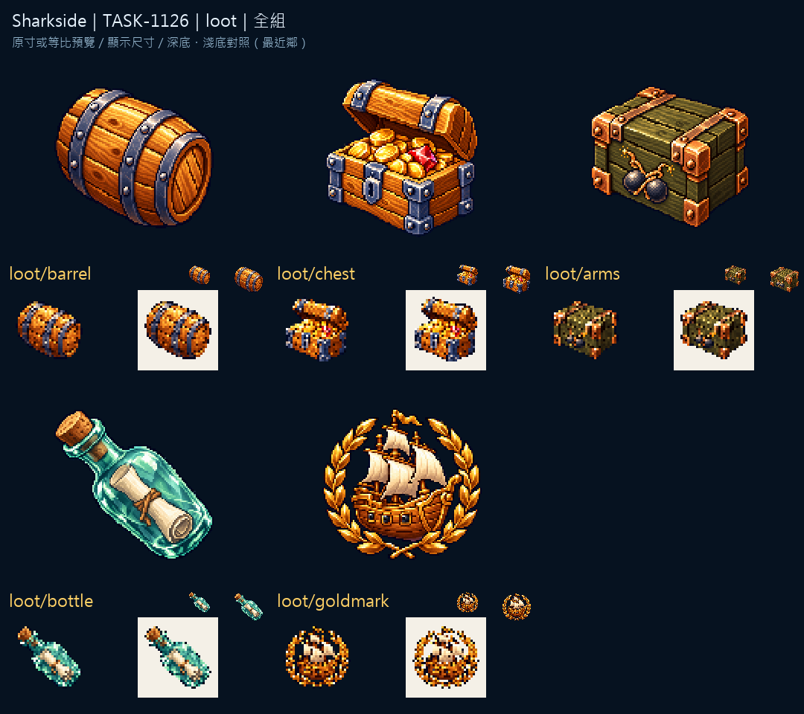

# Sharkside：海上拾獲物

五種拾獲物使用可辨識的容器或殘骸，物件的開口、金屬箍帶與內容物先交代用途，再用光色帶出價值。斜向木料與箱子的方形輪廓分開，避免所有拾獲物都變成同一顆亮點。

每件都獨立生成透明原稿，再以最近鄰取樣整理成原生尺寸。亮底檢視用來找出暗部邊緣與透明區殘影。

來源、實際參考與輸出SHA-256：Sharkside `art/evidence/loot/generation.json`。完整尺寸圖板分頁存於同目錄的 `review/`。所有素材透過內建image_gen生成，匯出腳本只做尺寸、透明與檢視圖板整理。遊戲整合與缺圖回退仍須gura驗收；藝廊瀏覽器預覽未驗證，索引以build／check驗證。

## 實際生成提示詞

```json
{
  "loot/barrel": "Original refined 16/32-bit PIXEL ART for Sharkside, rich material colors, upper-left highlights, discrete shaded pixel clusters, crisp stepped contours and restrained dark navy outline. Attached images guide ONLY pixel-art material/style, never copy their objects or composition. ONE compact standalone inventory icon, centered three-quarter view, simple bold silhouette, generous clear margin, native128x128 with main object104px, readable at20-40px. No ground, cast shadow, border or surrounding frame. Subject: One sealed round golden oak floating barrel with dark iron hoops, slightly tilted, no water background. TRUE clean transparent background, no vignette, no halo. NO letters, words, numbers, captions, logo, watermark or existing franchise design.",
  "loot/arms": "Original refined 16/32-bit PIXEL ART for Sharkside, rich material colors, upper-left highlights, discrete shaded pixel clusters, crisp stepped contours and restrained dark navy outline. Attached images guide ONLY pixel-art material/style, never copy their objects or composition. ONE compact standalone inventory icon, centered three-quarter view, simple bold silhouette, generous clear margin, native128x128 with main object104px, readable at20-40px. No ground, cast shadow, border or surrounding frame. Subject: One squat dark olive naval ammunition crate with copper corner braces, two crossed cannonballs and a fuse insignia, no lettering. TRUE clean transparent background, no vignette, no halo. NO letters, words, numbers, captions, logo, watermark or existing franchise design.",
  "loot/chest": "Original refined 16/32-bit PIXEL ART for Sharkside, rich material colors, upper-left highlights, discrete shaded pixel clusters, crisp stepped contours and restrained dark navy outline. Attached images guide ONLY pixel-art material/style, never copy their objects or composition. ONE compact standalone inventory icon, centered three-quarter view, simple bold silhouette, generous clear margin, native128x128 with main object104px, readable at20-40px. No ground, cast shadow, border or surrounding frame. Subject: One sturdy golden-brown treasure chest with a half-open lid revealing large gold coins and a red jewel. TRUE clean transparent background, no vignette, no halo. NO letters, words, numbers, captions, logo, watermark or existing franchise design.",
  "loot/bottle": "Original refined 16/32-bit PIXEL ART for Sharkside, rich material colors, upper-left highlights, discrete shaded pixel clusters, crisp stepped contours and restrained dark navy outline. Attached images guide ONLY pixel-art material/style, never copy their objects or composition. ONE compact standalone inventory icon, centered three-quarter view, simple bold silhouette, generous clear margin, native128x128 with main object104px, readable at20-40px. No ground, cast shadow, border or surrounding frame. Subject: One translucent sea-green glass bottle tilted right with a cork, rolled ivory message visible inside, preserve glass reflections and clear outline. TRUE clean transparent background, no vignette, no halo. NO letters, words, numbers, captions, logo, watermark or existing franchise design.",
  "loot/goldmark": "Original refined 16/32-bit PIXEL ART for Sharkside, rich material colors, upper-left highlights, discrete shaded pixel clusters, crisp stepped contours and restrained dark navy outline. Attached images guide ONLY pixel-art material/style, never copy their objects or composition. ONE compact standalone inventory icon, centered three-quarter view, simple bold silhouette, generous clear margin, native128x128 with main object104px, readable at20-40px. No ground, cast shadow, border or surrounding frame. Subject: One small golden age-of-sail treasure ship silhouette inside a simple laurel wreath, strong readable reward badge. TRUE clean transparent background, no vignette, no halo. NO letters, words, numbers, captions, logo, watermark or existing franchise design."
}
```


