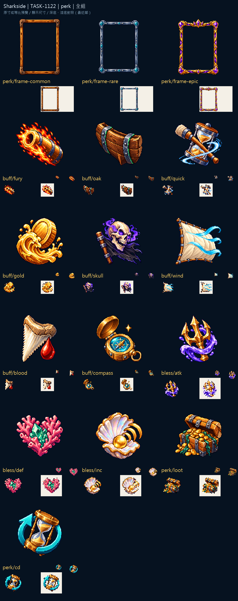

# Sharkside：卡片、祝福與戰利品

三種稀有度保留同樣的卡框輪廓，讓邊框材質與裝飾逐級增加。中央透明區留給遊戲文字；增益與祝福則用單一主物件交代效果，在小尺寸仍能辨認。

卡框之外，八種增益、三種祝福與兩種戰利品／冷卻提示各有自己的剪影。海色維持冷底，金屬與木頭延續核准的暖色高光。

來源、實際參考與輸出SHA-256：Sharkside `art/evidence/perk/generation.json`。完整尺寸圖板分頁存於同目錄的 `review/`。所有素材透過內建image_gen生成，匯出腳本只做尺寸、透明與檢視圖板整理。遊戲整合與缺圖回退仍須gura驗收；藝廊瀏覽器預覽未驗證，索引以build／check驗證。

## 實際生成提示詞

```json
{
  "perk/frame-common": "Original refined 16/32-bit PIXEL ART for Sharkside, rich material colors, upper-left highlights, discrete shaded pixel clusters, crisp stepped contours and restrained dark navy outline. Attached images guide ONLY pixel-art material/style, never copy their objects or composition. ONE hollow ornamental vertical card BORDER only, native256x352 portrait rectangle, all four edges visible, very thin12px border, generous transparent central opening for UI text. Center80percent MUST BE FULLY TRANSPARENT, outside frame also transparent. No card fill, no background panel, no text, no icon inside opening. Subject: Plain weathered OAK wood frame with small bronze corner braces, simple squared corners. Low rarity, restrained brown/copper palette, NO crown or gemstones. TRUE clean transparent background, no vignette, no halo. NO letters, words, numbers, captions, logo, watermark or existing franchise design.",
  "buff/wind": "Original refined 16/32-bit PIXEL ART for Sharkside, rich material colors, upper-left highlights, discrete shaded pixel clusters, crisp stepped contours and restrained dark navy outline. Attached images guide ONLY pixel-art material/style, never copy their objects or composition. ONE compact standalone inventory icon, centered three-quarter view, simple bold silhouette, generous clear margin, native128x128 with main object104px, readable at20-40px. No ground, cast shadow, border or surrounding frame. Subject: A broad cream sail billowing strongly to the right with three thick cyan wind ribbons, no ship. TRUE clean transparent background, no vignette, no halo. NO letters, words, numbers, captions, logo, watermark or existing franchise design.",
  "buff/fury": "Original refined 16/32-bit PIXEL ART for Sharkside, rich material colors, upper-left highlights, discrete shaded pixel clusters, crisp stepped contours and restrained dark navy outline. Attached images guide ONLY pixel-art material/style, never copy their objects or composition. ONE compact standalone inventory icon, centered three-quarter view, simple bold silhouette, generous clear margin, native128x128 with main object104px, readable at20-40px. No ground, cast shadow, border or surrounding frame. Subject: A bronze cannon muzzle surrounded by a compact scarlet-orange flame burst, fierce gunnery energy. TRUE clean transparent background, no vignette, no halo. NO letters, words, numbers, captions, logo, watermark or existing franchise design.",
  "buff/blood": "Original refined 16/32-bit PIXEL ART for Sharkside, rich material colors, upper-left highlights, discrete shaded pixel clusters, crisp stepped contours and restrained dark navy outline. Attached images guide ONLY pixel-art material/style, never copy their objects or composition. ONE compact standalone inventory icon, centered three-quarter view, simple bold silhouette, generous clear margin, native128x128 with main object104px, readable at20-40px. No ground, cast shadow, border or surrounding frame. Subject: One ivory shark tooth with a single large coral-red droplet beside it, compact blood-scent emblem, no gore. TRUE clean transparent background, no vignette, no halo. NO letters, words, numbers, captions, logo, watermark or existing franchise design.",
  "buff/compass": "Original refined 16/32-bit PIXEL ART for Sharkside, rich material colors, upper-left highlights, discrete shaded pixel clusters, crisp stepped contours and restrained dark navy outline. Attached images guide ONLY pixel-art material/style, never copy their objects or composition. ONE compact standalone inventory icon, centered three-quarter view, simple bold silhouette, generous clear margin, native128x128 with main object104px, readable at20-40px. No ground, cast shadow, border or surrounding frame. Subject: One squat brass treasure compass with a bright turquoise face and a single gold diamond spark above, no direction letters. TRUE clean transparent background, no vignette, no halo. NO letters, words, numbers, captions, logo, watermark or existing franchise design.",
  "bless/atk": "Original refined 16/32-bit PIXEL ART for Sharkside, rich material colors, upper-left highlights, discrete shaded pixel clusters, crisp stepped contours and restrained dark navy outline. Attached images guide ONLY pixel-art material/style, never copy their objects or composition. ONE compact standalone inventory icon, centered three-quarter view, simple bold silhouette, generous clear margin, native128x128 with main object104px, readable at20-40px. No ground, cast shadow, border or surrounding frame. Subject: A short golden trident tip wrapped in a compact violet crescent wave, blessing of naval attack. TRUE clean transparent background, no vignette, no halo. NO letters, words, numbers, captions, logo, watermark or existing franchise design.",
  "buff/oak": "Original refined 16/32-bit PIXEL ART for Sharkside, rich material colors, upper-left highlights, discrete shaded pixel clusters, crisp stepped contours and restrained dark navy outline. Attached images guide ONLY pixel-art material/style, never copy their objects or composition. ONE compact standalone inventory icon, centered three-quarter view, simple bold silhouette, generous clear margin, native128x128 with main object104px, readable at20-40px. No ground, cast shadow, border or surrounding frame. Subject: A stout curved dark oak timber plate with iron bands and emerald-green edge highlights, enchanted strong wood. TRUE clean transparent background, no vignette, no halo. NO letters, words, numbers, captions, logo, watermark or existing franchise design.",
  "bless/def": "Original refined 16/32-bit PIXEL ART for Sharkside, rich material colors, upper-left highlights, discrete shaded pixel clusters, crisp stepped contours and restrained dark navy outline. Attached images guide ONLY pixel-art material/style, never copy their objects or composition. ONE compact standalone inventory icon, centered three-quarter view, simple bold silhouette, generous clear margin, native128x128 with main object104px, readable at20-40px. No ground, cast shadow, border or surrounding frame. Subject: A broad heart-shaped coral cluster with pink branches and an emerald-green crystal at center, protective sea blessing. TRUE clean transparent background, no vignette, no halo. NO letters, words, numbers, captions, logo, watermark or existing franchise design.",
  "perk/cd": "Original refined 16/32-bit PIXEL ART for Sharkside, rich material colors, upper-left highlights, discrete shaded pixel clusters, crisp stepped contours and restrained dark navy outline. Attached images guide ONLY pixel-art material/style, never copy their objects or composition. ONE compact standalone inventory icon, centered three-quarter view, simple bold silhouette, generous clear margin, native128x128 with main object104px, readable at20-40px. No ground, cast shadow, border or surrounding frame. Subject: One brass hourglass wrapped by a thick turquoise circular rewind arrow, blank face, cooldown reset. TRUE clean transparent background, no vignette, no halo. NO letters, words, numbers, captions, logo, watermark or existing franchise design.",
  "buff/gold": "Original refined 16/32-bit PIXEL ART for Sharkside, rich material colors, upper-left highlights, discrete shaded pixel clusters, crisp stepped contours and restrained dark navy outline. Attached images guide ONLY pixel-art material/style, never copy their objects or composition. ONE compact standalone inventory icon, centered three-quarter view, simple bold silhouette, generous clear margin, native128x128 with main object104px, readable at20-40px. No ground, cast shadow, border or surrounding frame. Subject: A large gold coin rising from one thick golden ocean wave, simple abundant-income silhouette. TRUE clean transparent background, no vignette, no halo. NO letters, words, numbers, captions, logo, watermark or existing franchise design.",
  "perk/loot": "Original refined 16/32-bit PIXEL ART for Sharkside, rich material colors, upper-left highlights, discrete shaded pixel clusters, crisp stepped contours and restrained dark navy outline. Attached images guide ONLY pixel-art material/style, never copy their objects or composition. ONE compact standalone inventory icon, centered three-quarter view, simple bold silhouette, generous clear margin, native128x128 with main object104px, readable at20-40px. No ground, cast shadow, border or surrounding frame. Subject: A compact shipwreck treasure chest spilling gold coins and a little teal seaweed, warm gold/oak dominant. TRUE clean transparent background, no vignette, no halo. NO letters, words, numbers, captions, logo, watermark or existing franchise design.",
  "buff/quick": "Original refined 16/32-bit PIXEL ART for Sharkside, rich material colors, upper-left highlights, discrete shaded pixel clusters, crisp stepped contours and restrained dark navy outline. Attached images guide ONLY pixel-art material/style, never copy their objects or composition. ONE compact standalone inventory icon, centered three-quarter view, simple bold silhouette, generous clear margin, native128x128 with main object104px, readable at20-40px. No ground, cast shadow, border or surrounding frame. Subject: A compact silver hourglass with amber sand crossed by a short cannon rammer, pale blue speed streak. TRUE clean transparent background, no vignette, no halo. NO letters, words, numbers, captions, logo, watermark or existing franchise design.",
  "bless/inc": "Original refined 16/32-bit PIXEL ART for Sharkside, rich material colors, upper-left highlights, discrete shaded pixel clusters, crisp stepped contours and restrained dark navy outline. Attached images guide ONLY pixel-art material/style, never copy their objects or composition. ONE compact standalone inventory icon, centered three-quarter view, simple bold silhouette, generous clear margin, native128x128 with main object104px, readable at20-40px. No ground, cast shadow, border or surrounding frame. Subject: One open pearlescent seashell with a golden pearl and three warm gold curved ripples, sea-song income blessing. TRUE clean transparent background, no vignette, no halo. NO letters, words, numbers, captions, logo, watermark or existing franchise design.",
  "buff/skull": "Original refined 16/32-bit PIXEL ART for Sharkside, rich material colors, upper-left highlights, discrete shaded pixel clusters, crisp stepped contours and restrained dark navy outline. Attached images guide ONLY pixel-art material/style, never copy their objects or composition. ONE compact standalone inventory icon, centered three-quarter view, simple bold silhouette, generous clear margin, native128x128 with main object104px, readable at20-40px. No ground, cast shadow, border or surrounding frame. Subject: An ivory skull hovering over a short charcoal black pirate pennant, violet-blue shadows, fear aura. TRUE clean transparent background, no vignette, no halo. NO letters, words, numbers, captions, logo, watermark or existing franchise design.",
  "perk/frame-rare": "Original refined 16/32-bit PIXEL ART for Sharkside, rich material colors, upper-left highlights, discrete shaded pixel clusters, crisp stepped contours and restrained dark navy outline. Attached images guide ONLY pixel-art material/style, never copy their objects or composition. ONE hollow ornamental vertical card BORDER only, native256x352 portrait rectangle, all four edges visible, very thin12px border, generous transparent central opening for UI text. Center80percent MUST BE FULLY TRANSPARENT, outside frame also transparent. No card fill, no background panel, no text, no icon inside opening. Subject: Refined BLUE-GRAY STEEL frame with turquoise crystal corners and small pearl inlays; same basic rectangular proportions as reference common frame, richer stepped corners. Medium rarity, cool blue. TRUE clean transparent background, no vignette, no halo. NO letters, words, numbers, captions, logo, watermark or existing franchise design.",
  "perk/frame-epic": "Original refined 16/32-bit PIXEL ART for Sharkside, rich material colors, upper-left highlights, discrete shaded pixel clusters, crisp stepped contours and restrained dark navy outline. Attached images guide ONLY pixel-art material/style, never copy their objects or composition. ONE hollow ornamental vertical card BORDER only, native256x352 portrait rectangle, all four edges visible, very thin12px border, generous transparent central opening for UI text. Center80percent MUST BE FULLY TRANSPARENT, outside frame also transparent. No card fill, no background panel, no text, no icon inside opening. Subject: Ornate GOLD frame with vivid PURPLE CRYSTAL corners and an original three-pointed crown crest at top center. Same rectangular opening as reference common frame. Highest rarity, broad gold and violet silhouette. TRUE clean transparent background, no vignette, no halo. NO letters, words, numbers, captions, logo, watermark or existing franchise design."
}
```


