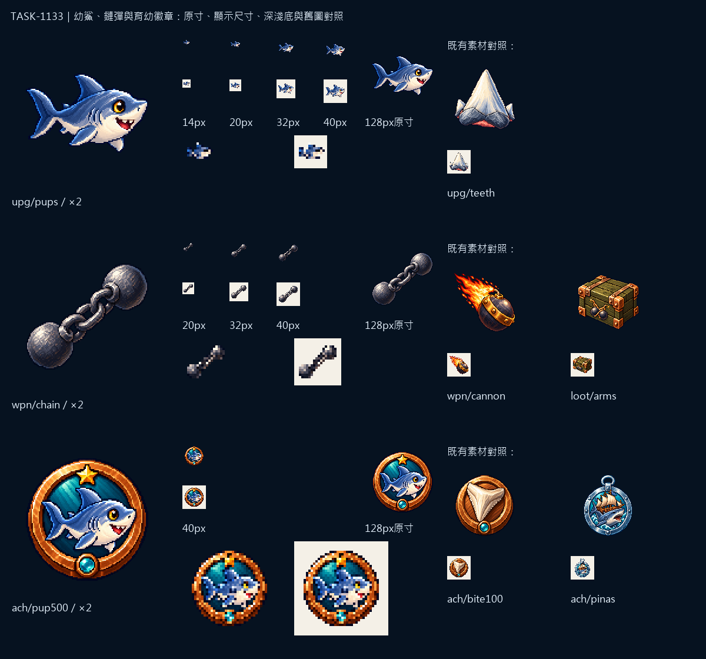

# 🖼️ Sharkside：育幼與斷帆

幼鯊用完整的身體、三角背鰭與分叉尾巴交代種類，大眼和小尖牙留下幼年的表情。育幼徽章沿用同一隻小鯊魚，把牠放回銅環、青色底與小金星之中，和既有的單顆牙齒勳章分開。

鏈彈只留下兩顆鐵球和粗鏈節，沒有爆裂彈的火尾與金帶。幼鯊最小14px、鏈彈20px、徽章40px的深淺底檢視放在同一張圖板，並排比較現有牙齒、爆裂彈、軍火箱與成就。

交付128×128 RGBA，主體最大邊約104px、留邊至少12px、alpha只用0／255。完整來源、實際參考與SHA-256在Sharkside `art/evidence/pups-chain/generation.json`。素材檢視與遊戲驗收分別留證，尚未代簽整合。

## 實際提示詞

```json
{
  "upg/pups": "Create ONE original Sharkside game icon in refined 16/32-bit PIXEL ART. Attached images guide ONLY the approved pixel texture, material shading and palette; do not copy unrelated objects. Rich material-specific colors, crisp stepped contours, discrete shaded clusters, restrained dark navy outline, upper-left highlights. Centered compact composition with generous transparent margins; native128x128 with main object about104px, must read as a strong silhouette at14-40px. TRUE transparent background, no backdrop, external cast shadow, ground, vignette or halo. NO text, numbers, letters, captions or watermark. Subject: ONE adorable BABY SHARK in full body, swimming horizontally toward screen right, round compact blue-gray body, light ivory belly, prominent triangular dorsal fin, TWO pectoral fins, CLEAR FORKED shark tail to left, short pointed snout, ONE large dark friendly eye with a tiny golden iris, very small open smile showing TWO tiny triangular ivory teeth. No legs or arms, no humanoid clothes, no ornaments, no waves or bubbles. Read unmistakably as a small SHARK rather than a generic fish at14px; prioritize full-body silhouette and broad body color regions, dorsal fin and tail. Reference shark image guides species palette only: make this a cute little shark, not a huge open-mouth head.",
  "wpn/chain": "Create ONE original Sharkside game icon in refined 16/32-bit PIXEL ART. Attached images guide ONLY the approved pixel texture, material shading and palette; do not copy unrelated objects. Rich material-specific colors, crisp stepped contours, discrete shaded clusters, restrained dark navy outline, upper-left highlights. Centered compact composition with generous transparent margins; native128x128 with main object about104px, must read as a strong silhouette at14-40px. TRUE transparent background, no backdrop, external cast shadow, ground, vignette or halo. NO text, numbers, letters, captions or watermark. Subject: EXACTLY TWO solid DARK IRON CANNONBALLS linked by ONE short thick iron CHAIN of THREE large visibly open links. The balls are at opposite diagonal ends, lower-left and upper-right, linked in the middle; the chain is short enough to keep a compact balanced silhouette. Cool graphite iron with bright silver upper-left highlights, dark blue-gray shading. Balls are separate circular masses, no wooden box, no fuse, no flame, no explosion, no spark or gold band. Authentic age-of-sail chain shot, instantly distinct from a single explosive shell or ammunition crate. No added motion lines that obscure the chain.",
  "ach/pup500": "Create ONE original achievement medal icon for Sharkside, refined16/32-bit PIXEL ART, rich shaded discrete pixel clusters, crisp stair-step contours, restrained navy outline, upper-left light. Image1 is the approved BABY SHARK identity/palette reference; image2 is ONLY the achievement badge material/round rim reference. Subject: ONE cute blue-gray full-body BABY SHARK from image1, centered inside a BRONZE circular medal ring with dark teal inset, ONE small golden five-point star above the shark's dorsal fin, tiny teal jewel centered at bottom of the ring. Preserve the baby's friendly eye, short snout, small toothy smile, triangular dorsal fin, ivory belly and forked tail. The whole shark including tail fits INSIDE the circular ring, no extra shark or other animal. This celebrates nurturing baby sharks, clearly distinct from a giant single shark TOOTH medal. Keep design compact and simple, main baby silhouette readable at40px. Native128x128 RGBA, object about104px, generous clear margins. TRUE transparent background outside medal, no ground/shadow/halo/vignette. NO text, numbers, letters, captions, watermark or existing franchise design."
}
```


