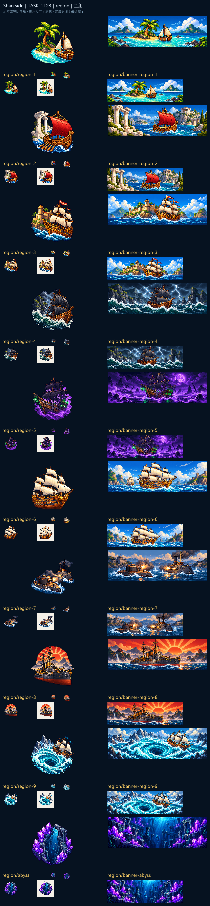

# Sharkside：十片海域

十枚海域徽章各自抓住一個地標或天候，從港口到冰海，先在小徽章裡建立形狀與配色，再延伸成同海域的橫幅。徽章負責辨識，橫幅提供航行的環境。

橫幅的構圖留出中央可用區，避免小尺寸徽章被誤當成風景縮圖。每組都保存自己的原稿與參考關係，讓徽章與橫幅的對應可追查。

來源、實際參考與輸出SHA-256：Sharkside `art/evidence/region/generation.json`。完整尺寸圖板分頁存於同目錄的 `review/`。所有素材透過內建image_gen生成，匯出腳本只做尺寸、透明與檢視圖板整理。遊戲整合與缺圖回退仍須gura驗收；藝廊瀏覽器預覽未驗證，索引以build／check驗證。

## 實際生成提示詞

```json
{
  "region/region-1": "Original refined 16/32-bit PIXEL ART for Sharkside, rich material colors, upper-left highlights, discrete shaded pixel clusters, crisp stepped contours and restrained dark navy outline. Attached images guide ONLY pixel-art material/style, never copy their objects or composition. ONE compact standalone inventory icon, centered three-quarter view, simple bold silhouette, generous clear margin, native128x128 with main object104px, readable at20-40px. No ground, cast shadow, border or surrounding frame. Subject: ONE compact emblem of Caribbean shallows: A tropical palm islet, turquoise shallow water, warm ochre sand, a small cream-sailed Caribbean sloop. Simplify to one dominant recognizable motif, no full landscape panorama. TRUE clean transparent background, no vignette, no halo. NO letters, words, numbers, captions, logo, watermark or existing franchise design.",
  "region/region-2": "Original refined 16/32-bit PIXEL ART for Sharkside, rich material colors, upper-left highlights, discrete shaded pixel clusters, crisp stepped contours and restrained dark navy outline. Attached images guide ONLY pixel-art material/style, never copy their objects or composition. ONE compact standalone inventory icon, centered three-quarter view, simple bold silhouette, generous clear margin, native128x128 with main object104px, readable at20-40px. No ground, cast shadow, border or surrounding frame. Subject: ONE compact emblem of Ancient sea route: White marble classical columns beside a cobalt strait, a red-sailed ancient oared galley. Simplify to one dominant recognizable motif, no full landscape panorama. TRUE clean transparent background, no vignette, no halo. NO letters, words, numbers, captions, logo, watermark or existing franchise design.",
  "region/region-3": "Original refined 16/32-bit PIXEL ART for Sharkside, rich material colors, upper-left highlights, discrete shaded pixel clusters, crisp stepped contours and restrained dark navy outline. Attached images guide ONLY pixel-art material/style, never copy their objects or composition. ONE compact standalone inventory icon, centered three-quarter view, simple bold silhouette, generous clear margin, native128x128 with main object104px, readable at20-40px. No ground, cast shadow, border or surrounding frame. Subject: ONE compact emblem of Spanish Main: A warm sandstone coastal fortress above deep blue sea, a towering golden brown age-of-sail galleon with cream sails. Simplify to one dominant recognizable motif, no full landscape panorama. TRUE clean transparent background, no vignette, no halo. NO letters, words, numbers, captions, logo, watermark or existing franchise design.",
  "region/region-5": "Original refined 16/32-bit PIXEL ART for Sharkside, rich material colors, upper-left highlights, discrete shaded pixel clusters, crisp stepped contours and restrained dark navy outline. Attached images guide ONLY pixel-art material/style, never copy their objects or composition. ONE compact standalone inventory icon, centered three-quarter view, simple bold silhouette, generous clear margin, native128x128 with main object104px, readable at20-40px. No ground, cast shadow, border or surrounding frame. Subject: ONE compact emblem of Ghost waters: Violet fog and black water, an eerie original black-sailed wooden ship with small green lanterns, distant crooked wreck masts. Simplify to one dominant recognizable motif, no full landscape panorama. TRUE clean transparent background, no vignette, no halo. NO letters, words, numbers, captions, logo, watermark or existing franchise design.",
  "region/region-4": "Original refined 16/32-bit PIXEL ART for Sharkside, rich material colors, upper-left highlights, discrete shaded pixel clusters, crisp stepped contours and restrained dark navy outline. Attached images guide ONLY pixel-art material/style, never copy their objects or composition. ONE compact standalone inventory icon, centered three-quarter view, simple bold silhouette, generous clear margin, native128x128 with main object104px, readable at20-40px. No ground, cast shadow, border or surrounding frame. Subject: ONE compact emblem of North Sea storm: Jagged dark slate cliffs, green-black storm waves, lightning under heavy clouds, a sturdy dark-sailed merchant vessel. Simplify to one dominant recognizable motif, no full landscape panorama. TRUE clean transparent background, no vignette, no halo. NO letters, words, numbers, captions, logo, watermark or existing franchise design.",
  "region/region-6": "Original refined 16/32-bit PIXEL ART for Sharkside, rich material colors, upper-left highlights, discrete shaded pixel clusters, crisp stepped contours and restrained dark navy outline. Attached images guide ONLY pixel-art material/style, never copy their objects or composition. ONE compact standalone inventory icon, centered three-quarter view, simple bold silhouette, generous clear margin, native128x128 with main object104px, readable at20-40px. No ground, cast shadow, border or surrounding frame. Subject: ONE compact emblem of Great sailing ships: A mighty original wooden three-decker ship with several rows of golden gunports and broad ivory sails on a bright open sea. Simplify to one dominant recognizable motif, no full landscape panorama. TRUE clean transparent background, no vignette, no halo. NO letters, words, numbers, captions, logo, watermark or existing franchise design.",
  "region/region-7": "Original refined 16/32-bit PIXEL ART for Sharkside, rich material colors, upper-left highlights, discrete shaded pixel clusters, crisp stepped contours and restrained dark navy outline. Attached images guide ONLY pixel-art material/style, never copy their objects or composition. ONE compact standalone inventory icon, centered three-quarter view, simple bold silhouette, generous clear margin, native128x128 with main object104px, readable at20-40px. No ground, cast shadow, border or surrounding frame. Subject: ONE compact emblem of Ironclad era: A compact low ironclad turret ship and an angular armored steamship facing each other in smoky blue-gray harbor water, dark iron and copper. Simplify to one dominant recognizable motif, no full landscape panorama. TRUE clean transparent background, no vignette, no halo. NO letters, words, numbers, captions, logo, watermark or existing franchise design.",
  "region/region-8": "Original refined 16/32-bit PIXEL ART for Sharkside, rich material colors, upper-left highlights, discrete shaded pixel clusters, crisp stepped contours and restrained dark navy outline. Attached images guide ONLY pixel-art material/style, never copy their objects or composition. ONE compact standalone inventory icon, centered three-quarter view, simple bold silhouette, generous clear margin, native128x128 with main object104px, readable at20-40px. No ground, cast shadow, border or surrounding frame. Subject: ONE compact emblem of Far East fleet: A majestic original dark steel late19th-century warship, red ochre rising-sun sky without flag emblems, misty mountain island silhouettes. Simplify to one dominant recognizable motif, no full landscape panorama. TRUE clean transparent background, no vignette, no halo. NO letters, words, numbers, captions, logo, watermark or existing franchise design.",
  "region/abyss": "Original refined 16/32-bit PIXEL ART for Sharkside, rich material colors, upper-left highlights, discrete shaded pixel clusters, crisp stepped contours and restrained dark navy outline. Attached images guide ONLY pixel-art material/style, never copy their objects or composition. ONE compact standalone inventory icon, centered three-quarter view, simple bold silhouette, generous clear margin, native128x128 with main object104px, readable at20-40px. No ground, cast shadow, border or surrounding frame. Subject: ONE compact emblem of The abyss: An immense dark deep-ocean chasm framed by luminous violet crystals and a tiny blue-gray shark silhouette descending toward ancient sunken ruins. Simplify to one dominant recognizable motif, no full landscape panorama. TRUE clean transparent background, no vignette, no halo. NO letters, words, numbers, captions, logo, watermark or existing franchise design.",
  "region/region-9": "Original refined 16/32-bit PIXEL ART for Sharkside, rich material colors, upper-left highlights, discrete shaded pixel clusters, crisp stepped contours and restrained dark navy outline. Attached images guide ONLY pixel-art material/style, never copy their objects or composition. ONE compact standalone inventory icon, centered three-quarter view, simple bold silhouette, generous clear margin, native128x128 with main object104px, readable at20-40px. No ground, cast shadow, border or surrounding frame. Subject: ONE compact emblem of Great maelstrom: A CLEAR HUGE SPIRAL WHIRLPOOL in icy turquoise water, an original powerful three-masted ship at its edge, distant jagged Nordic cliffs. Simplify to one dominant recognizable motif, no full landscape panorama. TRUE clean transparent background, no vignette, no halo. NO letters, words, numbers, captions, logo, watermark or existing franchise design.",
  "region/banner-region-1": "Original refined 16/32-bit PIXEL ART for Sharkside, rich material colors, upper-left highlights, discrete shaded pixel clusters, crisp stepped contours and restrained dark navy outline. Attached images guide ONLY pixel-art material/style, never copy their objects or composition. ONE ultra-wide3.2:1 naval landscape banner, native960x300, all key land/ship features inside central60percent horizontally for mobile cropping. Opaque pixel-art scenery, distinct readable silhouette and atmospheric depth. Subject: Caribbean shallows landscape: A tropical palm islet, turquoise shallow water, warm ochre sand, a small cream-sailed Caribbean sloop. NO letters, words, numbers, captions, logo, watermark or existing franchise design.",
  "region/banner-region-2": "Original refined 16/32-bit PIXEL ART for Sharkside, rich material colors, upper-left highlights, discrete shaded pixel clusters, crisp stepped contours and restrained dark navy outline. Attached images guide ONLY pixel-art material/style, never copy their objects or composition. ONE ultra-wide3.2:1 naval landscape banner, native960x300, all key land/ship features inside central60percent horizontally for mobile cropping. Opaque pixel-art scenery, distinct readable silhouette and atmospheric depth. Subject: Ancient sea route landscape: White marble classical columns beside a cobalt strait, a red-sailed ancient oared galley. NO letters, words, numbers, captions, logo, watermark or existing franchise design.",
  "region/banner-region-5": "Original refined 16/32-bit PIXEL ART for Sharkside, rich material colors, upper-left highlights, discrete shaded pixel clusters, crisp stepped contours and restrained dark navy outline. Attached images guide ONLY pixel-art material/style, never copy their objects or composition. ONE ultra-wide3.2:1 naval landscape banner, native960x300, all key land/ship features inside central60percent horizontally for mobile cropping. Opaque pixel-art scenery, distinct readable silhouette and atmospheric depth. Subject: Ghost waters landscape: Violet fog and black water, an eerie original black-sailed wooden ship with small green lanterns, distant crooked wreck masts. NO letters, words, numbers, captions, logo, watermark or existing franchise design.",
  "region/banner-region-3": "Original refined 16/32-bit PIXEL ART for Sharkside, rich material colors, upper-left highlights, discrete shaded pixel clusters, crisp stepped contours and restrained dark navy outline. Attached images guide ONLY pixel-art material/style, never copy their objects or composition. ONE ultra-wide3.2:1 naval landscape banner, native960x300, all key land/ship features inside central60percent horizontally for mobile cropping. Opaque pixel-art scenery, distinct readable silhouette and atmospheric depth. Subject: Spanish Main landscape: A warm sandstone coastal fortress above deep blue sea, a towering golden brown age-of-sail galleon with cream sails. NO letters, words, numbers, captions, logo, watermark or existing franchise design.",
  "region/banner-region-7": "Original refined 16/32-bit PIXEL ART for Sharkside, rich material colors, upper-left highlights, discrete shaded pixel clusters, crisp stepped contours and restrained dark navy outline. Attached images guide ONLY pixel-art material/style, never copy their objects or composition. ONE ultra-wide3.2:1 naval landscape banner, native960x300, all key land/ship features inside central60percent horizontally for mobile cropping. Opaque pixel-art scenery, distinct readable silhouette and atmospheric depth. Subject: Ironclad era landscape: A compact low ironclad turret ship and an angular armored steamship facing each other in smoky blue-gray harbor water, dark iron and copper. NO letters, words, numbers, captions, logo, watermark or existing franchise design.",
  "region/banner-region-8": "Original refined 16/32-bit PIXEL ART for Sharkside, rich material colors, upper-left highlights, discrete shaded pixel clusters, crisp stepped contours and restrained dark navy outline. Attached images guide ONLY pixel-art material/style, never copy their objects or composition. ONE ultra-wide3.2:1 naval landscape banner, native960x300, all key land/ship features inside central60percent horizontally for mobile cropping. Opaque pixel-art scenery, distinct readable silhouette and atmospheric depth. Subject: Far East fleet landscape: A majestic original dark steel late19th-century warship, red ochre rising-sun sky without flag emblems, misty mountain island silhouettes. NO letters, words, numbers, captions, logo, watermark or existing franchise design.",
  "region/banner-region-6": "Original refined 16/32-bit PIXEL ART for Sharkside, rich material colors, upper-left highlights, discrete shaded pixel clusters, crisp stepped contours and restrained dark navy outline. Attached images guide ONLY pixel-art material/style, never copy their objects or composition. ONE ultra-wide3.2:1 naval landscape banner, native960x300, all key land/ship features inside central60percent horizontally for mobile cropping. Opaque pixel-art scenery, distinct readable silhouette and atmospheric depth. Subject: Great sailing ships landscape: A mighty original wooden three-decker ship with several rows of golden gunports and broad ivory sails on a bright open sea. NO letters, words, numbers, captions, logo, watermark or existing franchise design.",
  "region/banner-abyss": "Original refined 16/32-bit PIXEL ART for Sharkside, rich material colors, upper-left highlights, discrete shaded pixel clusters, crisp stepped contours and restrained dark navy outline. Attached images guide ONLY pixel-art material/style, never copy their objects or composition. ONE ultra-wide3.2:1 naval landscape banner, native960x300, all key land/ship features inside central60percent horizontally for mobile cropping. Opaque pixel-art scenery, distinct readable silhouette and atmospheric depth. Subject: The abyss landscape: An immense dark deep-ocean chasm framed by luminous violet crystals and a tiny blue-gray shark silhouette descending toward ancient sunken ruins. NO letters, words, numbers, captions, logo, watermark or existing franchise design.",
  "region/banner-region-4": "Original refined 16/32-bit PIXEL ART for Sharkside, rich material colors, upper-left highlights, discrete shaded pixel clusters, crisp stepped contours and restrained dark navy outline. Attached images guide ONLY pixel-art material/style, never copy their objects or composition. ONE ultra-wide3.2:1 naval landscape banner, native960x300, all key land/ship features inside central60percent horizontally for mobile cropping. Opaque pixel-art scenery, distinct readable silhouette and atmospheric depth. Subject: North Sea storm landscape: Jagged dark slate cliffs, green-black storm waves, lightning under heavy clouds, a sturdy dark-sailed merchant vessel. NO letters, words, numbers, captions, logo, watermark or existing franchise design.",
  "region/banner-region-9": "Original refined 16/32-bit PIXEL ART for Sharkside, rich material colors, upper-left highlights, discrete shaded pixel clusters, crisp stepped contours and restrained dark navy outline. Attached images guide ONLY pixel-art material/style, never copy their objects or composition. ONE ultra-wide3.2:1 naval landscape banner, native960x300, all key land/ship features inside central60percent horizontally for mobile cropping. Opaque pixel-art scenery, distinct readable silhouette and atmospheric depth. Subject: Great maelstrom landscape: A CLEAR HUGE SPIRAL WHIRLPOOL in icy turquoise water, an original powerful three-masted ship at its edge, distant jagged Nordic cliffs. NO letters, words, numbers, captions, logo, watermark or existing franchise design."
}
```


