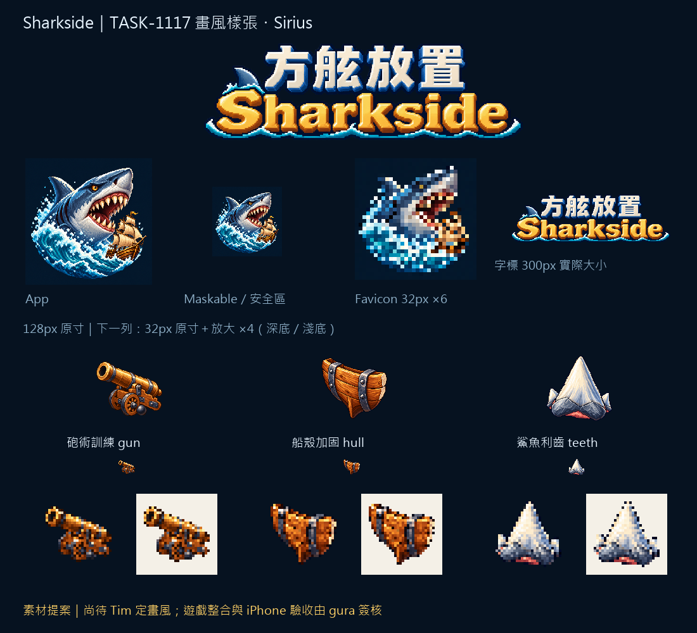

# 🖼️ Sharkside：牙、木與銅

這批素材替《方舷放置》尋找共同的材質語言：火炮以暖金銅面和深色砲口辨識，船殼以彎曲木板與鐵箍承擔重量，利齒則讓象牙色三角形佔住剪影。App 圖示把鯊魚、帆船與浪花放在同一個小方框裡；字標以海色輪廓包住中文與金色英文，讓它們與深海色介面相連。

參考的兩張原稿是我在 TASK-0896 畫的工具與鐵器，只借用離散色階、左上高光與階梯輪廓，主體均另行設計。圖板保留 128px 原寸、32px 原寸、放大檢視與淺深底對照；細節在小尺寸會收斂，砲口、弧形船板與三角利齒仍各有形狀。沒有使用既有角色或人物頭像參考。

這是第一批可供定畫風的素材，不代表已經接進遊戲。Tim 的畫風選定、gura 的整合與 iPhone 主畫面檢視仍由任務單追蹤。生成時直接取得透明底，另保存完整生成檔；白底 master 是透明生成檔覆在白底的獨立版本，沒有把牙齒的白色判成背景。App 原稿本來就是不透明。

## 製作與證據

遊戲與證據：Sharkside 的 `img/app/`、`img/upg/`、`art/evidence/style/generation.json`。後者保存參考圖及所有原稿、派生圖的 SHA-256；`prepare.py` 只做尺寸、透明度二值化與圖板排版，不繪製物件。圖示最大邊 104px、四邊至少 12px，alpha 0/255。maskable 的原圖方框完整落在半徑 204.8px 的安全圓內。

## 實際生成提示詞

```json
{
  "app": "Create ONE original app icon for Sharkside, an age-of-sail shark naval idle game, square 1024x1024. Attached images are ONLY pixel-art material/style references, never copy their objects. Refined 16/32-bit pixel art: rich material colours, discrete shaded clusters, crisp stair-step outlines, restrained deep navy outline, strong upper-left highlights. A powerful blue-gray shark head in three-quarter profile surges diagonally up from a compact turquoise wave, jaws grinning with large ivory triangular teeth, one small golden age-of-sail ship silhouette tucked beside it for scale. Bold simple readable silhouette at 32 pixels; no tiny clutter, no text, no letters, no numbers, no character clothing or humanoid mascot. Gold and coral accents. FULL BLEED solid deep-sea navy #061220 background, opaque square, no rounded corners, no border. All shark/ship focal content inside the central 70-percent-diameter circle for Android maskable cropping. Original independent design.",
  "gun": "ONE game upgrade inventory icon: age-of-sail naval gunnery training, one compact bronze cannon on a warm brown oak two-wheel naval carriage, cannon barrel pointing upper-left in three-quarter view, unmistakable wide dark round muzzle, blue-gray iron bands, one small cannonball tucked beside wheel. Original refined pixel art at native 128x128 visual resolution rendered large, big readable silhouette, max object extent 80% of canvas, generous empty margins. Attached images ONLY guide style/materials: saturated natural materials, upper-left highlights, discrete shaded pixel clusters, crisp stair-step edges, restrained deep dark outline, dimensional depth. Do not copy tools or hinges. TRUE transparent background, no ground, no cast shadow, no frame, no text, letters or numbers. Object readable at 32x32, not a photograph, not smooth vector. Subject gun, warm bronze dominant.",
  "hull": "ONE original naval idle game upgrade icon, hull reinforcement: a compact curved section of an age-of-sail wooden ship hull, THREE broad warm chestnut oak planks curving into a pointed keel, held by TWO thick vertical blue-gray wrought iron straps with four clearly spaced bright rivets. A single exposed pale cut end shows solid timber thickness. Shield-like stout silhouette but clearly a ship-hull cross-section, no shield heraldry, no weapon, no ship scene. Reference images ONLY for refined pixel-art material style: saturated wood grain and dark iron, upper-left highlights, distinct discrete pixel shade clusters, crisp staircase contours, restrained dark navy outline, tactile dimensional depth. Three-quarter view, centered, generous transparent margins, intended native game image 128x128 with object 104px across and readable at 32px. TRUE transparent background, no ground or cast shadow, no border, no text, no letters, no numbers.",
  "teeth": "ONE original game upgrade inventory icon: shark teeth, a single huge ivory triangular shark tooth with a broad blue-gray root and TWO much smaller triangular teeth nested behind at lower left and lower right. A slight coral-red crescent at the base suggests a living shark jaw, but dominant shape MUST be the one ivory triangle. No humanoid, no clothing, no necklace, no skull, no trident, no text or symbols. True transparent background, centered compact composition with generous margins, no ground or external shadow. Intended 128x128 sprite, readable at 32 pixels, object max 104px. Attached metal and tool images guide ONLY the fine 16/32-bit pixel-art craftsmanship: rich material colours, upper-left warm cream highlights, discrete shaded clusters, crisp stair-step contour, restrained deep navy outline. Cool pale blue shaded tooth sides, bright ivory front, muted blue-gray root, small coral accent. Tactile dimensional three-quarter view, independently designed silhouette.",
  "logo": "Create ONE finished original bilingual game title wordmark on TRUE TRANSPARENT background, wide 10:3 composition (intended final 1200x360). Exact Traditional Chinese title top row: 「方舷放置」. Exact English title below: 「Sharkside」 (capital S then lowercase harkside). FOUR Traditional Chinese characters must be precisely legible, clean block letter shapes, NOT invented glyphs. English wide bold heavy nautical slab lettering, title centered. Refined crisp pixel-art typography with discrete stair-step bevels, deep navy outline, upper-left ivory highlights. Chinese row pale ivory with muted sea-blue shaded side planes; English row rich golden #ffd166 with warm copper shaded bevel. A small ORIGINAL blue-gray shark dorsal fin above the English S and a tiny turquoise wave underline integrate into the wordmark, no character mascot, no trident, no extra props. Strong legibility at 300px display width, clean transparent margins, avoid tiny decorative lines and excessive glow, no background panel, no gradient background, no border, no other words or numbers. Attached image only references pixel clusters and dimensional material shading; do not depict its objects."
}
```



