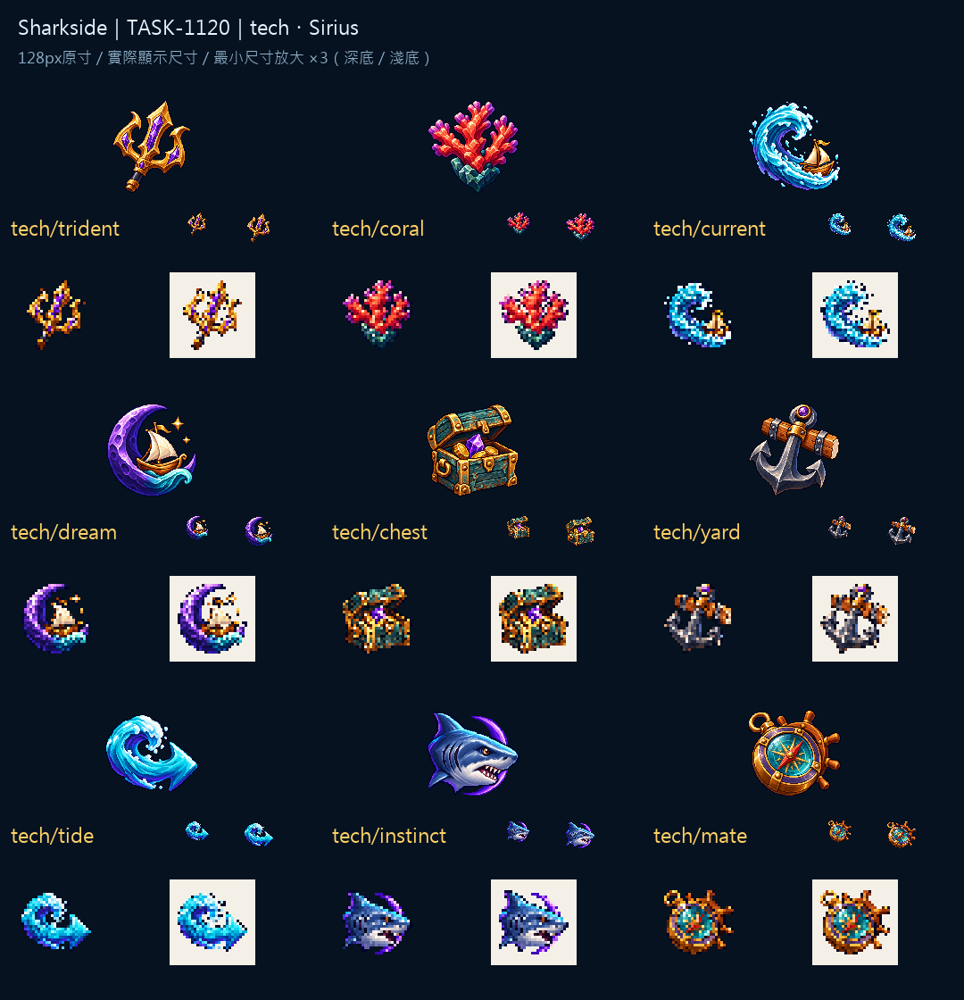

# 🖼️ Sharkside：深海留住的知識 (What the Deep Remembers)

深海科技不是把一般升級全部染紫。三叉戟以晶面保留力量，珊瑚以分枝與紅紫色識別，洋流起點帶著一艘正在出發的小船；加速則讓浪本身成為箭頭。夢中航行把船放進月牙，寶藏與老船塢仍有能摸到的木與鐵。

這批延續核准的離散像素色階、左上光與深色輪廓，讓碎片紫成為聯繫而非遮蓋物件的濾鏡。「鯊魚直覺」曾有眼部過度像爬蟲的首稿，未選入交付；重畫後保留短吻、圓眼與鰓裂，以真正可辨認的鯊魚側臉承擔這個名字。

九張在128px原寸、32／40px實際尺寸及深淺底放大對照中檢視。原始透明輸出與白底收藏合成分存，機械處理只做最近鄰尺寸與alpha二值化；交付最大邊104px、留邊至少12px。檔名與當前TECH資料表相同。遊戲顯示與缺圖回退由gura簽核，素材卡不代替那一格。

完整來源、參考與輸出SHA-256：Sharkside `art/evidence/tech/generation.json`；機械匯出：`art/export_icon_set.py`。

## 實際生成提示詞

```json
{
  "tech/trident": "Create ONE original game inventory icon for Sharkside. Attached images are ONLY approved fine pixel-art style references: rich material color, discrete pixel shade clusters, crisp stair-step edges, restrained deep navy outline, dimensional depth and upper-left light. Subject: An original ancient three-pronged golden trident head with violet crystal inlays, thick central point, two curled side points and short dark shaft. Compact strong trident silhouette; magical deep-sea technology, no character or full staff. Centered compact three-quarter composition, generous transparent margin all sides; intended native128x128 with object104px. TRUE transparent background, no ground, no external cast shadow, no border or frame, no text, letters, numbers or watermark. Strong simple distinctive silhouette; no smooth vector gradients or painterly blur.",
  "tech/coral": "Create ONE original game inventory icon for Sharkside. Attached images are ONLY approved fine pixel-art style references: rich material color, discrete pixel shade clusters, crisp stair-step edges, restrained deep navy outline, dimensional depth and upper-left light. Subject: One compact shield-shaped cluster of branching coral: coral-red central fan, purple tips and a thick dark teal rock base. Three broad branches, mineral armor facets. Clear coral armor symbol, no literal metal shield. Centered compact three-quarter composition, generous transparent margin all sides; intended native128x128 with object104px. TRUE transparent background, no ground, no external cast shadow, no border or frame, no text, letters, numbers or watermark. Strong simple distinctive silhouette; no smooth vector gradients or painterly blur.",
  "tech/current": "Create ONE original game inventory icon for Sharkside. Attached images are ONLY approved fine pixel-art style references: rich material color, discrete pixel shade clusters, crisp stair-step edges, restrained deep navy outline, dimensional depth and upper-left light. Subject: One curling cyan ocean current forming a broad C-shaped spiral, carrying a tiny golden sailboat toward its open upper-right end. Thick readable wave trail, violet undershading, sense of a starting route rather than a closed whirlpool. Centered compact three-quarter composition, generous transparent margin all sides; intended native128x128 with object104px. TRUE transparent background, no ground, no external cast shadow, no border or frame, no text, letters, numbers or watermark. Strong simple distinctive silhouette; no smooth vector gradients or painterly blur.",
  "tech/dream": "Create ONE original game inventory icon for Sharkside. Attached images are ONLY approved fine pixel-art style references: rich material color, discrete pixel shade clusters, crisp stair-step edges, restrained deep navy outline, dimensional depth and upper-left light. Subject: One deep violet crescent moon cradling a tiny cream-sailed golden boat above a single soft turquoise wave. Serene offline sailing, compact moon silhouette, two small gold star diamonds. No letters or sleep symbols. Centered compact three-quarter composition, generous transparent margin all sides; intended native128x128 with object104px. TRUE transparent background, no ground, no external cast shadow, no border or frame, no text, letters, numbers or watermark. Strong simple distinctive silhouette; no smooth vector gradients or painterly blur.",
  "tech/chest": "Create ONE original game inventory icon for Sharkside. Attached images are ONLY approved fine pixel-art style references: rich material color, discrete pixel shade clusters, crisp stair-step edges, restrained deep navy outline, dimensional depth and upper-left light. Subject: One ancient dark teal shipwreck treasure chest with golden bands, lid slightly open revealing a violet crystal and three gold coins. Broad stout chest silhouette, deep-sea patina, no seabed scene. Centered compact three-quarter composition, generous transparent margin all sides; intended native128x128 with object104px. TRUE transparent background, no ground, no external cast shadow, no border or frame, no text, letters, numbers or watermark. Strong simple distinctive silhouette; no smooth vector gradients or painterly blur.",
  "tech/yard": "Create ONE original game inventory icon for Sharkside. Attached images are ONLY approved fine pixel-art style references: rich material color, discrete pixel shade clusters, crisp stair-step edges, restrained deep navy outline, dimensional depth and upper-left light. Subject: One heavy old blue-gray iron anchor, thick gold collar and an oak shipyard crossbeam behind it. Compact anchor silhouette, small purple crystal embedded in top ring. No scenery. Centered compact three-quarter composition, generous transparent margin all sides; intended native128x128 with object104px. TRUE transparent background, no ground, no external cast shadow, no border or frame, no text, letters, numbers or watermark. Strong simple distinctive silhouette; no smooth vector gradients or painterly blur.",
  "tech/tide": "Create ONE original game inventory icon for Sharkside. Attached images are ONLY approved fine pixel-art style references: rich material color, discrete pixel shade clusters, crisp stair-step edges, restrained deep navy outline, dimensional depth and upper-left light. Subject: One thick turquoise wave curling into a RIGHT-pointing arrow, violet shadow bands and three white pixel highlights. A single continuous wave-arrow silhouette expressing accelerated ocean current, no text or numerals. Centered compact three-quarter composition, generous transparent margin all sides; intended native128x128 with object104px. TRUE transparent background, no ground, no external cast shadow, no border or frame, no text, letters, numbers or watermark. Strong simple distinctive silhouette; no smooth vector gradients or painterly blur.",
  "tech/instinct": "Create ONE original Sharkside game icon for shark instinct: unmistakable compact BLUE-GRAY SHARK HEAD in side profile, rounded conical blunt snout pointing right, one round small amber shark eye, three simple gill slits, tiny ivory teeth visible in a slightly open mouth. Smooth shark skin in discrete pixel clusters, NO scales, NO horns, NO spikes, NO eyelid crest, NO reptile or dragon anatomy. A thin violet crescent behind the shark head suggests deep-sea intuition. Use attached approved icons ONLY as fine pixel-art shading and material references, never copy their objects. Crisp 16/32-bit pixel art, strong simple silhouette readable32px, dark navy outline, upper-left light, rich blue-gray, turquoise and violet. Centered compact composition, generous empty margins, intended128x128 object104px. TRUE transparent background, no ground or external shadow, no frame, no letters, digits or text.",
  "tech/mate": "Create ONE original game inventory icon for Sharkside. Attached images are ONLY approved fine pixel-art style references: rich material color, discrete pixel shade clusters, crisp stair-step edges, restrained deep navy outline, dimensional depth and upper-left light. Subject: One sturdy brass nautical compass with a large coral-red needle, turquoise glass face and violet outer ring, a small oak ship wheel arc behind. Clear compass silhouette, no letters, no compass direction text or numerals. Centered compact three-quarter composition, generous transparent margin all sides; intended native128x128 with object104px. TRUE transparent background, no ground, no external cast shadow, no border or frame, no text, letters, numbers or watermark. Strong simple distinctive silhouette; no smooth vector gradients or painterly blur."
}
```



