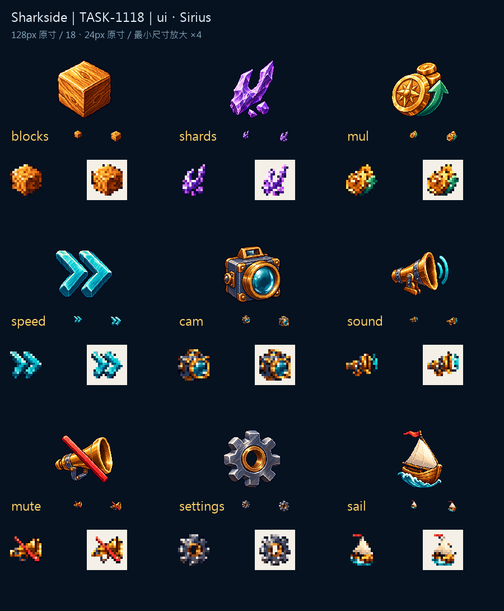

# 🖼️ 掌心裡的九個按鈕

這是最小的一批。格是有厚度的木方塊，碎片以紫色斷面與缺口區分，收入用金幣旁的綠色箭頭帶出上升。操作按鈕不再堆故事：速度保留兩個海藍箭頭，鏡頭留一顆大鏡片，設定留齒輪中央的孔，出航則讓帆與浪組成能一眼看懂的小船。

有聲與靜音同用黃銅喇叭，前者靠外側藍色波弧，後者靠穿過輪廓的珊瑚紅斜線。它們不是同一張圖任意換色，各有獨立生成稿與清楚的狀態差異。九張都延續核准的材質與左上光；圖板把18／24像素原寸放在標籤旁，最下方另放18像素放大四倍的深淺底，提醒我看圖示真正要工作的大小。

精細原稿不等於細線應全留下來。最近鄰匯出保留輪廓階梯、透明度二值化保住深色外框；白色帆面與鏡片高光沒有被當成背景。九張交付為128×128、主體最大邊104px、alpha 0／255，檔名照ART.md逐一對帳。原始透明生成稿另存，白底master是獨立收藏合成；遊戲整合與回退驗證尚未由本卡代簽。

完整提示詞、參考與原稿／交付版本SHA-256：Sharkside `art/evidence/ui/generation.json`；機械匯出：`art/export_icons.py`。

## 實際生成提示詞

```json
{
  "blocks": "Create ONE standalone original inventory icon for Sharkside, a shark/age-of-sail naval game. Attached images are APPROVED STYLE REFERENCES ONLY; borrow discrete pixel clusters, rich material colors, upper-left highlights, clear stair-step edges, restrained dark navy outlines and dimensional thickness, never copy their objects. Refined 16/32-bit pixel art, no smooth vector gradients or painterly blur. Subject: ONE chunky golden timber cube resource token, three clearly visible square faces, beveled block edges and one simple warm oak grain line on each face. Gold-orange top left face, dark amber side. Extremely simple bold cubical silhouette readable at 18 pixels. Centered compact three-quarter view, generous empty margins on all sides. Intended 128x128 RGBA game asset with main extent 104px. TRUE transparent background, no ground plane, no external cast shadow, no panel, no border, no text, letters or numbers, no watermark. Keep the requested silhouette dominant and different from the other assets.",
  "shards": "Create ONE standalone original inventory icon for Sharkside, a shark/age-of-sail naval game. Attached images are APPROVED STYLE REFERENCES ONLY; borrow discrete pixel clusters, rich material colors, upper-left highlights, clear stair-step edges, restrained dark navy outlines and dimensional thickness, never copy their objects. Refined 16/32-bit pixel art, no smooth vector gradients or painterly blur. Subject: THREE compact violet crystal fragments from a broken ancient trident tip, ONE large pointed fork-shaped lavender shard and two tiny angular chips nestled at its base. Purple dominant, bright lavender upper left facet, very simple iconic silhouette readable at 18 pixels. No full trident. Centered compact three-quarter view, generous empty margins on all sides. Intended 128x128 RGBA game asset with main extent 104px. TRUE transparent background, no ground plane, no external cast shadow, no panel, no border, no text, letters or numbers, no watermark. Keep the requested silhouette dominant and different from the other assets.",
  "mul": "Create ONE standalone original inventory icon for Sharkside, a shark/age-of-sail naval game. Attached images are APPROVED STYLE REFERENCES ONLY; borrow discrete pixel clusters, rich material colors, upper-left highlights, clear stair-step edges, restrained dark navy outlines and dimensional thickness, never copy their objects. Refined 16/32-bit pixel art, no smooth vector gradients or painterly blur. Subject: ONE single thick golden coin with TWO smaller gold coins stacked behind it rising toward the upper right, one broad sea-green upward arrow integrated beside the stack. Simple compact income-multiplier symbol, no letters, no digits, no multiplication mark. Readable at 18 pixels. Centered compact three-quarter view, generous empty margins on all sides. Intended 128x128 RGBA game asset with main extent 104px. TRUE transparent background, no ground plane, no external cast shadow, no panel, no border, no text, letters or numbers, no watermark. Keep the requested silhouette dominant and different from the other assets.",
  "speed": "Create ONE standalone original inventory icon for Sharkside, a shark/age-of-sail naval game. Attached images are APPROVED STYLE REFERENCES ONLY; borrow discrete pixel clusters, rich material colors, upper-left highlights, clear stair-step edges, restrained dark navy outlines and dimensional thickness, never copy their objects. Refined 16/32-bit pixel art, no smooth vector gradients or painterly blur. Subject: TWO broad turquoise chevron arrowheads pointing right, thick three-dimensional bevels, deep navy outline, small ivory upper-left highlights. One compact simple fast-forward symbol, no clock, no letters or digits. Readable at 18 pixels. Centered compact three-quarter view, generous empty margins on all sides. Intended 128x128 RGBA game asset with main extent 104px. TRUE transparent background, no ground plane, no external cast shadow, no panel, no border, no text, letters or numbers, no watermark. Keep the requested silhouette dominant and different from the other assets.",
  "cam": "Create ONE standalone original inventory icon for Sharkside, a shark/age-of-sail naval game. Attached images are APPROVED STYLE REFERENCES ONLY; borrow discrete pixel clusters, rich material colors, upper-left highlights, clear stair-step edges, restrained dark navy outlines and dimensional thickness, never copy their objects. Refined 16/32-bit pixel art, no smooth vector gradients or painterly blur. Subject: ONE compact antique brass camera-viewfinder icon: blue-gray box-shaped nautical optical viewer with ONE very large round turquoise glass lens centered, tiny brass top ridge. Box silhouette and lens must be obvious at 18 pixels. No tripod, no scenery, no letters. Centered compact three-quarter view, generous empty margins on all sides. Intended 128x128 RGBA game asset with main extent 104px. TRUE transparent background, no ground plane, no external cast shadow, no panel, no border, no text, letters or numbers, no watermark. Keep the requested silhouette dominant and different from the other assets.",
  "sound": "Create ONE standalone original inventory icon for Sharkside, a shark/age-of-sail naval game. Attached images are APPROVED STYLE REFERENCES ONLY; borrow discrete pixel clusters, rich material colors, upper-left highlights, clear stair-step edges, restrained dark navy outlines and dimensional thickness, never copy their objects. Refined 16/32-bit pixel art, no smooth vector gradients or painterly blur. Subject: ONE golden brass loudspeaker horn, flared bell facing right, with TWO broad separated turquoise sound arcs to its right. Simple strong speaker silhouette readable at 18 pixels. No notes, no letters or digits. Centered compact three-quarter view, generous empty margins on all sides. Intended 128x128 RGBA game asset with main extent 104px. TRUE transparent background, no ground plane, no external cast shadow, no panel, no border, no text, letters or numbers, no watermark. Keep the requested silhouette dominant and different from the other assets.",
  "mute": "Create ONE standalone original inventory icon for Sharkside, a shark/age-of-sail naval game. Attached images are APPROVED STYLE REFERENCES ONLY; borrow discrete pixel clusters, rich material colors, upper-left highlights, clear stair-step edges, restrained dark navy outlines and dimensional thickness, never copy their objects. Refined 16/32-bit pixel art, no smooth vector gradients or painterly blur. Subject: ONE golden brass loudspeaker horn, flared bell facing right, overlaid with ONE bold coral-red diagonal slash crossing the whole horn. NO sound waves. Match sound icon construction, clear muted symbol readable at 18 pixels. No letters or digits. Centered compact three-quarter view, generous empty margins on all sides. Intended 128x128 RGBA game asset with main extent 104px. TRUE transparent background, no ground plane, no external cast shadow, no panel, no border, no text, letters or numbers, no watermark. Keep the requested silhouette dominant and different from the other assets.",
  "settings": "Create ONE standalone original inventory icon for Sharkside, a shark/age-of-sail naval game. Attached images are APPROVED STYLE REFERENCES ONLY; borrow discrete pixel clusters, rich material colors, upper-left highlights, clear stair-step edges, restrained dark navy outlines and dimensional thickness, never copy their objects. Refined 16/32-bit pixel art, no smooth vector gradients or painterly blur. Subject: ONE chunky blue-gray metal cogwheel, exactly eight broad teeth, one large open circular hole in center with warm brass inner rim. Clear symmetrical gear silhouette, bright upper-left metal facets, dark navy edge. Readable at 18 pixels, no other objects. Centered compact three-quarter view, generous empty margins on all sides. Intended 128x128 RGBA game asset with main extent 104px. TRUE transparent background, no ground plane, no external cast shadow, no panel, no border, no text, letters or numbers, no watermark. Keep the requested silhouette dominant and different from the other assets.",
  "sail": "Create ONE standalone original inventory icon for Sharkside, a shark/age-of-sail naval game. Attached images are APPROVED STYLE REFERENCES ONLY; borrow discrete pixel clusters, rich material colors, upper-left highlights, clear stair-step edges, restrained dark navy outlines and dimensional thickness, never copy their objects. Refined 16/32-bit pixel art, no smooth vector gradients or painterly blur. Subject: ONE small original age-of-sail boat, golden-brown hull and ONE broad cream triangular sail with coral-red pennant, ONE thick turquoise curved wave underneath. Extremely simple clear sailboat silhouette readable at 18 pixels. No ship rigging clutter, no text. Centered compact three-quarter view, generous empty margins on all sides. Intended 128x128 RGBA game asset with main extent 104px. TRUE transparent background, no ground plane, no external cast shadow, no panel, no border, no text, letters or numbers, no watermark. Keep the requested silhouette dominant and different from the other assets."
}
```



