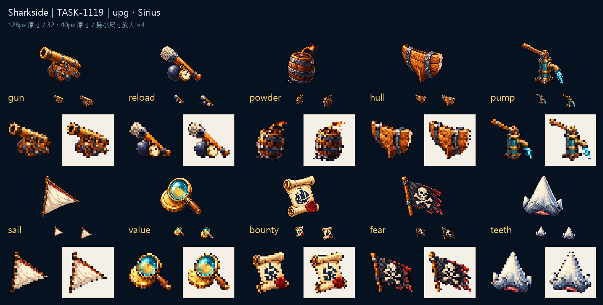

# 🖼️ 十種升級的手感

升級不只是一列相同的加號。裝填用斜放的填彈桿與砲彈，抽水機讓彎曲出水口從直立輪廓伸出；火藥的火星、帆的淺色三角形，各自留下能被小尺寸保住的特徵。經濟類則以鏡片裡的金幣、帶封蠟的卷軸與黑色骷髏旗，分開鑑價、賞金與恐懼三種用途。

這批以第一批核准原稿及工具原稿作材質參考，統一左上光、厚實輪廓與離散像素色階。火炮、船殼、利齒保持已核准的原圖，不為湊新批而重畫；其餘七張獨立生成。圖板列出128px原寸、32／40px原寸與32px放大深淺底對照，讓精細原稿回到實際要用的尺度。

來源與遊戲版本分別保存。生成輸出本身是透明底，白底 master 是另外合成的收藏版本；沒有以白色取代透明度判斷。遊戲圖全為128×128、主體最大邊104px、留邊至少12px、alpha只有0／255。檔名已與當前遊戲的UPG資料表逐一比對。素材完整，接進遊戲與缺圖回退檢查仍待gura完成。

完整參考與輸出SHA-256、舊三張的來源指路：Sharkside `art/evidence/upg/generation.json`。機械匯出與圖板排版：`art/export_icons.py`。

## 七張新原稿的實際提示詞

```json
{
  "reload": "Create ONE standalone original inventory icon for Sharkside, a shark/age-of-sail naval game. Attached images are APPROVED STYLE REFERENCES ONLY; borrow discrete pixel clusters, rich material colors, upper-left highlights, clear stair-step edges, restrained dark navy outlines and dimensional thickness, never copy their objects. Refined 16/32-bit pixel art, no smooth vector gradients or painterly blur. Subject: A short oak-handled cannon rammer crossing ONE dark iron cannonball, a small brass pocket stopwatch tucked at their base. Broad clear diagonal rammer silhouette, warm tan handle, blue iron ball, cream clock face with simple hands but NO numerals. Loading drill, not a cannon. Centered compact three-quarter view, generous empty margins on all sides. Intended 128x128 RGBA game asset with main extent 104px. TRUE transparent background, no ground plane, no external cast shadow, no panel, no border, no text, letters or numbers, no watermark. Keep the requested silhouette dominant and different from the other assets.",
  "powder": "Create ONE standalone original inventory icon for Sharkside, a shark/age-of-sail naval game. Attached images are APPROVED STYLE REFERENCES ONLY; borrow discrete pixel clusters, rich material colors, upper-left highlights, clear stair-step edges, restrained dark navy outlines and dimensional thickness, never copy their objects. Refined 16/32-bit pixel art, no smooth vector gradients or painterly blur. Subject: ONE squat dark brown gunpowder keg with broad charcoal iron hoops, a coral-orange sparking fuse rising from its top. A few discrete black powder grains at its foot. Sturdy barrel silhouette and flame accent; no explosion cloud obscuring the keg. Centered compact three-quarter view, generous empty margins on all sides. Intended 128x128 RGBA game asset with main extent 104px. TRUE transparent background, no ground plane, no external cast shadow, no panel, no border, no text, letters or numbers, no watermark. Keep the requested silhouette dominant and different from the other assets.",
  "pump": "Create ONE standalone original inventory icon for Sharkside, a shark/age-of-sail naval game. Attached images are APPROVED STYLE REFERENCES ONLY; borrow discrete pixel clusters, rich material colors, upper-left highlights, clear stair-step edges, restrained dark navy outlines and dimensional thickness, never copy their objects. Refined 16/32-bit pixel art, no smooth vector gradients or painterly blur. Subject: ONE compact age-of-sail manual bilge pump: weathered teal-blue upright cylinder, bent brass spout pouring a short bright turquoise stream, oak lever handle. Simple L-shaped silhouette and clearly visible spout, no bucket, no modern electric motor. Centered compact three-quarter view, generous empty margins on all sides. Intended 128x128 RGBA game asset with main extent 104px. TRUE transparent background, no ground plane, no external cast shadow, no panel, no border, no text, letters or numbers, no watermark. Keep the requested silhouette dominant and different from the other assets.",
  "sail": "Create ONE standalone original inventory icon for Sharkside, a shark/age-of-sail naval game. Attached images are APPROVED STYLE REFERENCES ONLY; borrow discrete pixel clusters, rich material colors, upper-left highlights, clear stair-step edges, restrained dark navy outlines and dimensional thickness, never copy their objects. Refined 16/32-bit pixel art, no smooth vector gradients or painterly blur. Subject: ONE compact folded-out cream triangular lateen sail on a short dark oak mast and yard, one coral-red trim strip and a tiny brass fitting. Sail hardware and cloth only, no boat or sea. A clean light triangular silhouette distinct from a shark tooth. Centered compact three-quarter view, generous empty margins on all sides. Intended 128x128 RGBA game asset with main extent 104px. TRUE transparent background, no ground plane, no external cast shadow, no panel, no border, no text, letters or numbers, no watermark. Keep the requested silhouette dominant and different from the other assets.",
  "value": "Create ONE standalone original inventory icon for Sharkside, a shark/age-of-sail naval game. Attached images are APPROVED STYLE REFERENCES ONLY; borrow discrete pixel clusters, rich material colors, upper-left highlights, clear stair-step edges, restrained dark navy outlines and dimensional thickness, never copy their objects. Refined 16/32-bit pixel art, no smooth vector gradients or painterly blur. Subject: ONE brass-rimmed magnifying glass held over a single large gold coin, coin has a simple bevel and plain unlettered center. Big circular teal-blue lens, warm gold coin beneath, compact diagonal handle. Appraiser, no text. Centered compact three-quarter view, generous empty margins on all sides. Intended 128x128 RGBA game asset with main extent 104px. TRUE transparent background, no ground plane, no external cast shadow, no panel, no border, no text, letters or numbers, no watermark. Keep the requested silhouette dominant and different from the other assets.",
  "bounty": "Create ONE standalone original inventory icon for Sharkside, a shark/age-of-sail naval game. Attached images are APPROVED STYLE REFERENCES ONLY; borrow discrete pixel clusters, rich material colors, upper-left highlights, clear stair-step edges, restrained dark navy outlines and dimensional thickness, never copy their objects. Refined 16/32-bit pixel art, no smooth vector gradients or painterly blur. Subject: ONE rolled ivory bounty parchment with curled upper and lower edges, ONE very simple dark navy ship silhouette stamped in the center and a broad red wax seal at lower right. NO words, letters, numbers or scribbles. Vertical ivory scroll silhouette distinct from black flag. Centered compact three-quarter view, generous empty margins on all sides. Intended 128x128 RGBA game asset with main extent 104px. TRUE transparent background, no ground plane, no external cast shadow, no panel, no border, no text, letters or numbers, no watermark. Keep the requested silhouette dominant and different from the other assets.",
  "fear": "Create ONE standalone original inventory icon for Sharkside, a shark/age-of-sail naval game. Attached images are APPROVED STYLE REFERENCES ONLY; borrow discrete pixel clusters, rich material colors, upper-left highlights, clear stair-step edges, restrained dark navy outlines and dimensional thickness, never copy their objects. Refined 16/32-bit pixel art, no smooth vector gradients or painterly blur. Subject: ONE wind-blown charcoal-black pirate flag on a short brown mast, an original simple ivory skull with TWO crossed bones clearly centered. Restrained coral-red frayed edge. Bold rectangular black fabric silhouette, no lettering. Centered compact three-quarter view, generous empty margins on all sides. Intended 128x128 RGBA game asset with main extent 104px. TRUE transparent background, no ground plane, no external cast shadow, no panel, no border, no text, letters or numbers, no watermark. Keep the requested silhouette dominant and different from the other assets."
}
```



