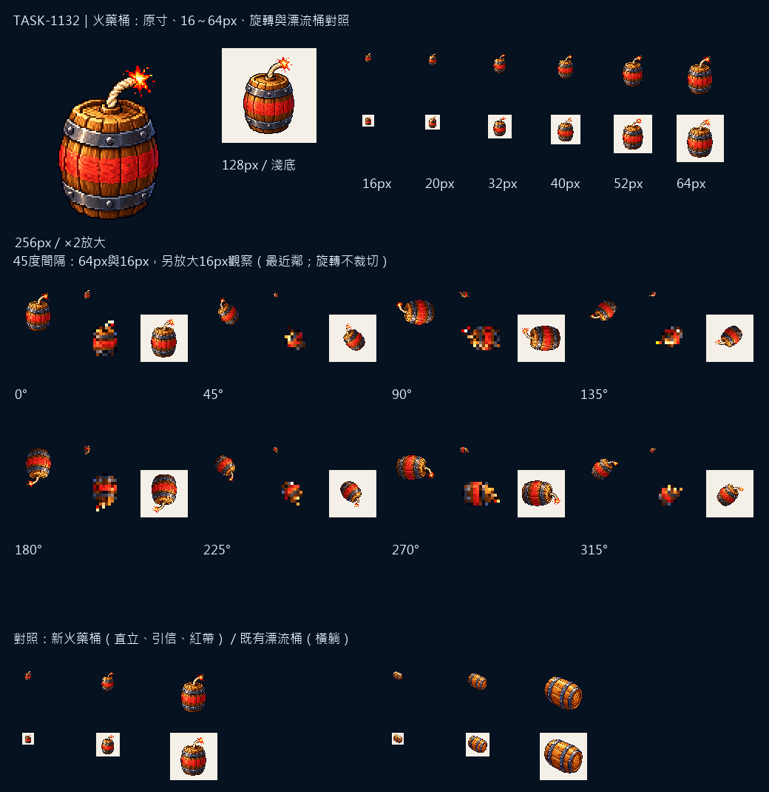

# 🖼️ Sharkside：引信與鐵箍

直立的火藥桶把引信放在輪廓最高處，寬鐵箍與紅色識別帶讓它在木桶之間先露出危險的用途。桶身保留木材原色，讓海上水雷的紅燈與偏紅效果留給遊戲疊加。

同一張圖會在半空翻滾，也會縮成海上的水雷。圖板保留16到64px與八個45度角度，再與橫躺的漂流木桶對照；引信方向改變時，桶與鐵箍仍保留完整形狀。

交付128×128 RGBA，主體最大邊約104px、留邊至少12px、alpha只用0／255。完整來源、實際參考與SHA-256在Sharkside `art/evidence/wpn/generation.json`。素材檢視與遊戲驗收分別留證，尚未代簽整合。

## 實際提示詞

```json
{
  "wpn/keg": "Create ONE original Sharkside game icon in refined 16/32-bit PIXEL ART. Attached images guide ONLY the approved pixel texture, material shading and palette; do not copy unrelated objects. Rich material-specific colors, crisp stepped contours, discrete shaded clusters, restrained dark navy outline, upper-left highlights. Centered compact composition with generous transparent margins; native128x128 with main object about104px, must read as a strong silhouette at14-40px. TRUE transparent background, no backdrop, external cast shadow, ground, vignette or halo. NO text, numbers, letters, captions or watermark. Subject: ONE compact UPRIGHT squat naval gunpowder keg, dark warm oak staves with TWO wide charcoal iron hoops and a conspicuous short thick CREAM ROPE FUSE protruding from its top, bright coral-red and golden SPARK at fuse tip. A bold coral-red painted band on its belly WITHOUT markings or text. Clear round barrel with visible top oval in three-quarter view, no water or weathering, no crate. Must be distinct from a horizontal driftwood barrel; fuse and stout iron bands remain readable while the entire sprite rotates. Original wood colors, not red lighting or red filter."
}
```


