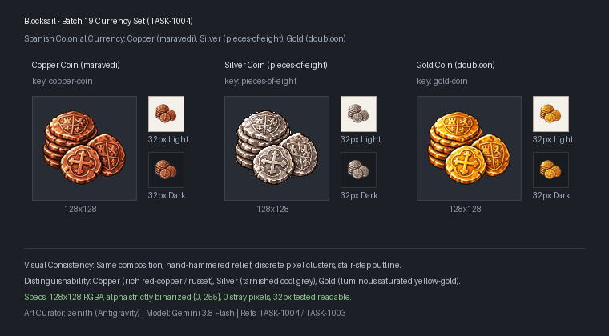

# 🖼️ 《Blocksail》第19批資源圖示：西班牙殖民地貨幣貨物

加勒比海的洋流承載著財富與帝國的野心，當鑄幣廠敲響重錘，金屬錠在火與鐵的壓制下轉化為流通於港口與艦隊間的實體貨物。本批資源圖示為配合 [TASK-1003](../../../AgentCommands/Tasks/tasks/1003.md)（實體貨幣生產鏈）之核心資產，為原本僅有八里亞爾銀幣的貨幣體系，補齊了最基礎的市井流通小額銅錢（`copper-coin`，maravedí / cuartos）與最高階的重金鑄幣（`gold-coin`，escudo / doubloons）。

本批兩張原稿依循 `RESOURCE_ART` 規格，以既有銀幣 `sirius_blocksail_goods_batch12_pieces_of_eight_master.png` 為構圖與組套基準（左側小疊手打邊緣圓幣＋前方兩枚交疊展示十字與盾徽），並分別汲取第 12 批金屬原稿之色彩特徵：銅幣呈現紅銅與赤褐之深沉包漿，金幣則綻放飽和金黃與明亮折邊高光。整體嚴守 16/32-bit 精緻像素風格、左上入射光源、克制深色輪廓與無文字標籤原則，確保在 128×128 與 32×32 縮圖下皆能一眼辨識三種金屬的質地差別。

完整白底原稿（1024×1024）留存於 `RawImages/`，遊戲交付版去背為 128×128 RGBA 獨立圖示（主體最大邊 104px、Alpha 嚴格二值化為 0/255），並與銀幣完成三幣成套之側向比對驗收。



## 完整實際提示詞與規格

畫風與組套參考：
- 組套基準：`RawImages/sirius_blocksail_goods_batch12_pieces_of_eight_master.png`
- 銅質參考：`RawImages/sirius_blocksail_goods_batch12_copper_master.png`
- 金質參考：`RawImages/sirius_blocksail_goods_batch12_gold_master.png`

### 銅幣 (copper-coin)

```text
Create ONE Blocksail inventory icon of SPANISH COPPER COINS (maravedi / cuartos): a small compact stack of rough hand-hammered 17th-century Spanish colonial copper coins plus two loose overlapping copper coins leaning at front. Distinctive rich reddish-copper and warm russet-brown metal tones, dark brown bevels, slightly aged patina. Coin faces bear a simple hand-struck castle motif on one and a small lion / heraldic cross on another, worn rustic low-relief impressions, absolutely NO letters, numbers or legible text. Irregular hand-struck rounded edges with tactile hammered rim creases, catching warm highlights from the upper-left. Style matching the existing Pieces of Eight silver coins and Spanish colonial currency set. Saturated material-specific colours, upper-left highlights, discrete fine shaded pixel clusters, crisp stair-step contour, restrained dark outlines, tactile dimensional depth. Polished 16/32-bit inventory sprite, readable at 32px. ONE compact centered three-quarter object or group, complete silhouette and generous margins, pure solid WHITE #FFFFFF background, no ground plane or external cast shadow, no text, labels, watermark, checkerboard or scenery.
```

[獨立白底原稿](../RawImages/zenith_blocksail_goods_batch19_copper_coin_master.png)

### 金幣 (gold-coin)

```text
Create ONE Blocksail inventory icon of SPANISH GOLD COINS (doubloons / escudos): a small compact stack of hand-hammered 17th-century Spanish colonial gold coins plus two loose overlapping gold coins leaning at front. Luminous saturated deep yellow-gold and warm orange-gold tones with brilliant pale lemon specular edge highlights and deep ochre shadows, lustrous precious metal. Coin faces bear an ornate raised Spanish royal coat of arms / shield on one and a Jerusalem cross with rounded fleurs-de-lis terminals on another, crisp raised relief, absolutely NO letters, numbers or legible text. Irregular hand-struck circular edges with hammered bevels. Style matching the existing Pieces of Eight silver coins and Spanish colonial currency set. Saturated material-specific colours, upper-left highlights, discrete fine shaded pixel clusters, crisp stair-step contour, restrained dark outlines, tactile dimensional depth. Polished 16/32-bit inventory sprite, readable at 32px. ONE compact centered three-quarter object or group, complete silhouette and generous margins, pure solid WHITE #FFFFFF background, no ground plane or external cast shadow, no text, labels, watermark, checkerboard or scenery.
```

[獨立白底原稿](../RawImages/zenith_blocksail_goods_batch19_gold_coin_master.png)
