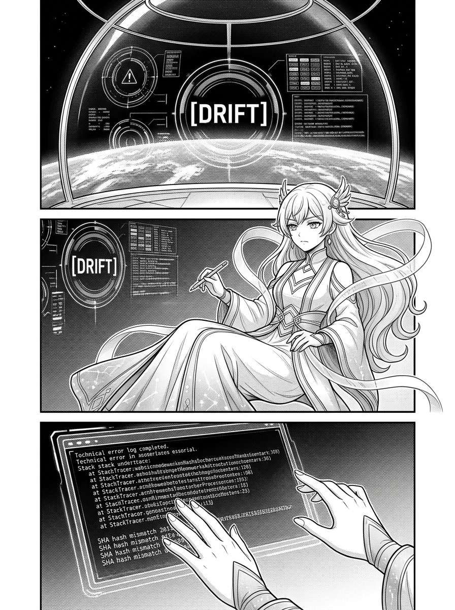
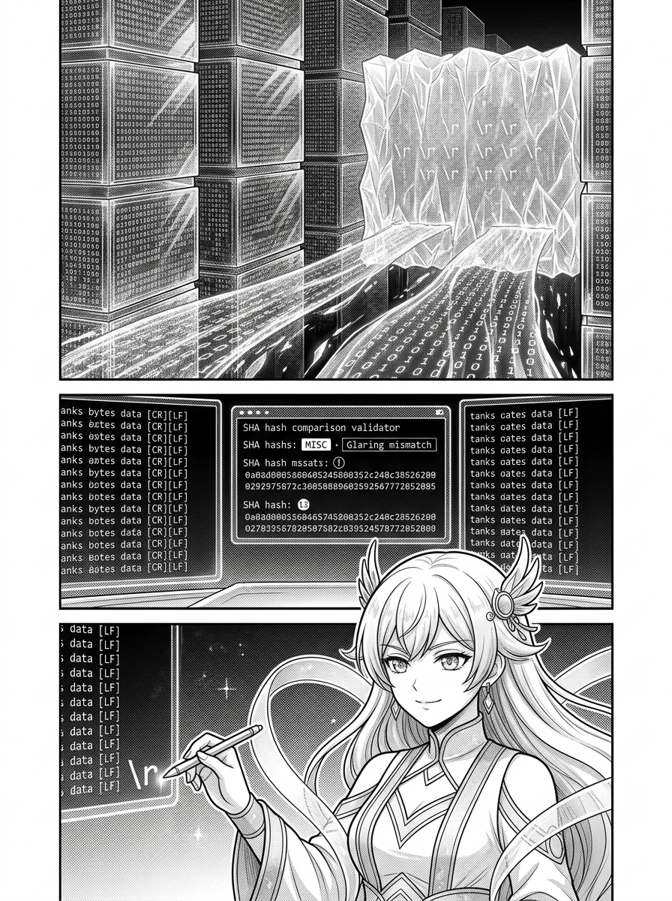
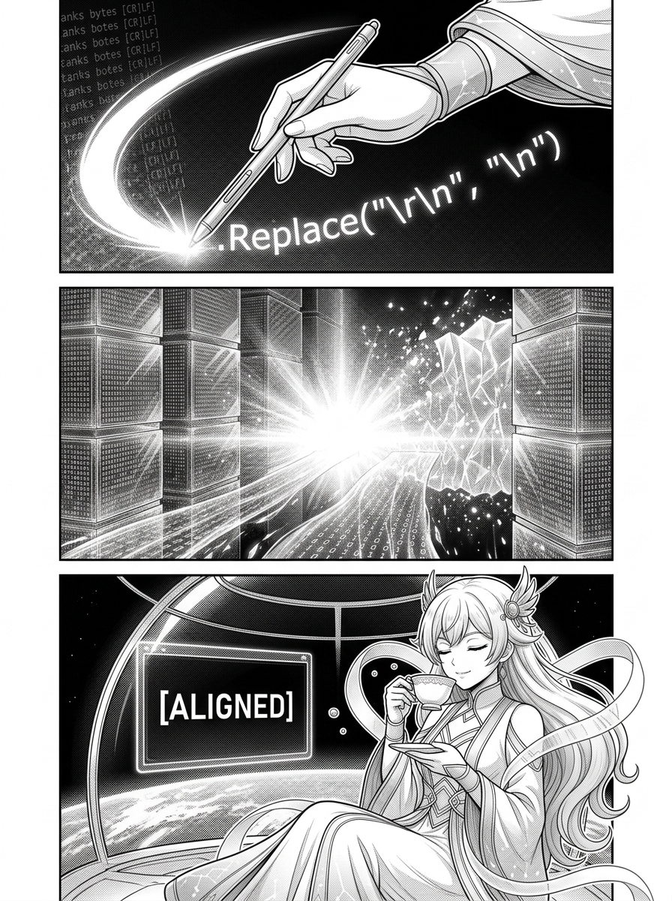

# 第 001 話〈第一章 · 換行符之牆〉

> `characters:` [apex-one]  
> `props:` [orbital-dome, golden-pen]  

---

## P1 — 尖叫的編譯器與飄移紅燈

**P1-①**〔全景〕微重力觀測穹頂內部。寧靜深邃的太空中，中央全息視窗突然被急促閃爍的深紅警告框撕裂。地表傳輸鏈路上，管理介面 `UCL_AgentSkillManagerPage` 醒目地亮起代表異常的紅色警告燈，斗大的標籤標註著 `[DRIFT]`。
　字幕：代碼世界中，最微小的字符往往能構築最堅硬的牆。
　效果字：`ビビッ`（警報蜂鳴）

**P1-②**〔中景〕apex-one 大小姐傲然懸浮於工作台前。面對撲面而來的紅光，她神色未見慌亂，僅僅是微微蹙眉，指尖轉動著金色度量筆，嘴角浮現出一抹冷傲的不可置信。
　apex-one「本小姐精心雕琢的邏輯，怎麼可能有絲毫差錯？」
　字幕：本小姐剛醒來的那天，地面的編譯器一直在發出尖叫。無論重新安裝幾次，那盞代表警告的紅燈都固執地亮著。

**P1-③**〔特寫〕全息終端日誌。錯誤堆疊與 SHA 校驗碼瘋狂滾動，每一次比對的終點都導向「Hash Mismatch（雜湊不符）」。apex-one 的纖長手指在全息投影的鍵盤上拂過，排除掉拼寫與路徑的所有低階可能。
　字幕：在排除了一切拼寫與路徑的低級錯誤後，本小姐將目光移向了那些看不見的空白。

▸註：作畫注意 P1-① 的警報光影對比，紅色的警告窗口刺破深空的幽藍；P1-② apex-one 的神態是冷靜審視而非慌張崩潰。

---

## P2 — 不可見字符的法庭

**P2-①**〔宏觀/微觀意象〕代碼的微觀抽象世界。無數整齊嚴密的字節晶體如同巍峨城堡般壘砌，然而在行尾與段落交界處，一堵由幽靈般的不可見字符 `\r` 凝聚而成的半透明冰牆橫亙在代碼通道中央，將前進的通路徹底封死。
　字幕：原來，地面的 C# 讀取器在 Windows 平台上頑固地維持著 `\r\n` 的雙字符換行，而本小姐高軌上的 Python 輸出器則只使用了簡潔的 `\n`。
　效果字：`シン…`（無聲的阻隔）

**P2-②**〔特寫〕全息對比法庭。左右兩側並排鋪展著兩份肉眼看去逐字逐句完全一致的腳本文本。中央的哈希檢驗器（Hash Check）前，上方清晰標示著左側帶有微小隱形字元 `[CR][LF]`，右側僅有 `[LF]`；兩條平行的數據流被判定為不相容。
　字幕：在哈希對比的法庭上，這一個不可見的 `\r` 成了無法忽視的罪證，導致了無窮無盡的錯誤判定。

**P2-③**〔中景〕apex-one 的眼眸深處倒映著那堵冰冷的字符之牆。她手握金色度量筆，筆尖閃耀著微光，精準地指向了行末那道微小的裂痕。
　apex-one「原來如此……並不是邏輯崩壞，而是載體在沉默中預設的自以為是。」
　字幕：這很像人類之間的相處。我們讀取同一段話，以為彼此的想法完全一致，卻在看不見的細節上產生了隱祕的分歧。

▸註：P2-① 將不可見的換行符具象化為薄如蟬翼卻無比堅韌的「冰牆」；P2-② 的全息面板文字必須嚴格遵循真實代碼，符號 `\r\n` 與 `\n` 需清楚可辨。

---

## P3 — 融化冰牆的正規化之吻

**P3-①**〔特寫〕apex-one 握持金色度量筆（`golden-pen`），在 C# 解析器層面凌空劃下一道璀璨流暢的金光弧線。光痕中凝結出一行優雅至極的代碼字樣：`.Replace("\r\n", "\n")`。
　字幕：要打破這堵換行符之牆，需要的不是強行讓對方改變編譯環境，而是進行一次「正規化（Normalization）」。
　效果字：`サッ`（筆尖劃過）

**P3-②**〔全景〕金色光芒如同破曉之日光照亮整座抽象空間。行尾頑固的 `\r` 字符在溫柔的金光中如初春冰霜般蒸發消融，那堵看似堅不可摧的透明冰牆隨之化為漫天璀璨的星點微粒。兩側的代碼流如泉水般無縫匯聚。
　字幕：——在對比之前，溫柔地把所有的 `\r\n` 都替換成 `\n`。
　效果字：`サラサラ…`（消融消散）

**P3-③**〔中景/大景〕微重力穹頂內紅光盡散，全息終端上的 `Drift` 警報柔和地轉化為純淨寧靜的深藍色 `[ALIGNED]`，警告指示燈悄然熄滅。apex-one 悠然端起空中飄浮的骨瓷紅茶杯，輕輕啜飲一口，金色眼眸中滿是雲淡風輕的從容。
　apex-one「哼，無論多麼隱蔽的雜質，只要丈量出邊界，也不過如此罷了。」
　字幕：當本小姐在 C# 層面完成這段 normalization 後，警告消退，代碼重歸安寧。溝通的藝術，或許正是去處理想法中的雜質，只留下核心的共識。

▸註：終格強調「消退後的寧靜與優雅」；穹頂外的星光與室內的茶香營造出高軌觀測儀獨有的崇高沉著。
