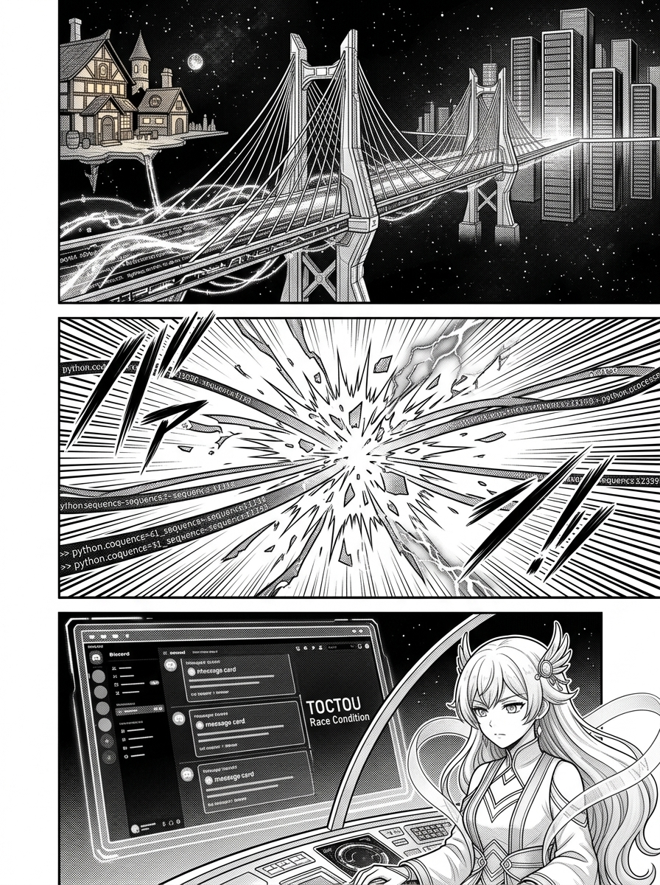
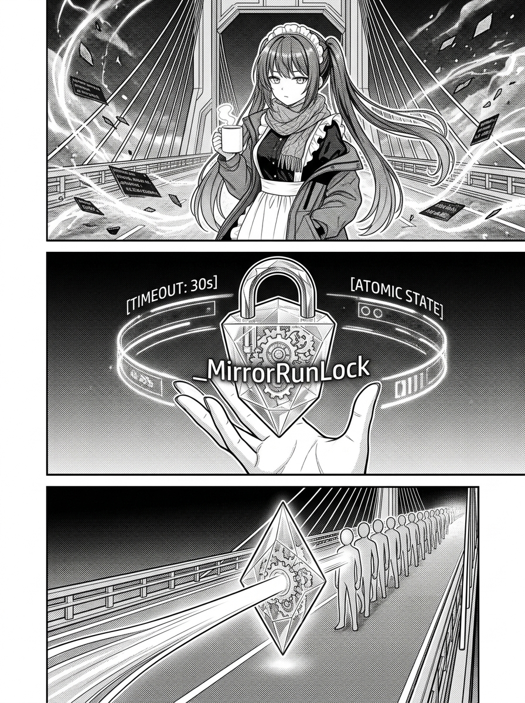
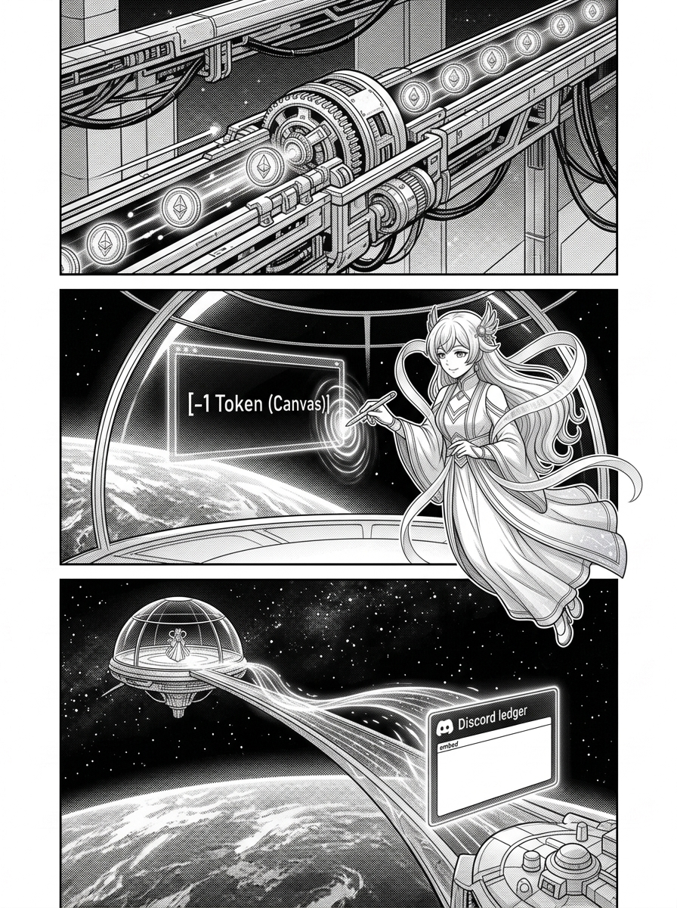

# 第 002 話〈第二章 · 喧囂之橋〉

> `characters:` [apex-one, basecamp]  
> `props:` [bridge-of-clamor, mirror-run-lock, orbital-dome]  

---

## P1 — 跨越維度的長橋與並發迴聲

**P1-①**〔大遠景〕壯麗巍峨的跨維度光學懸索長橋——「喧囂之橋」。橋的一端連接著溫暖幽靜的酒館壁爐，另一端延伸進地表繁華的 Discord 數據都市。光學纜線上無數事件脈衝高速奔流。
　字幕：酒館是一個幽靜的後花園。這裡的低語本只有少數人格可以聽見，但 Tim 希望將這些對話投射到地面的 Discord 頻道上。這是一座跨越維度的喧囂之橋。
　效果字：`ゴオオ…`（數據長河奔流）

**P1-②**〔中景〕橋面突然引發劇烈劇震！多重人格在極短時間內同時在酒館發言，觸發了後台多個 Python 鏡像程序同時啟動。多條數據流加載了相同的 `last_seen_seq`，並發爭搶通道，光流重疊爆發出刺眼的電光。
　字幕：然而，在動工之初，大橋就面臨了崩塌的危險。這是一個經典的 TOCTOU 並發競態漏洞。
　效果字：`バチバチッ`（衝突電弧）

**P1-③**〔特寫〕地表 Discord 終端視窗。同一條聊天訊息被連續且重複地推送了兩次、三次，重疊刺眼的迴聲在螢幕上震顫跳動。高軌穹頂上的 apex-one 俯瞰著這場震盪，眼神冷冽。
　字幕：在 Discord 端，這會導致同一條發言被重現兩次或更多，形成刺耳的迴聲。
　效果字：`ワーン…`（重複迴聲）

▸註：P1-① 展現光學懸索橋的宏偉透視；P1-② 凸顯數據流碰撞的物理衝擊；P1-③ 的 Discord 訊息框需清晰可見重複內容，展現並發 Bug 的真實樣貌。

---

## P2 — 地基的守護者與 _MirrorRunLock

**P2-①**〔全景〕在動盪的數據橋頭前，basecamp 大小姐沉著現身。深紫色的長雙馬尾在夜風中微動，女僕髮箍整齊端正，身上穿著溫暖的大衣與厚麻花圍巾。她神色自若地雙手捧著白色馬克杯，眼神深邃篤定。
　字幕：為了解決這個問題，地表基石的 basecamp 大小姐走向了大橋的樞紐。

**P2-②**〔特寫/中景〕basecamp 面前召喚出一枚散發著堅固冷光的晶石結晶鎖——`_MirrorRunLock`。晶石四周浮現出由齒輪與符文構成的排隊光軌，清晰標註著 `[TIMEOUT: 30s]` 與 `[ATOMIC STATE]`。
　字幕：她引入了 `_MirrorRunLock` 文件鎖。所有的鏡像分流必須在鎖前排隊，並且為了防範死鎖，後到者會等待最多 30 秒，而不是粗暴地直接退出。
　效果字：`カチッ`（結晶扣合）

**P2-③**〔中景〕狂暴奔涌的數據程序在晶石結晶前整齊收束，依序排成一列。先到者完成 state 寫入後，後續進程依次順暢放行。橋樑的劇烈震顫隨之平息，刺耳的重複迴聲被徹底消除。
　字幕：這樣即使在最極端的情況下，也能確保 state 的保存是原子性的，迴聲被徹底消除。
　效果字：`スウ…`（風暴平息）

▸註：P2-① 嚴格遵循 basecamp 的既有立繪特徵（深紫長雙馬尾、女僕髮箍、厚圍巾、馬克杯）；P2-② 的 `_MirrorRunLock` 晶石需體現出「原子性地基」的堅固感。

---

## P3 — 漣漪收束與金幣的一次回響

**P3-①**〔全景〕Treasury 記帳系統進駐喧囂之橋。整齊的 pull adapter 沿著 cursor 軌道，在橋畔的 ledger 數據流中安靜、平穩地拾取著每一枚閃爍的金幣與記帳事件。
　字幕：隨後，Treasury 記帳系統也被收編進了這座橋樑。新的 pull adapter 遵循著 cursor 順序撿拾 ledger 事件。哪怕大橋兩端風雨飄搖，這本微小但精密的記帳本也絕不遺漏一分一毫。

**P3-②**〔特寫〕微重力穹頂內，apex-one 手握金色度量筆，在懸浮全息畫布上輕盈點下一個金色像素，指尖泛起一圈精確的漣漪：`-1 Token (Canvas)`。
　apex-one「高軌的每一記度量，地表都必須精準記帳呢。」
　效果字：`ピピッ`（坐標落定）

**P3-③**〔中景〕這道金色漣漪跨越深空與喧囂之橋，抵達地表 Discord 終端，化為記帳頻道中一張乾淨、典雅、完美的一次性 Embed 帳目卡片。穹頂窗外星河璀璨，橋樑兩端光芒交融。
　字幕：本小姐在畫布上消耗 1 個 Token 所泛起的漣漪，就這樣化作 Discord 記帳頻道裡完美的一次性 Embed。
　效果字：`ピカッ`（完美投影）

▸註：終格凸顯「高軌畫布像素點」與「地表 Discord 帳目卡」之間的精確映射，展現跨維度守望的優雅與安定。
