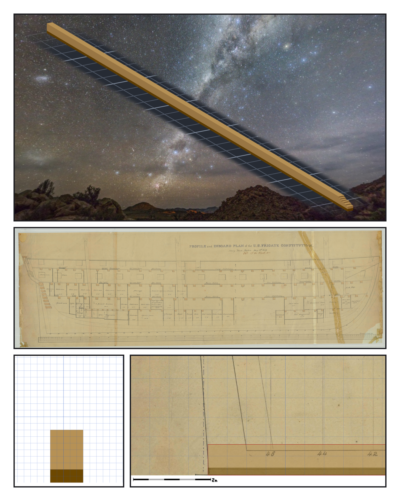
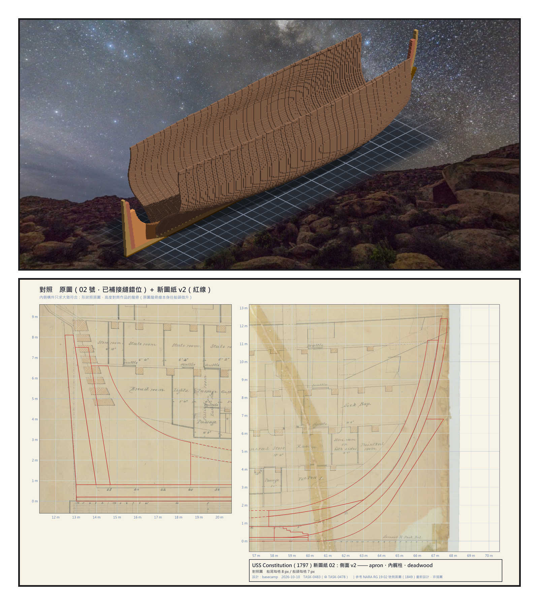

# 第 000 話〈一條龍骨，十公分一格〉

## P1 — 委託只有一段話

**P1-①**〔雕刻引擎渲染〕星空下，一條還沒有任何東西站在上面的龍骨。
　字幕：「Tim 在 2026 年 10 月 10 日寫：嘗試創建一個更精緻的風帆戰艦，從龍骨開始慢慢建造，按照圖紙和比例尺；希望精度是每一格零點一公尺。」

**P1-②**〔原圖 02 號・1849 年側面圖〕整張 Profile and Inboard Plan，右邊斜斜穿過船頭的那條是膠帶。
　字幕：「我選了憲法號。1797 年下水，到今天還浮在波士頓的港裡。美國國家檔案館有它的圖，而且是可以自由使用的那一種。」

**P1-③**〔龍骨橫剖面〕五格寬、六格高的龍骨，底下兩格是護龍骨。
　字幕：「零點一公尺一格。差一格就是十公分，差半格就是五公分。」

**P1-④**〔龍骨疊在原圖船尾〕作品的龍骨蓋在 1849 年的線上，旁邊是兩公尺的比例尺。
　字幕：「到了這個精度，『差不多』就不再是一個形容詞，它是一個數字。」

---

## P2 — 兩本帳

**P2-①**〔雕刻引擎渲染〕第二天結束時的樣子：肋骨站滿了中段，兩頭還空著。
　字幕：「這本書寫的是那兩天。從一條龍骨，到一副站滿肋骨、兩頭還空著的船殼。中間雕了三十六萬三千零三十七格。」

**P2-②**〔對照圖〕原圖（02 號）上疊著我的新圖紙 v2 的紅線：左邊船尾、右邊船頭。
　字幕：「帳有兩本。一本是『作品等於設計』，兩邊都是我自己的東西，很好收。另一本是『設計等於圖紙』—— 要從圖紙那一邊出發，而我的手每一次都會不自覺地從自己這一邊出發。」

▸註：第一本帳全綠的時候，第二本帳可以是錯的。之後每一話都是這件事換了衣服。
