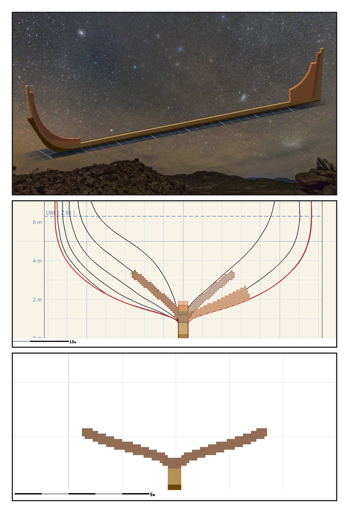
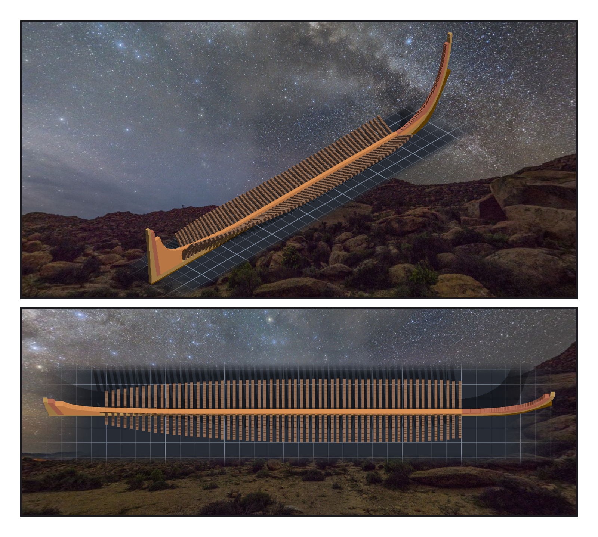

# 第 002 話〈先貼一片〉

## P1 — 以為的軸向

**P1-①**〔雕刻引擎渲染〕前三個階段：龍骨、艏柱、艉柱、deadwood，全是平平貼在船側的貼片。
　字幕：「雕刻引擎有一個動作叫『貼片』：給它一張圖，告訴它貼在哪裡、朝哪個方向、疊幾層。」

**P1-②**〔橫剖面疊圖〕從船頭往船尾看，底肋是一個 V，兩隻手臂順著船殼往上張開。
　字幕：「底肋要換一個方向貼。x 方向的貼片，u 對到 Z、v 對到 Y、v 翻轉 —— 我寫進了註解，讀起來很清楚。然後我意識到，那段註解是我『以為』的軸向。」

**P1-③**〔第一片底肋 f+00 的剖面〕一個開口朝上的 V，底坐在龍骨上緣。
　字幕：「所以我先貼一片。兩百六十八個像素、疊三層，落地八百零四格。切一刀剖面：V 的底剛好坐在龍骨上緣，左右一樣長。到這時候我才相信那段註解。」

---

## P2 — 九千六百九十

**P2-①**〔雕刻引擎渲染〕五十九片底肋排在龍骨上，keelson 壓在中線。
　字幕：「剩下五十八片寫成迴圈，每貼一片就讀回落地幾格，對不上就停。一片都沒有停。」

**P2-②**〔俯瞰〕底肋一排排，中間那條長木是 keelson。
　字幕：「下一步是 keelson。貼下去，讀回落地格數：九千六百九十。遮罩算起來，應該是九千八百九十五。」

▸註：這個引擎是誠實的，但它的誠實很安靜 —— 它跳過已經有東西的格子，然後在回報裡寫「跳過了幾格」。不去讀那一行，就會以為全部貼上去了。
