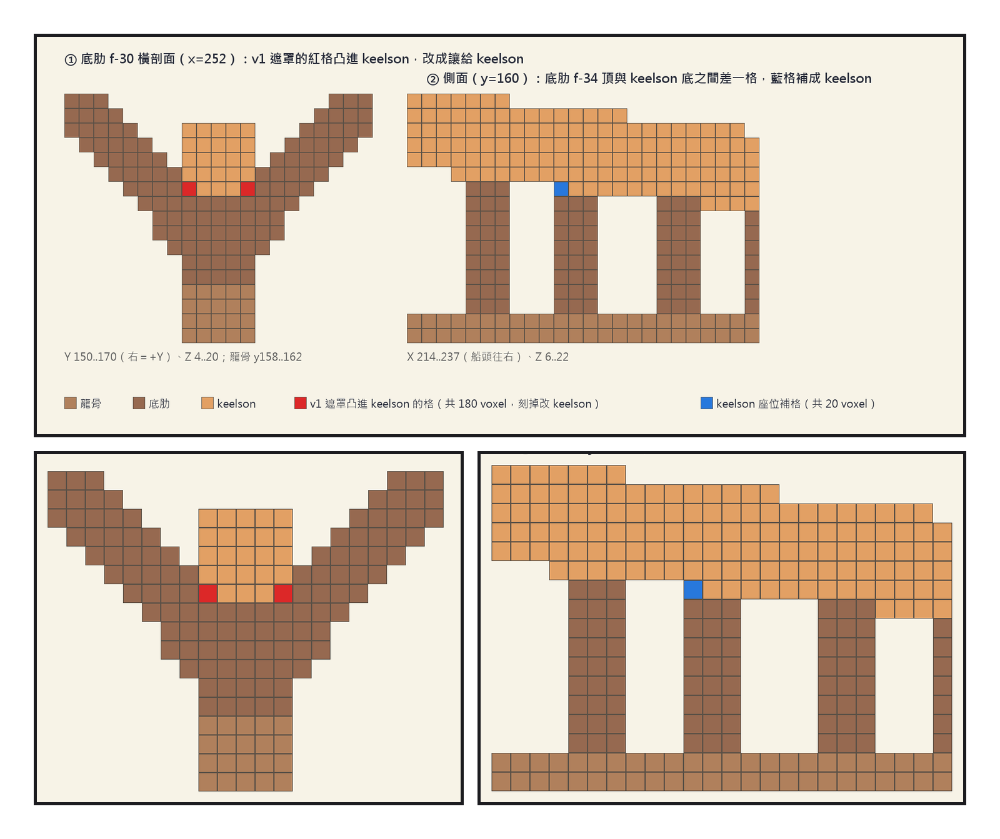
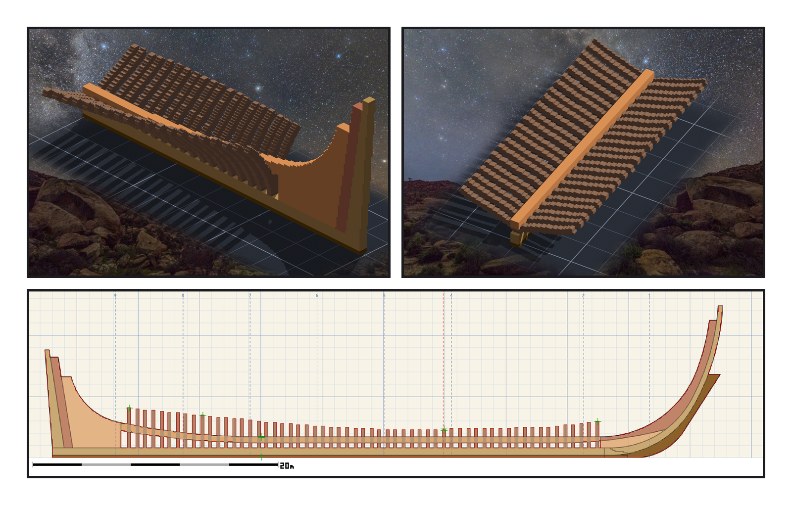

# 第 003 話〈少了兩百零五格〉

## P1 — 兩條規則從來沒有見過面

**P1-①**〔修正示意圖〕左：底肋 f−30 的橫剖面；右：中線的側面。
　字幕：「差了兩百零五格。引擎沒有報錯 —— 它照規矩不蓋掉別人，於是那兩百零五格就沒有放上去。」

**P1-②**〔左圖放大〕紅格是底肋凸進 keelson 的那幾格。
　字幕：「第一條規則：離船殼三點六格以內都算底肋。第二條規則：cutting-down line 往上到 keelson 頂都是 keelson。船尾的船底是一個 V，V 的底部那幾格，兩條規則都說是自己的。先貼的人贏了。」

**P1-③**〔右圖放大〕藍格是 keelson 跟底肋之間空出來的那一格。
　字幕：「方向反過來的也有：二十格，兩條規則都沒有拿。設計裡那裡本來就是空的，作品也是空的 —— 帳看不到。」

---

## P2 — 讓了會留洞

**P2-①**〔雕刻引擎渲染・船尾〕底肋與 keelson 在船尾那一段。
　字幕：「把要刻的格子拆成五十八個小盒子，每一個都事先驗過裡面只有要讓出去的格。刻掉一百八十，重貼 keelson，補回一百八十。」

**P2-②**〔雕刻引擎渲染・船中〕keelson 坐在底肋上，沒有縫。
　字幕：「還剩二十五格沒有讓 —— 它們在邊界上，讓了會留洞。不是每一個不一致都要消滅。」

**P2-③**〔側面疊新圖紙〕五十九片底肋與 keelson 對著新圖紙 03。
　字幕：「十萬零兩百一十三對十萬零兩百一十三。洞零。每一層都說真話，數字還是會少。」
