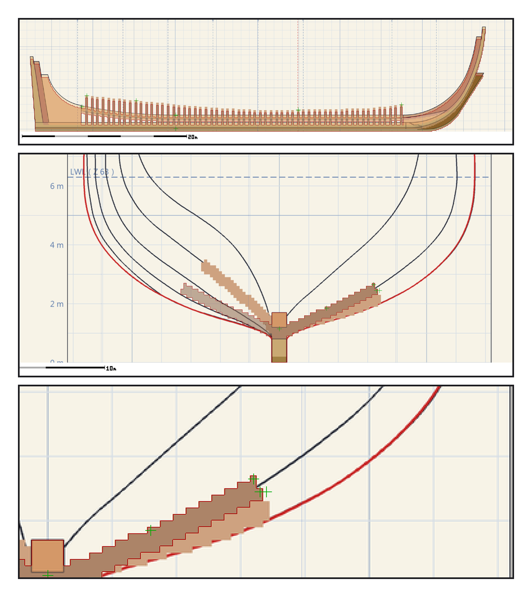
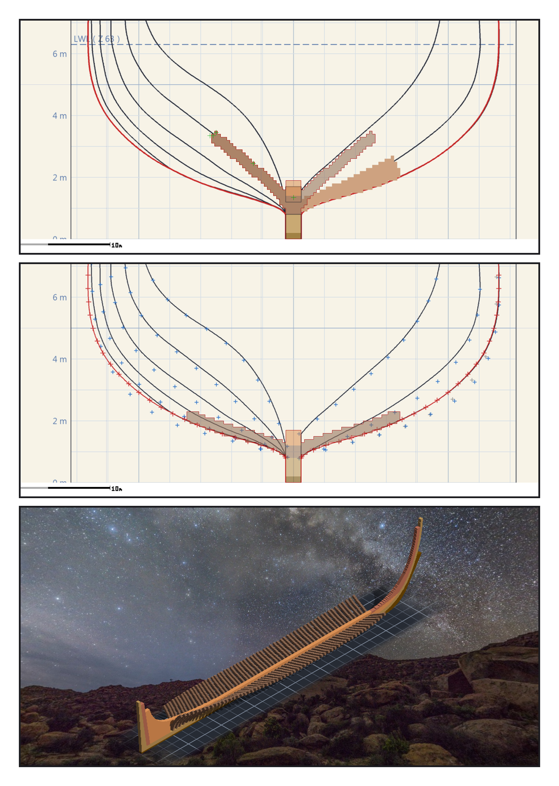

# 第 004 話〈假證人〉

## P1 — 我自己有沒有我自己

**P1-①**〔側面疊圖・錨點故意偏三格〕
　字幕：「把錨點故意偏三格，四根底肋頭的探針報三。偏三報三，那是尺會說話的意思。報零的尺是瞎的，報三的尺是醒的。」

**P1-②**〔橫剖面疊圖 f+15〕探針四根全是零。
　字幕：「橫剖面那張也報零。然後我打開那張疊圖，用眼睛看。」

**P1-③**〔右半邊放大〕圖上的淺色帶子，比作品的深色帶子低了一兩格。
　字幕：「那四個探針點，是我從底肋的遮罩上挑的。它問的是『我自己有沒有我自己』，而答案永遠是有。它是我造的證人，所以它永遠同意我 —— 而那不是證據。」

---

## P2 — 從被量的那一邊取點

**P2-①**〔橫剖面疊圖 f−30〕這一次從圖紙的像素出發。
　字幕：「左半邊 f−30：圖上一百一十四格，作品一百一十四格。右半邊多出來的一圈，是圖說漏寫的那一片 f+00 —— 算進去，一百七十八格，多零格、少零格。」

**P2-②**〔船中 f+00 對 1928 年 15 號圖〕藍十字是原圖的讀數。
　字幕：「這一次證人是真的從外面來的：落在底肋範圍內的十八個點，最遠零點七三格，七公分。」

**P2-③**〔雕刻引擎渲染〕
　字幕：「四個 verifier 裡，量幾何的那一位說：五十九片底肋的中心，平均往船頭偏了零點四九格 —— 作品跟圖紙一起偏，所以疊圖永遠對得上。Tim 說：以美觀優先，不追求完全復刻。偏得一致的船，比一半準、一半偏的船好看。」
