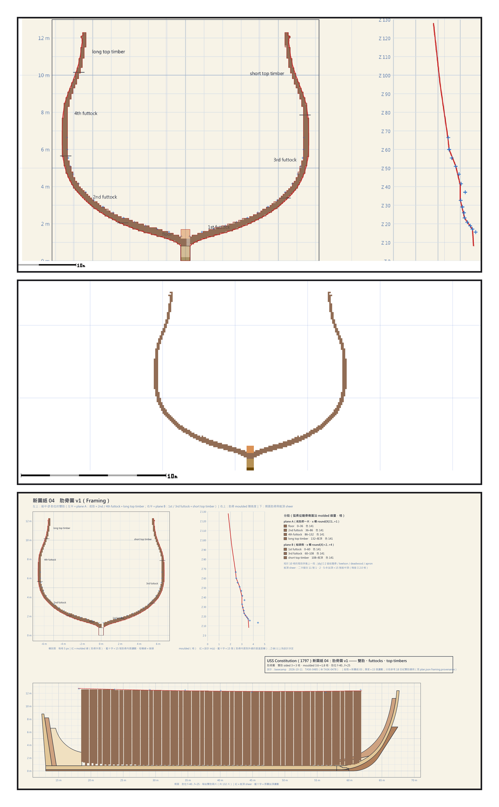
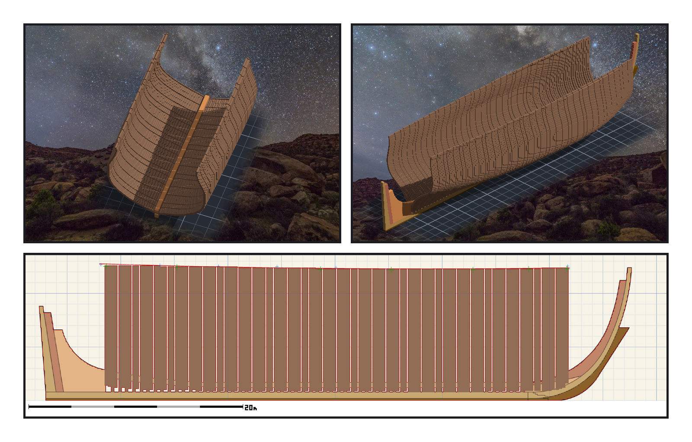

# 第 005 話〈看不見的房間〉

## P1 — 圖上沒畫的肋骨

**P1-①**〔新圖紙 04・船中橫剖面〕左半 floor、2nd futtock、4th futtock、long top timber；右半 1st、3rd futtock、short top timber。
　字幕：「一根真正的肋骨，是好幾段木頭接起來的，而且兩根並排。這些事，四張原圖幾乎都沒有畫。」

**P1-②**〔第一片肋骨 f+00 的剖面〕一個完整、對稱、開口朝上的 U。
　字幕：「先貼船中那一片，切剖面看。然後迴圈貼完，每一片讀回，一片都沒停。」

**P1-③**〔新圖紙 04・肋骨圖 v1〕
　字幕：「Tim 說：圖紙缺的部分，可以參考其他風帆戰艦，由我設計來補上；以美觀優先。每一段多長，是我決定的。」

---

## P2 — 五個房間

**P2-①**〔雕刻引擎渲染・船內〕
　字幕：「整艘船裡有五個房間，每間六十格。下面是龍骨，上面是 keelson，前後是兩片底肋，左右是肋骨的根。從任何一個角度都看不到它們 —— 這張圖裡也看不到。」

**P2-②**〔雕刻引擎渲染〕一百三十二片，全部同一個顏色。
　字幕：「Tim 說：木紋可以不處理，同色可以合併。看不見的房間，會讓匯出的檔案多一層朝內的面。我把它們填滿，叫 chock。」

**P2-③**〔側面疊新圖紙 04〕
　字幕：「帳對得上，只證明作品跟設計一樣。設計自己哪裡少了一排、哪裡封死了一個房間，要一個不從設計出發的人，才看得到。」
