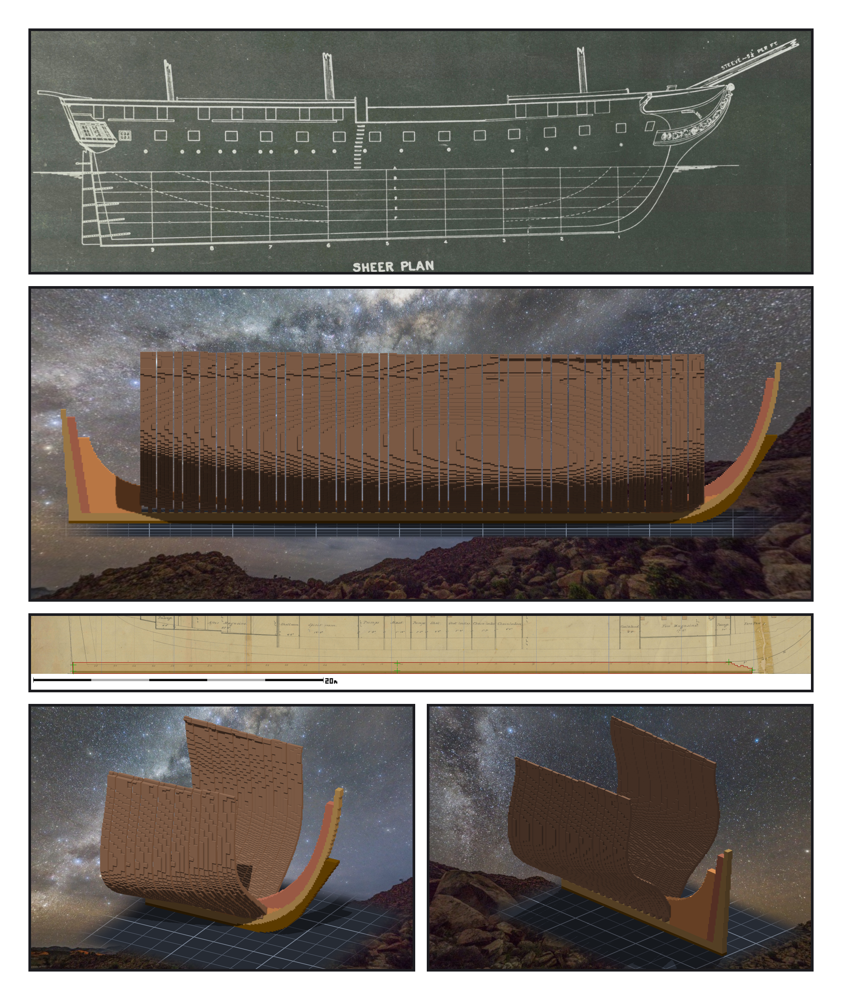

# 第 006 話〈龍骨是直的〉

## P1 — 斜的是水

**P1-①**〔原圖 11 號・1927 年 Sheer Plan〕水線一條條平行，龍骨往船尾斜下去。
　字幕：「讀 11 號圖的時候，量到這艘船的龍骨跟吃水線不平行。船尾比船頭深大約二點七英尺。這叫 keel drag。」

**P1-②**〔雕刻引擎渲染・正側面〕
　字幕：「Tim 說：由妳決定。我去量，量完才發現問題問錯了：龍骨本來就是直的。斜的不是龍骨，是水，自己斜了零點八五度。」

**P1-③**〔龍骨疊在原圖上〕一條直線。
　字幕：「基準要是直的，量測才有意思。量到一個斜的東西時，先問斜的是誰。」

**P1-④⑤**〔雕刻引擎渲染・船頭／船尾〕肋骨站滿中段，兩頭還空著。
　字幕：「龍骨是直的。水會斜。圖紙會被膠帶接過。我會從自己這一邊伸出探針。那就再叫一個人，從另一邊伸過來。」

▸註：原書這一章還寫了「以水線為基準的高度，都從側面圖相對龍骨量」—— 那是錯的（側面圖畫了 drag、橫剖面沒有）。更正在後記。
