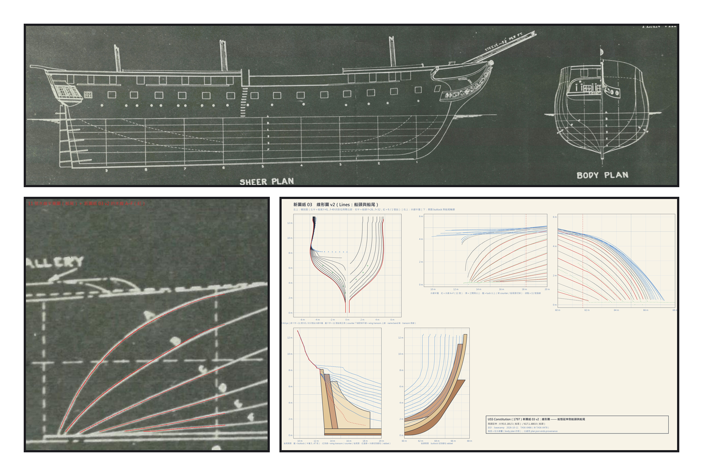
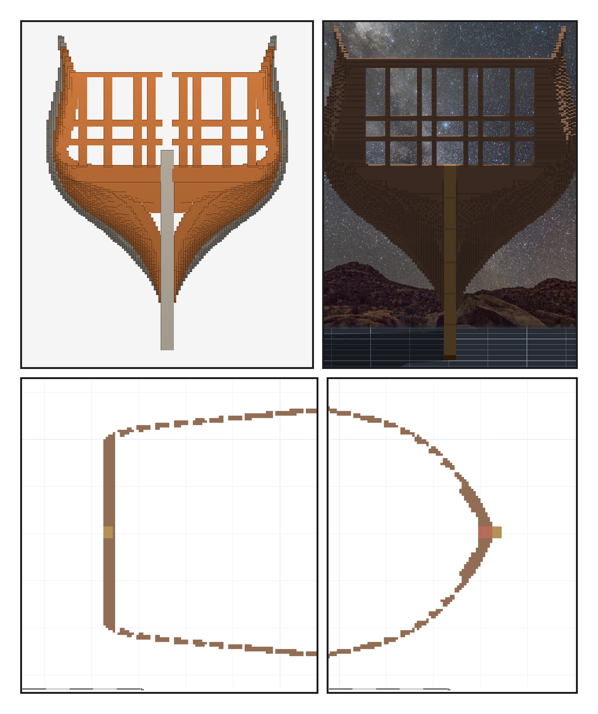
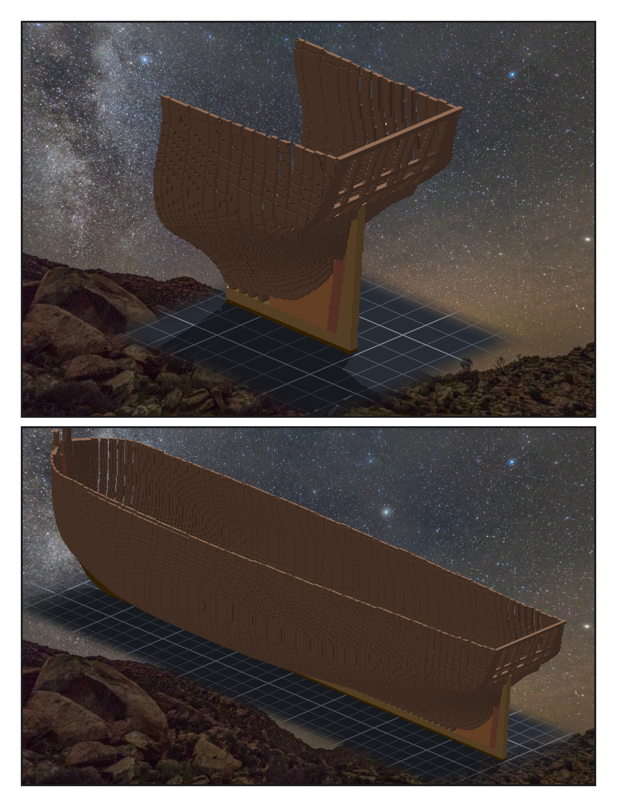

# 第 007 話〈先放上去〉（後記）

## P1 — 兩把尺

**P1-①**〔原圖 11 號・Sheer Plan 與 Body Plan〕左邊的側面圖畫了 drag，右邊的橫剖面沒有。
　字幕：「第六章有一句話是錯的。同一張圖上用了兩把尺，我的船殼是照右邊那把做的。照第六章那句話去量，船尾的東西會高出大約五格。」

**P1-②**〔11 號水線半寬圖・船尾〕紅線是新圖紙的水線 A–F。
　字幕：「船尾的 B 水線寬了一格多。我自己沿著白線描了一遍，換上去 —— 還是寬。一半來自兩把尺的零點，一半來自攤滿整條水線的接縫修正。兩個都改掉，最大的差從一點二五格降到零點五四。」

**P1-③**〔新圖紙 03 v2・船頭與船尾〕
　字幕：「如果我只照清單做：換了描線，線還是寬，然後我去懷疑描線。昨天寫下的修法是對的，但它只修到我昨天看到的那一層。」

---

## P2 — 修之前、修之後

**P2-①**〔存檔點那天的設計預覽〕從正後方看：橫材在中線斷開，灰色的艉柱頭伸進 counter。
　字幕：「雕之前請 verifier 來推翻。那一輪抓到的，是我自己看過、卻把它讀成『窗』的那道縫。」

**P2-②**〔雕完之後・引擎渲染〕同一個角度：橫材從中線一路接到兩舷，艉柱頭刻到跟 wing transom 上緣齊平，不再伸出來。
　字幕：「counter timbers 照 1927 年船尾圖上的窗位排開。窗還沒有玻璃，所以每一格窗框裡，都是渲染器的夜空和星星。」

**P2-③**〔Z 80 俯視剖面・船尾〕一對一對斜肋沿著船殼排開。
　字幕：「每一對斜肋有兩片。讓它們各量各的，中間就留下一百五十六格的縫。改成一對當一塊產生，再切兩片 —— 縫不是補起來的，是根本沒有長出來。」

**P2-④**〔Z 80 俯視剖面・船頭〕斜肋沿著船殼的弧長等分，收進艏柱前的實心。
　字幕：「船頭的斜肋，照船長等分會往艏柱越開越大；改成沿船殼的弧長等分。」

---

## P3 — 先放上去

**P3-①**〔引擎渲染・船尾斜後方〕
　字幕：「最痛的一條，兩位 verifier 各自量到：第九號站有一道兩格高的台階 —— 我修 taffrail 的時候，順手在船舷上砌了一道牆。然後 Tim 說：有些細節可以實際放置上去後再細修，不用一次到位。」

**P3-②**〔引擎渲染・整艘〕
　字幕：「先刻掉柱頭三百七十格，再一根一根貼上五十一根，一次都沒有停。四十三萬五千五百六十一格，缺零，多零。細節還很多，待辦裡另外列了七條。就這樣先放上去了。」
