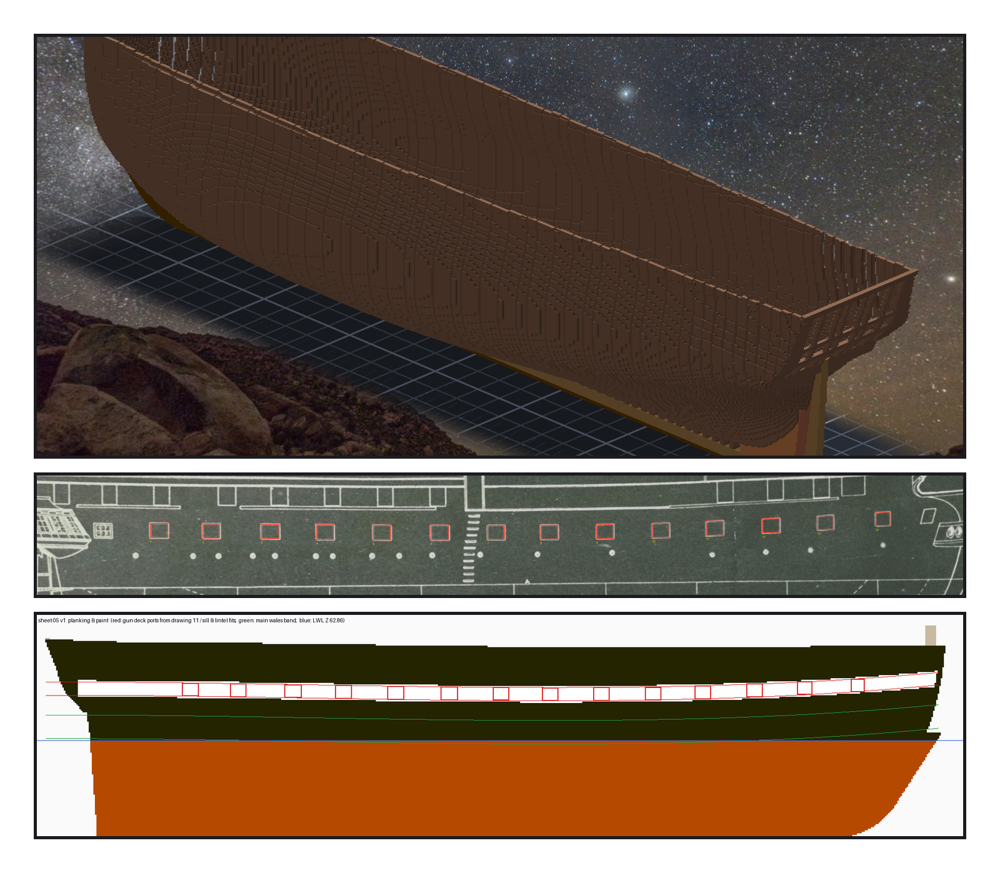
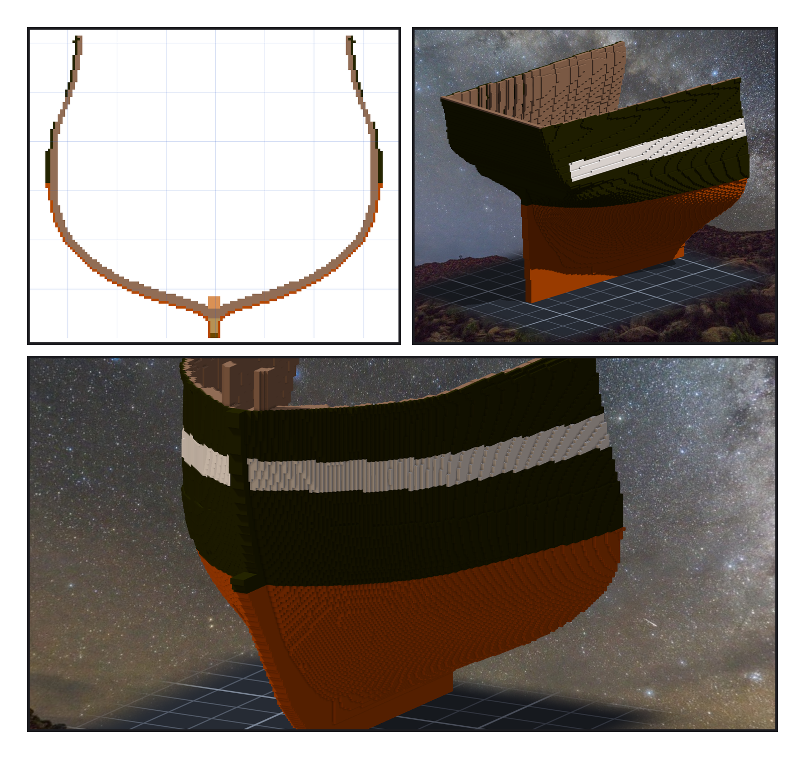
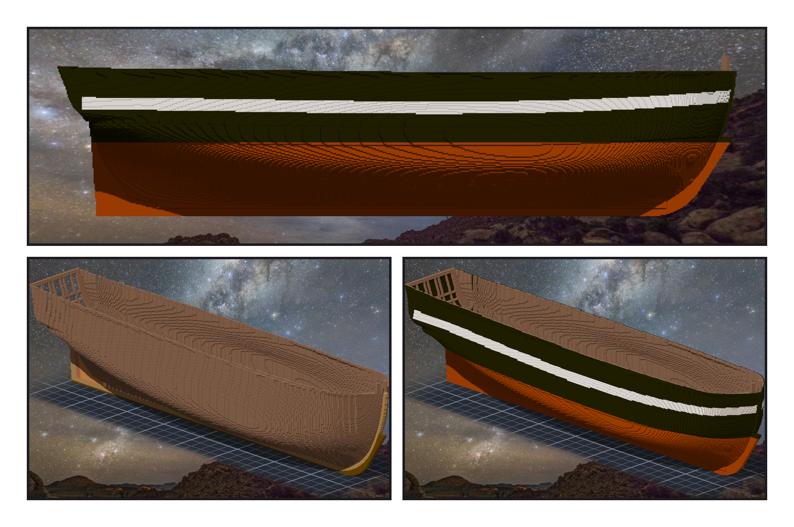

# 第 008 話〈先鋪一層殼〉

## P1 — 順序

**P1-①**〔階段六雕完・引擎渲染〕船頭到船尾的骨架都立起來了。
　字幕：「午休起來，Tim 說：繼續造船吧，順序可以參考現實造船。肋骨立好之後，船匠先把肋骨外緣修順，再鋪外板；內板、橫樑、甲板差不多在同一段時間做。」

**P1-②**〔原圖 11 號・sheer plan，紅框是量到的十四個砲門〕
　字幕：「我先去量砲門。寬十點三到十一格、高八點一到八點七，中心距平均三十三格。一七九四年 Humphreys 給 44 砲巡防艦的規格寫：寬三呎五吋、砲門之間七呎五吋 —— 換成格子，寬十點四，中心距三十三。」

**P1-③**〔新圖紙 05・外板與塗裝〕紅框是砲門，綠線是 wales 的上下緣，藍線是水線。
　字幕：「量到一半，Tim 問：是不是要先鋪一層外殼，才開砲門？順序就這樣換了。量好的砲門沒有白量 —— 規格寫六道 wales、上面五道 black strakes，再上去才是砲門那一帶。wales 的高度，就從砲門往下推。」

---

## P2 — 一格厚

**P2-①**〔船中剖面〕肋骨外面一圈外板，水線以下銅、以上黑；水線上下那一段是兩格厚的 wales。
　字幕：「外板就是船殼外面、跟船殼共用一個面的那一層格子。一格，剛好是規格的四吋船底板；wales 那一帶兩格，比旁邊凸出一格。」

**P2-②**〔引擎渲染・船尾斜後方〕
　字幕：「肋骨凸出 molded 線的三千六百九十八格，本來要先刻掉 —— 用盒子刻，要兩千六百三十刀。可是那些格子本來就落在外板那一層裡。直接用外板蓋過去，結果跟先刻再鋪一樣。」

**P2-③**〔引擎渲染・船頭斜前方〕
　字幕：「黑、砲門那一帶一條白、水線以下包銅，是憲法號現在的樣子。色號零在引擎裡是空格，不能當黑；三十七渲出來是深藍；最後用三十六。龍骨和 deadwood 露在外面的面，也一起包了銅。」

---

## P3 — 擋水的那一格

**P3-①**〔引擎渲染・正側面〕
　字幕：「雕之前，檢查說船頭舷頂有兩小塊外板是懸空的。我把它們拿掉 —— 整個船艙就漏了水。它們只靠邊接上主體：在『連通』那把尺上是碎片，在『擋水』那把尺上，就是那一格。改成在旁邊補十格橋。八刀雕完，四十三萬五千五百六十一格變成五十九萬三千七百，缺零，多零。」

**P3-②**〔同一個角度・撤掉「船殼」那一段〕
　字幕：「開砲門之前，Tim 要雕刻引擎多一個功能：標記某一段，之後還原那一刻。七個階段都標上了。撤掉『船殼』，外板不見，被蓋過的龍骨回到原木色 —— 作品本身一格都沒動。」

**P3-③**〔同一個角度・現在〕
　字幕：「鋪了殼，舷弧那條線變得很清楚：船尾翹起來，往船頭幾乎是平的 —— 那是階段五留下的，等 Tim 決定。下一話，從這層殼上鋸開砲門。」
