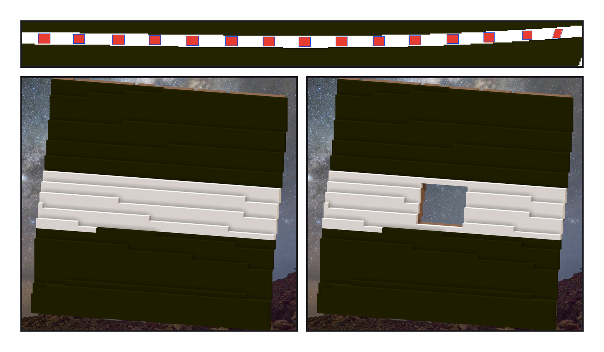
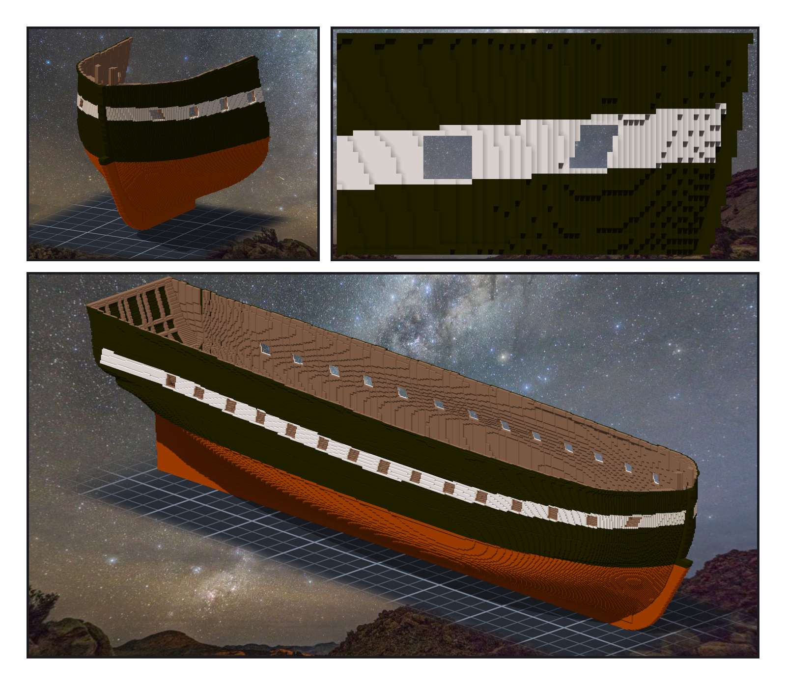

# 第 009 話〈從殼上鋸開〉

## P1 — 鋸之前、鋸之後

**P1-①**〔新圖紙 06〕紅色是要刻掉的格，藍框是 11 號原圖上的砲門。最右邊那個是平行四邊形。
　字幕：「開口的規則很簡單：格中心落在圖上框裡的格子。麻煩的是刻什麼 —— 開口裡全是同一個木頭色，分不出哪一格是肋骨、哪一格是 hawse piece。只好照清單，一格一格標身分。」

**P1-②**〔同一個角度・開砲門之前〕
　字幕：「動刀之前，Tim 問：雕刻引擎能不能標記某一段，之後還原那一刻？事件本來就一刀一刀記著，只差一個名字。標記叫『砲門:begin』—— 這張就是用它叫回來的。」

**P1-③**〔同一個角度・現在〕
　字幕：「四十四刀，每一刀少掉幾格都等於事先算好的數；再一刀補上四百一十六格的框，把肋骨之間的縫填掉。本來說好上下各留一格白帶 —— 第四個砲門的上面被開口吃掉了，是雕完派去的 verifier 抓到的。補了三十六格的漆。」

---

## P2 — 每舷十五個

**P2-①**〔引擎渲染・船頭斜前方〕
　字幕：「自己寫的檢查裡有一格叫『透光』。寫完回讀才發現，它查的是刻掉的格是不是空的 —— 那不可能紅。改成掃開口裡還剩下什麼，再拿同一把尺掃上緣往上一列：掃到六十八格。它會叫，才算數。」

**P2-②**〔船頭那個砲門・正側面〕
　字幕：「船頭那一個，在轉得很急的船殼上是一列一列往前錯開的平行四邊形，斜著看有鋸齒。Tim 自己檢查過砲門，說：沒問題的。」

**P2-③**〔引擎渲染・整艘〕
　字幕：「五十九萬三千七百格，開完砲門、補完漆，變成五十八萬六千二百。從另一舷的砲門看出去，是星星。下一段，是船艙裡的甲板。」
