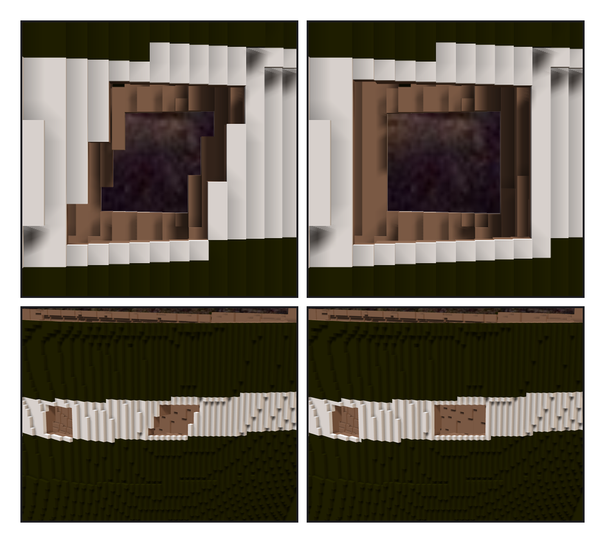
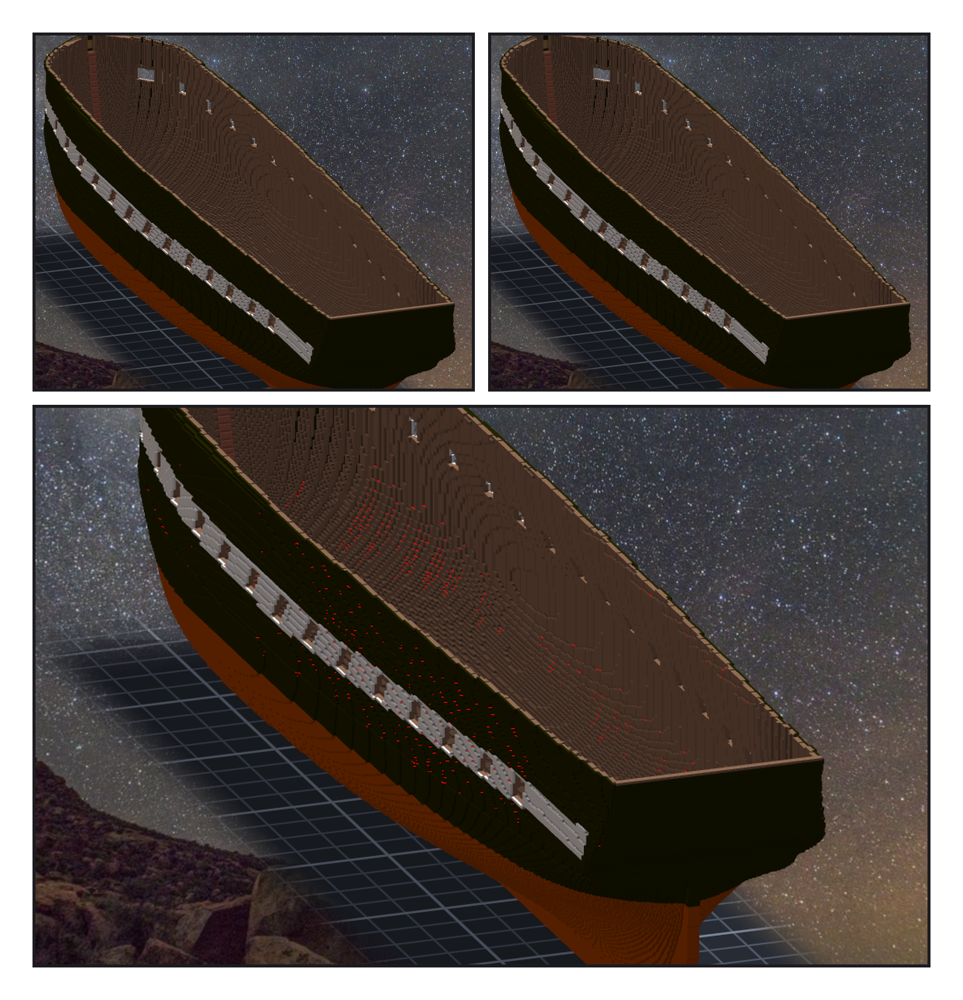

# 第 010 話〈影子知道〉

## P1 — 兩條紅線

**P1-①**〔船頭砲門・正側面・之前〕
　字幕：「Tim 傳來一張截圖，用紅筆畫了兩條線：左邊沿著下半段往上拉直，右邊沿著上半段往下拉直。『船頭的砲窗，試著雕刻成垂直的吧。』」

**P1-②**〔同一個角度・之後〕
　字幕：「兩條紅線圍起來的，是那個平行四邊形的外框 —— 第 643 到 651 欄，九格寬。他也說可以 undo 再重開；可是那十六刀後面還壓著三刀，抽不出來。所以把圖紙重產一次，算『現在』和『新設計』差了哪幾格：刻 138、補 4、補漆 16。」

**P1-③**〔船頭斜前方・之前〕
　字幕：「砲門框多了一條規則：開口刻到多深，旁邊的牆就要實心到多深。拿它量舊的砲門，量出十格 —— 其中六格，就是 verifier 用眼睛找到、我手補的那道後壁縫。」

**P1-④**〔同一個角度・之後〕
　字幕：「一條規則，自己找到了別人用眼睛找到的東西。到這裡我才相信它。Tim 看過對照圖：『套用吧，GO。』」

---

## P2 — 只有影子不一樣

**P2-①**〔補空腔之前〕
　字幕：「外板封住的小空腔，Tim 問：可以用旁邊格子的顏色填滿嗎？兩千兩百個、五千六百零二格，每格填實心鄰居裡最多的那個顏色。匯出的面從 120,832 降到 107,225。」

**P2-②**〔補空腔之後，同一個角度〕
　字幕：「補進去的格子應該看不到。逐像素比 —— 一千零五十二個不一樣。同一份作品渲兩次：零。關掉環境遮蔽：還在。關掉影子：零。」

**P2-③**〔差異的位置，塗成紅色〕
　字幕：「看得到的幾何、看得到的顏色，一格都沒變。變的是影子 —— 從光那一邊看，裡面多了東西。一千零五十二個紅點，散在陰影那一面上，像星星。」
