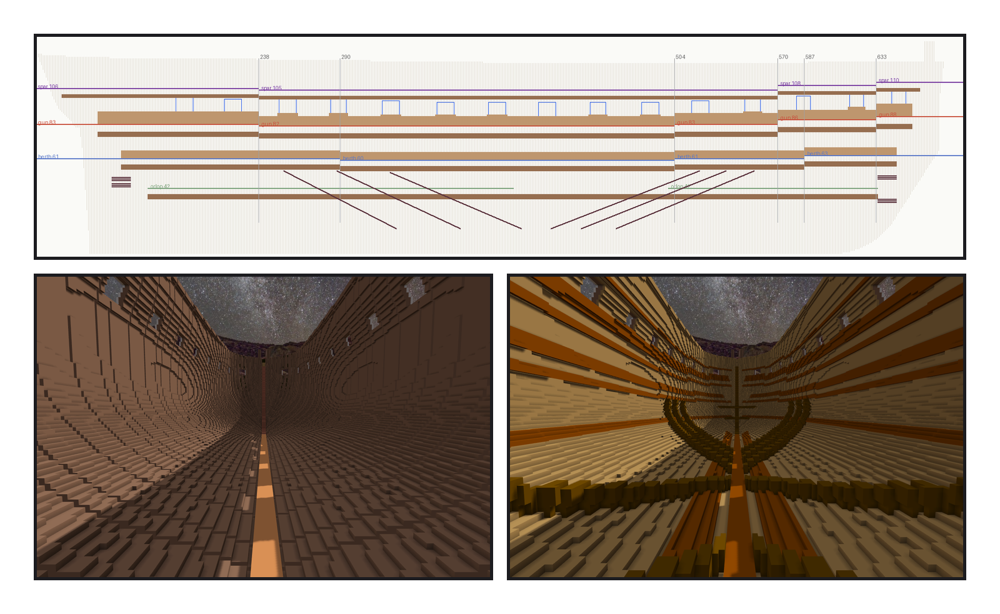
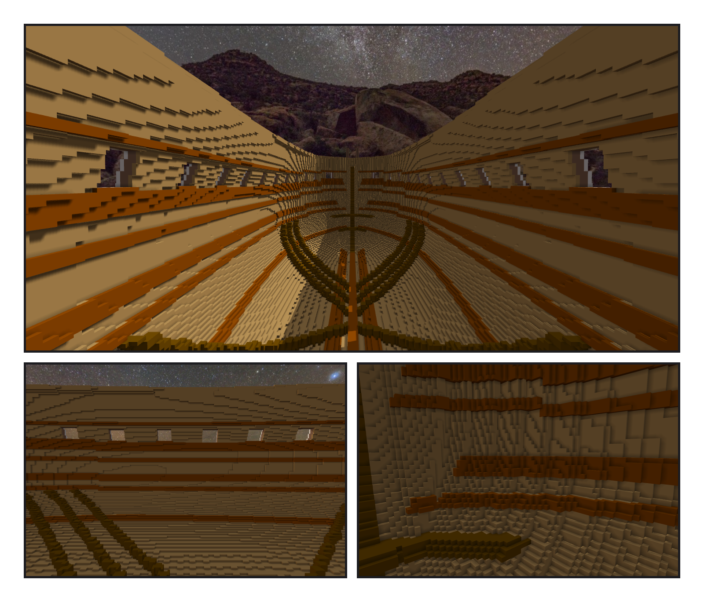
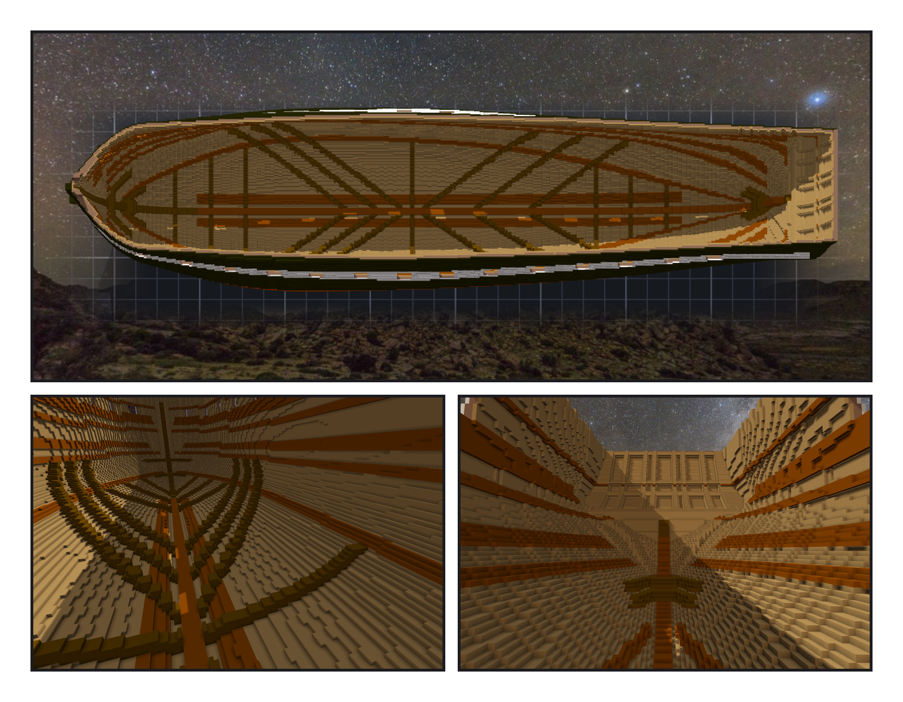

# 第 011 話〈從裡面看〉

## P1 — 一把數漆的尺

**P1-①**〔新圖紙 07・右舷內側立面〕紅、藍、紫、綠線是四層甲板的面，深色帶子是 clamps，淺色是 spirketting，藍框是砲門，斜線是斜肋，灰色直線是艙壁。
　字幕：「Tim 說：從裡面看，看得到外殼的漆，實際上應該是別的結構吧？甲板希望大致平整。—— 每層甲板拆成幾段平的，高低差只放在艙壁上：艦長室的前艙壁、前艙口、前桅後、manger。」

**P1-②**〔底艙往船頭看・之前〕
　字幕：「動手之前先做一把尺：從艙裡的空氣出發，數它碰到幾面外板的漆。兩萬四千三百六十面。做完，要是零。」

**P1-③**〔同一個角度・之後〕
　字幕：「內板就是『艙內空氣碰到船殼的那一層』，一格。史料上，憲法號的艙內刷白灰水；Tim 說原木色好看 —— 美觀優先，史料寫進出處欄。內板米棕、構件栗棕、斜肋深棕，三次配色才定下來。」

---

## P2 — 請人來挑

**P2-①**〔gun deck 的高度・往船頭看〕
　字幕：「spirketting 一路鋪到砲門下緣，clamps 釘在將來的橫樑底下。每個砲門下緣離甲板六到九格 —— 一八三三年以前，憲法號的砲門下緣本來就不齊。」

**P2-②**〔船中・右舷內壁〕
　字幕：「請了三位來挑。我在出處欄寫了『斜肋的頭在第八、六、四根橫樑，USNI』—— 那是搜尋工具給的一段摘要，原文我沒讀過。拿掉，照實寫『轉述』。」

**P2-③**〔船頭・內壁近看〕
　字幕：「clamps 在船頭碎成了一塊一塊的磚：我的『往內一格』只沿著左右找。改成沿著船殼的法向，兩百四十塊變成七塊。」

---

## P3 — 肋骨為什麼是斜的

**P3-①**〔俯瞰・加了橫向 rider 之後〕
　字幕：「Tim 從上往下看，圈了兩處：一般船內部的骨架，應該垂直於龍骨吧？—— 是。肋骨也是垂直的，在內板後面。他圈的是斜肋，Humphreys 規格裡每舷六根，把船頭船尾的重量送到船中的龍骨。『維持斜肋吧。』過了一下：『再加幾根橫向吧。』」

**P3-②**〔主艙口底下・往船頭看〕
　字幕：「每四個肋位一根，挑不會跟斜肋交叉的站位：每舷七根。從艙裡看得到的外板漆 —— 零面。把內板拿掉再數：五千三百二十二面。那把尺是會叫的。」

**P3-③**〔船尾・往裡看〕
　字幕：「寫筆記時回讀，我跟 Tim 說評審是十一、七、二 —— 重數一次是八、九、三。修了哪幾條沒錯，錯的是那三個數字：它們是從記憶那一邊看的。下一段，是甲板。」
