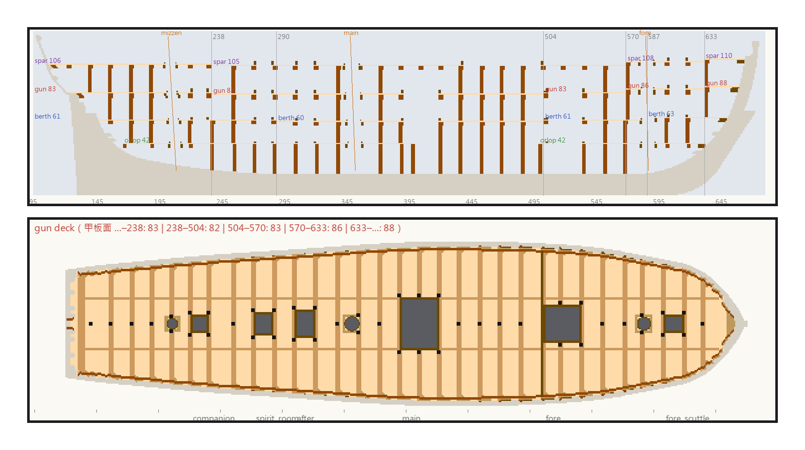
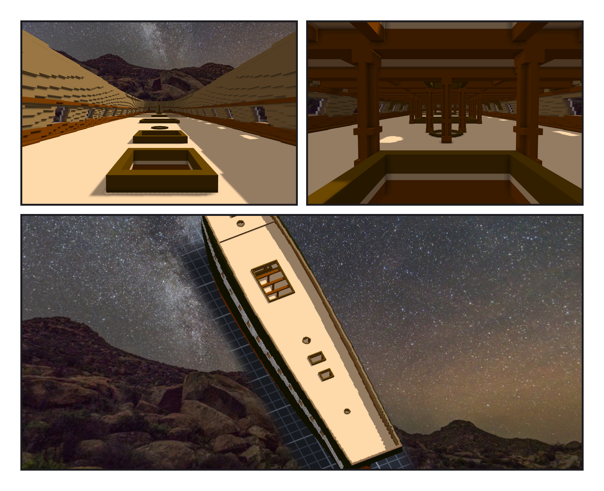

# 第 012 話〈照砲門排橫樑〉

## P1 — 一句話，四道接縫

**P1-①**〔新圖紙 08・中線縱剖面〕淡色的線是四層甲板的板，深色的小方塊是橫樑的斷面，直的棕條是柱子，斜的細線是三根桅的軸，灰色直線是甲板的接縫。
　字幕：「02 號圖把每一根橫樑畫成一個橘色的小方塊。我寫了一支程式去找，找到一半，Tim 說：參考就好，主要由妳設計。—— Humphreys 一七九四年寫：每個砲門底下一根，兩個砲門之間一根。我照這一句排。」

**P1-②**〔新圖紙 08・gun deck 平面（從上往下看）〕淡色是甲板板，透出來的深一點的條紋是板下的橫樑和 carlings，深灰是艙口，圓的是桅孔，黑點是站在這一層上的柱子。
　字幕：「上一階段定甲板高度時挑的四道接縫 —— 二三八、五〇四、五七〇、六三三 —— 剛好都是『兩個砲門之間』那一根。每一道台階底下，本來就有一根橫樑。carlings 照 15 號圖的一行小字：離中線六英尺十吋。」

---

## P2 — 柱子算在它撐住的那一層

**P2-①**〔gun deck・拿掉 spar deck 往船頭看〕
　字幕：「上下對齊的艙口，會讓柱子沒有地方站：spar deck 底下有十八根放不下。改成中線放不下，就往外找，放一對。—— 柱子算在它撐住的那一層，所以拿掉 spar deck，柱子也一起拿掉了。」

**P2-②**〔同一個位置・放回 spar deck〕
　字幕：「頭上一排一排的橫樑，橫樑底下站著車削的柱子。前面是艙口的圍板，再過去是主桅的桅座。」

**P2-③**〔組裝件・俯瞰〕
　字幕：「Tim：可以開一個作品來組裝憲法號，目前的作品就當船殼。組裝件一格都不雕，只有關聯。一百二十二萬六千零三十七格 —— 船殼加四層甲板，重疊的格，零。他看了說：測試 OK。」
