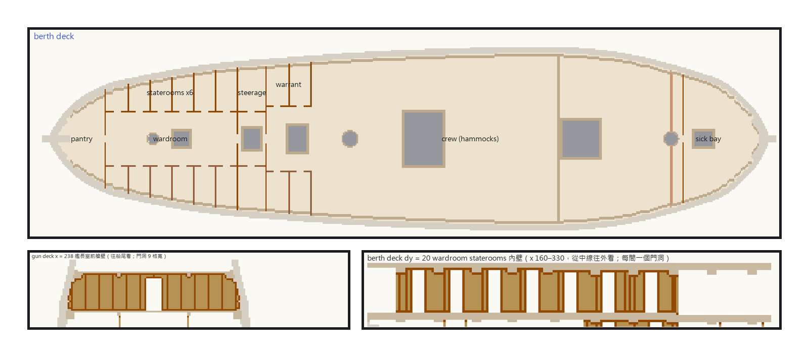
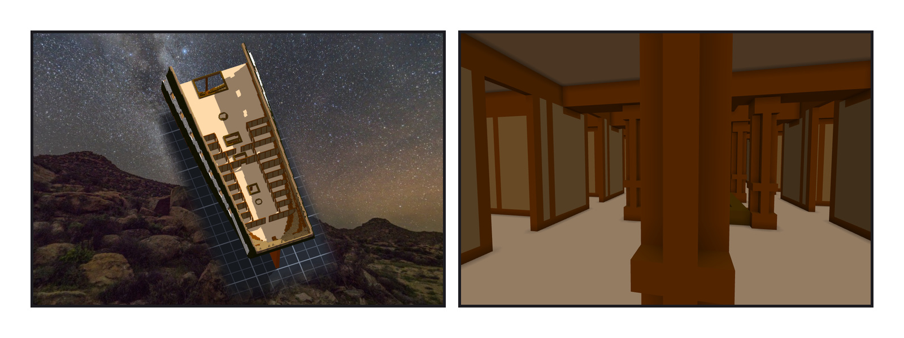

# 第 013 話〈鏡面在哪一格〉

## P1 — 一舷做一份

**P1-①**〔新圖紙 09・berth deck 平面〕深棕色是牆，淡一點的那一舷是同一件作品翻過去關聯進來的。
　字幕：「房間照三份不同年代的資料：一八一六年的 orlop、一八一二年前後的 berth deck、一九三一年的 gun deck。全寬的艙壁整道做成一件；靠船舷的艙房只做一舷，另一舷翻過去。—— 中線在第一百六十格，引擎在作品自己的框裡翻，一百六十翻過去是一百五十九。差一格。」

**P1-②**〔gun deck・艦長室前艙壁（往船尾看）〕
　字幕：「牆一格厚：米棕色的板子，栗棕色的框，每八格一根立柱。門不放，門洞留著。」

**P1-③**〔berth deck・wardroom 那一排 staterooms 的牆（從中線往外看）〕
　字幕：「每一間一個門洞。great cabin 的隔間原本會穿過第一個砲門，往前挪到兩百；berth deck 五八七那道接縫剛好在前桅上，sick bay 的艙壁往前到五九六。」

---

## P2 — 同一件作品

**P2-①**〔拿掉上面兩層・從上往下看 berth deck 的船尾〕
　字幕：「Tim 問：房間可以做為所在甲板的子模組嗎？隱藏甲板的時候，房間一起隱藏。—— 已經是了。拿掉 gun deck 匯出一次：一百一十三萬一千零一十九格，一格不差。」

**P2-②**〔berth deck・wardroom 裡往船尾看〕
　字幕：「兩邊是一間一間 staterooms 的牆，中間一根車削的柱子。右手邊那一排牆，跟左手邊那一排，是同一件作品。」
