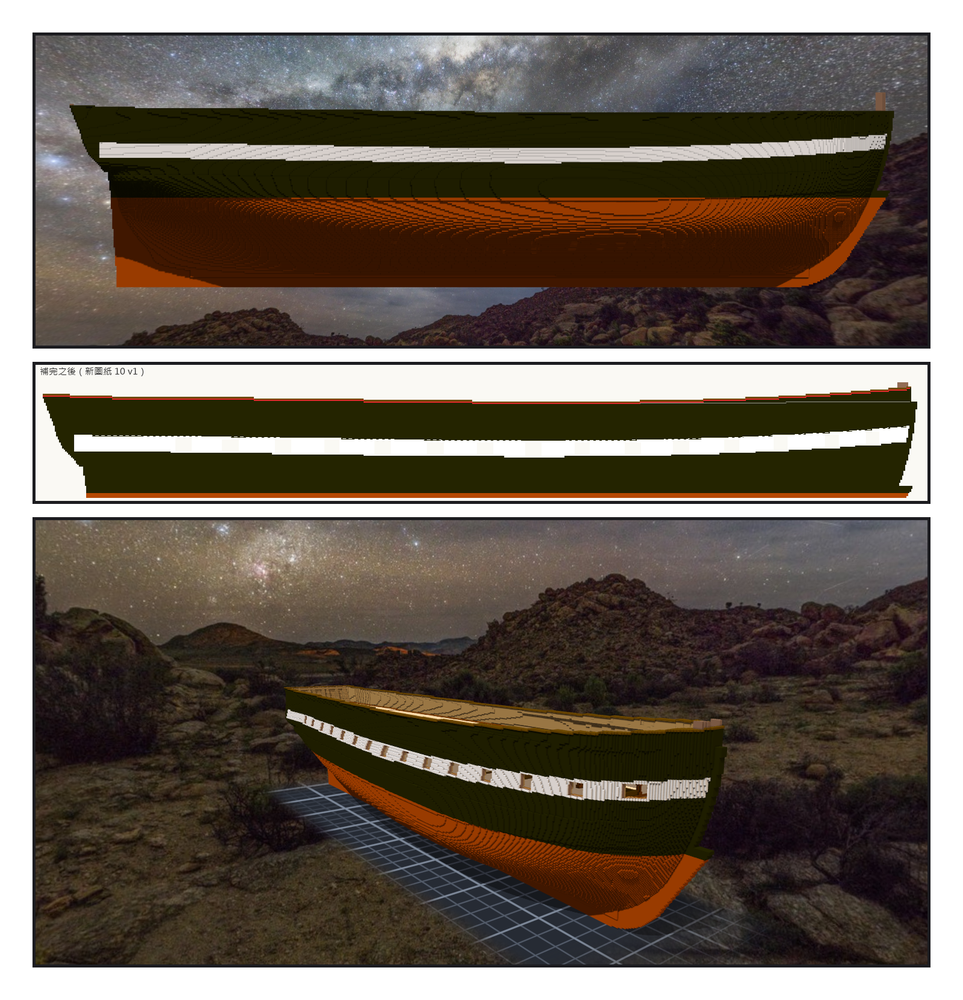
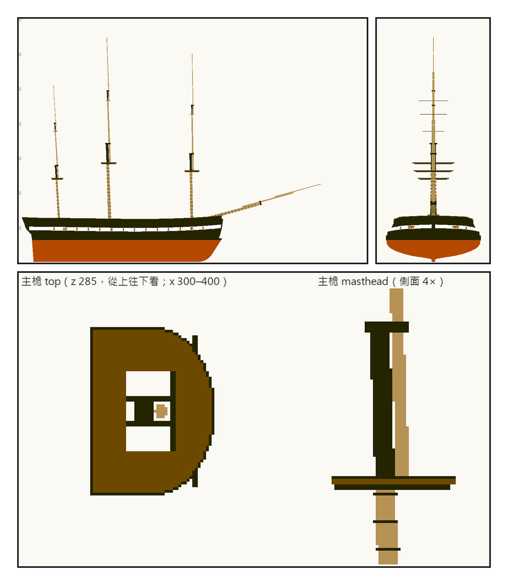
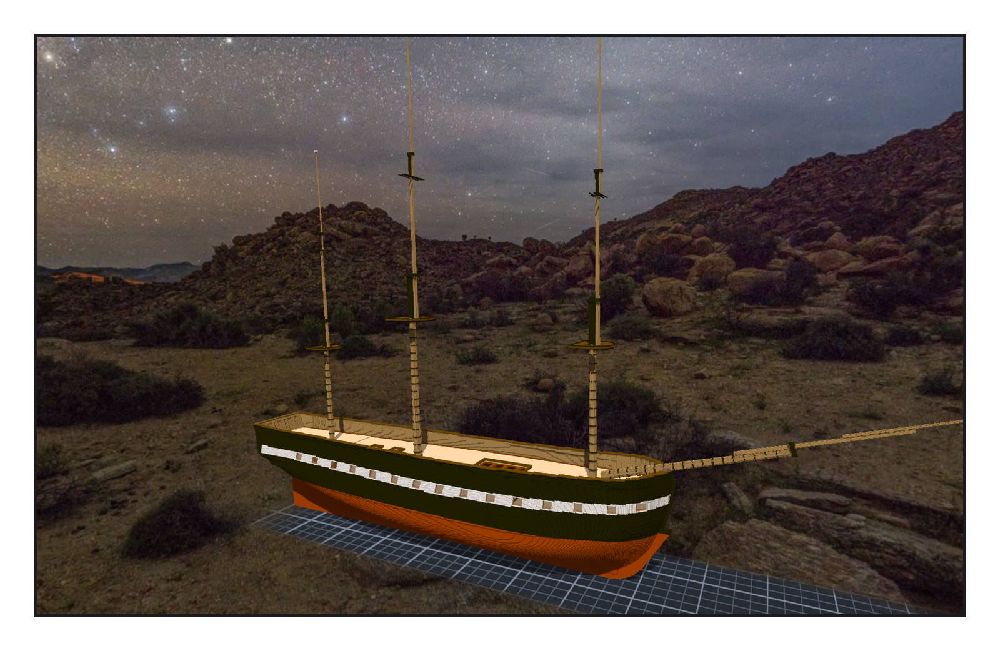

# 第 014 話〈兩條平行的線〉

## P1 — 讓舷頂跟著白帶

**P1-①**〔階段七・側面（之前）〕
　字幕：「鋪外板的時候就記下了：白帶照著舷弧往船頭翹，舷頂幾乎是直的。兩條線不平行，船頭看起來往下垂。要不要翹起來，Tim 交給我決定。」

**P1-②**〔新圖紙 10・補完之後〕
　字幕：「在船中，白帶的上緣和舷頂差二十五格。那就讓整條船都差二十五格。從 x 四九三開始往上補，船頭最多補九格，最上面一條深棕色的 cap rail。」

**P1-③**〔舷牆草稿・從船頭斜看〕
　字幕：「六千四百零六格，加六千九百九十五格。」

---

## P2 — 一八〇一年的那封信

**P2-①**〔新圖紙 11・側面〕
　字幕：「四十四門砲的巡防艦：前桅九十五英尺、主桅一百零五、後桅九十二，bowsprit 六十四。—— 斜度兩份資料對不上：甲板的桅孔照 02 號圖開，一八一〇年的日誌說前桅比主桅還斜。孔已經開好了，桅杆照孔走，落差寫進出處欄。後桅照九十二英尺放，top 會比前桅高；改成八十二。」

**P2-②**〔新圖紙 11・從船頭看〕
　字幕：「三根的 top 依序在兩百八十五、兩百六十二、兩百四十。bowsprit 斜度十五點四度，最前端到 x 九百五十八。」

**P2-③**〔主桅的 top（從上往下看）與 masthead（側面）〕
　字幕：「房間是在桅杆之前做的；那時候前桅孔是空的，一道矮檻橫了過去。它沒有做錯：那一刻，那裡真的是空的。是我給它的尺，只看得到現在。—— 套用之後我多看了一行：components = 2。主桅的 top 整片浮在空中，離桅杆一格。四捨五入，捨到了遠的那一邊。」

---

## P3 — 匯進 Unity

**P3-①**〔組裝件・全部套用之後〕
　字幕：「改成緊貼桅頂外面那一格，刻一百四十四、補一百四十四。components = 1。—— Tim 把它匯進了 Unity，傳來一張截圖：三根桅往船尾傾，每一根半腰一片 D 字形的 top，bowsprit 從船頭斜斜伸出去。他說：測試 OK，辛苦了。」
