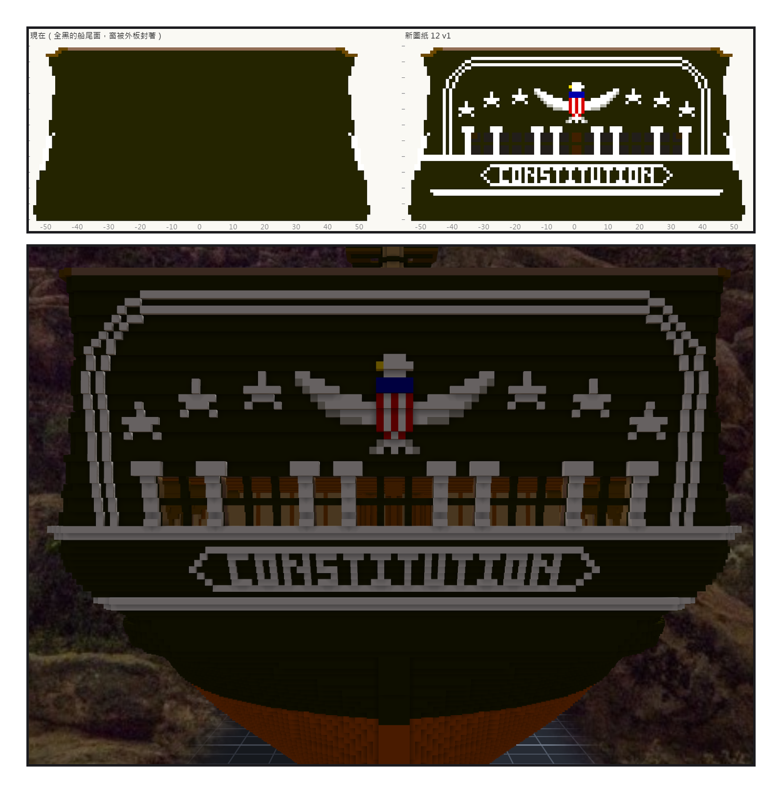
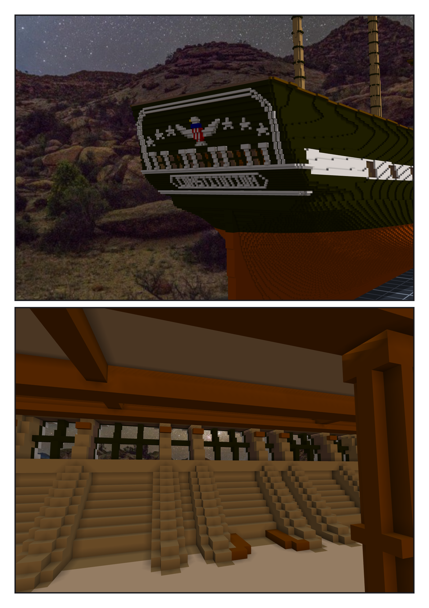

# 第 015 話〈照片裡的那面黑〉

## P1 — 一整面黑

**P1-①**〔新圖紙 12・從正後方看：現在／設計〕
　字幕：「Tim 的照片裡，船尾是一整面黑。我們的船尾也是一整面黑，因為什麼都還沒有。」
　字幕：「窗那幾排，只有兩格厚：外面一格黑漆的外板，裡面一格原木色的內板。背後就是艦長室。一千一百六十五格。」

**P1-②**〔船尾特寫・套用的那一版〕
　字幕：「第一次落草稿，引擎渲出來，船名是反的：NOITUTITSNOC。」
　字幕：「白窗格像一排白柵欄；星星像一隻小烏龜；兩道白線的圓角，糊成一團。」
　字幕：「改了一段程式、格數一格沒變，代表那一段沒在做事。」

---

## P2 — 窗格外面

**P2-①**〔斜後方・窗台白線繞過船尾角，接上側面白帶〕
　字幕：「第一次跑，我順手加的一道斷言把它擋了下來：白線跑進了船尾牆的裡面，落在艦長室裡。」
　字幕：「它擋下的，正是我沒想到的那一種外面。」

**P2-②**〔從艦長室往船尾看〕
　字幕：「一排黑色的窗格，木頭的窗台，窗楣上面是 spar deck 的橫樑。窗格外面，是渲染器的夜空和星星——第一冊的後記裡就在那裡，被我的外板擋了七章。」
