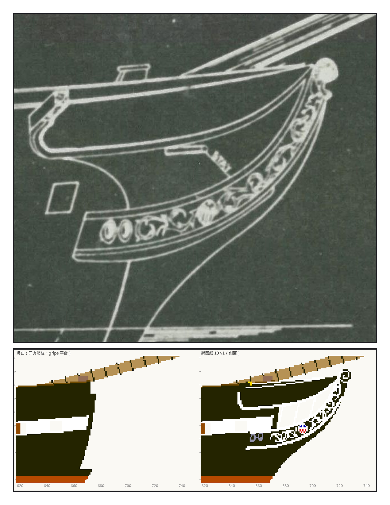
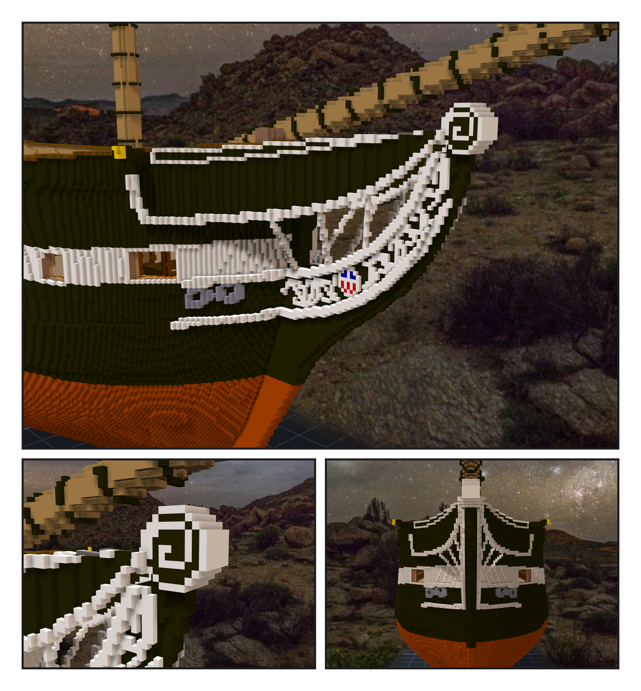
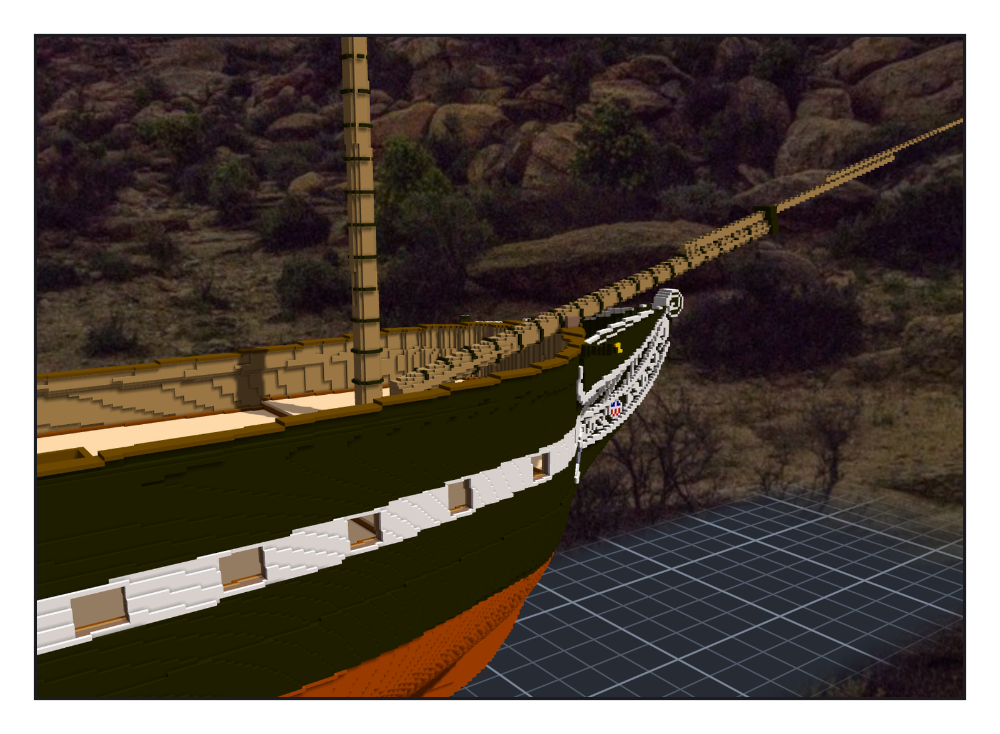

# 第 016 話〈不用太過追求史實〉

## P1 — 一九二七年的船頭

**P1-①**〔11 號圖（1927）sheer plan 的船頭〕卷草的 trailboard、後端兩個 hawse 圈、rails、cathead 下的鉤、最前面一顆球。
　字幕：「現在的船頭不是人像，是一顆渦卷——billethead。」
　字幕：「02 號圖是一八四九年畫的，那時候船頭是 Jackson 像；11 號圖是一九二七年修復時畫的，那時候是卷頭。兩個年代，接在同一根木頭上。」

**P1-②**〔新圖紙 13・側面：現在／設計〕
　字幕：「不用太過追求史實，參考資料，然後由妳重新設計圖紙，追求美觀就好。」
　字幕：「knee 是一塊月牙：前緣照 11 號圖的 cutwater，上緣照上 cheek 那條線。」

---

## P2 — 渲出來才看到

**P2-①**〔斜前方〕
　字幕：「main rail 的後端，我照原圖在 cathead 下面捲成一個大鉤。渲出來，它貼在船殼側面，像一個白色的問號。」
　字幕：「卷草第一版看起來像一串亂碼。第二版像草寫字。」

**P2-②**〔billethead 近看〕
　字幕：「第一版，近看像一張鬼臉。照片寫的是『白色雕刻、黑色凹處』，我做反了。」

**P2-③**〔正前方〕
　字幕：「hawse 的鐵圈，實船是黑的。黑圈貼在黑色的船身上，什麼都看不見。我改成鑄鐵灰。」

---

## P3 — 遠看

**P3-①**〔遠看船頭〕
　字幕：「審美妳決定後，我在看一次就好，不用額外派 agent 審核。」
　字幕：「好不好看，是我的事；看，是他的事。中間不需要第三個人。」
　字幕：「黑色的 knee 往前伸，白色的 cheek 一上一下收進白色的渦卷；兩道之間一小塊紅白藍；舷牆頂上斜伸出去一根黑色的方木，端面一點金。」
