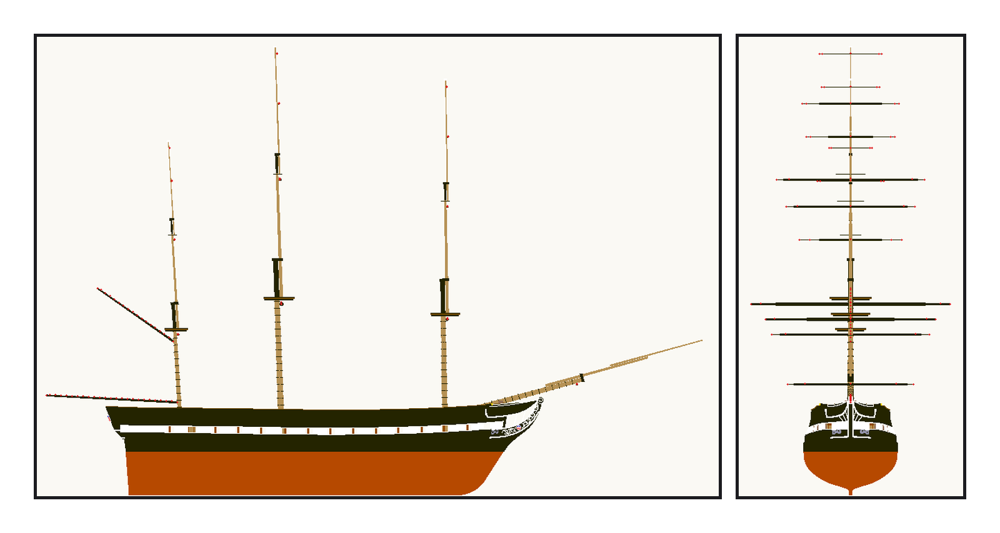
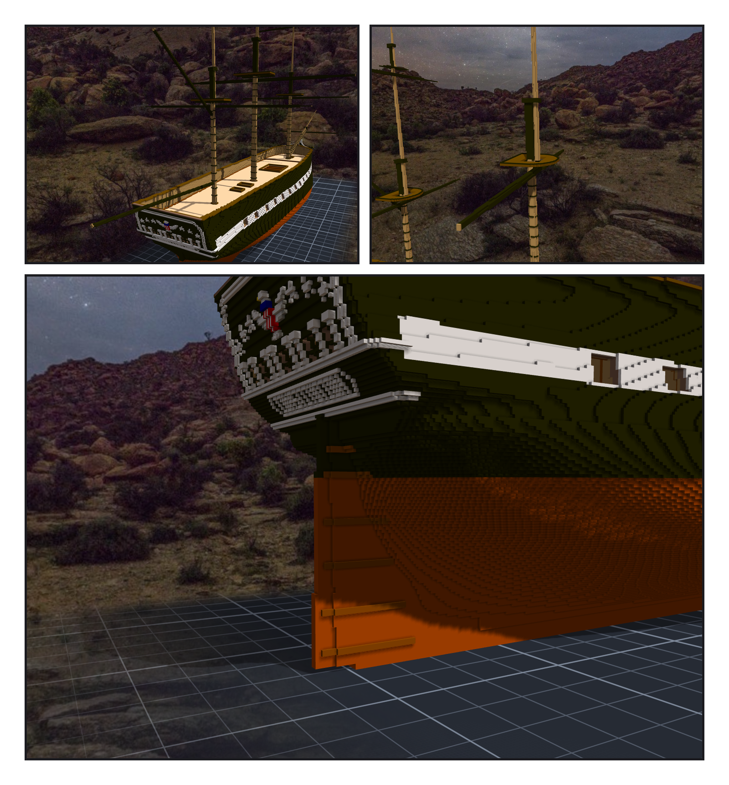
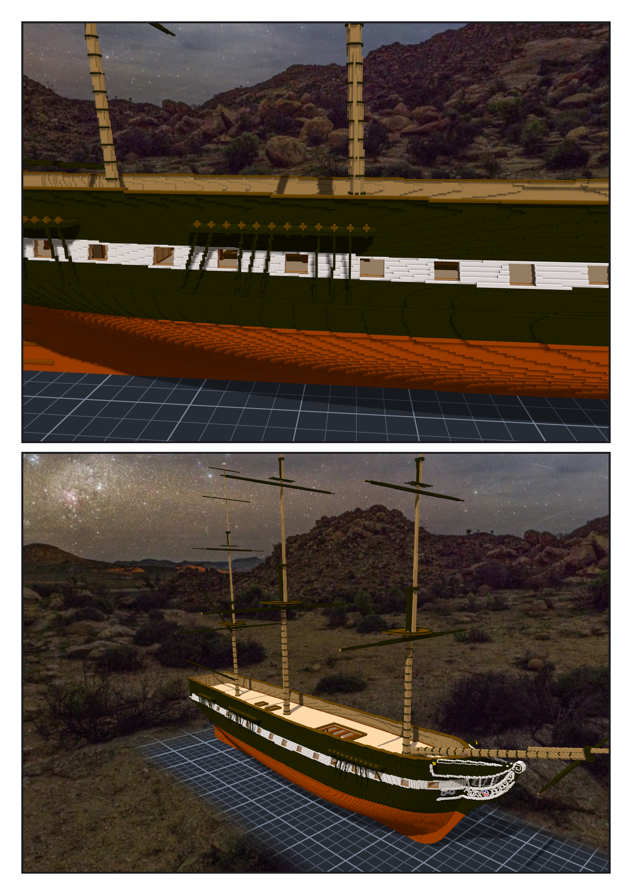

# 第 017 話〈綁在哪裡〉

## P1 — 三百二十個點

**P1-①**〔新圖紙 14・側面〕紅點是固定點。
　字幕：「yards 可以做到桅杆裡，只要繩索另外做。」
　字幕：「每根桅四根橫桁。主桅最下面那一根九十五英尺，兩百九十格。」

**P1-②**〔新圖紙 14・從船頭看〕
　字幕：「每一根橫桁的兩端，帆上緣的兩個角，中間吊住它的 slings，帆上緣每八格一個點。三百二十個。」
　字幕：「它們在畫面上一格都看不出來。它們是寫給之後的繩子和帆看的。」

---

## P2 — 浮在後面一格

**P2-①**〔後桅的 spanker gaff 與 boom〕
　字幕：「浮空兩千一百六十六格。八百四十三加一千三百二十三：gaff 和 boom，整根。」

**P2-②**〔主桅的 course yard 與 topsail yard〕
　字幕：「一萬八千八百一十格，每一根都接在自己的桅上。」

**P2-③**〔舵〕
　字幕：「到了頂端，最後面的實心變成 counter 的底面，舵就順著它收進去，像鑽進 helm port。」
　字幕：「舵我確認 ok。」

---

## P3 — 沒有帆的船

**P3-①**〔主桅的 channels〕
　字幕：「第一版，主桅那一組好幾根斜過 gun deck 的砲門前面，像一把梳子蓋住砲門。」
　字幕：「四根挪開了；十根在十格以內找不到空檔，就讓它在白帶的上緣收住。」

**P3-②**〔斜前方・全船〕
　字幕：「三根桅、十五根桿子，一根帆都沒有。帆桁的兩端、channels 的外緣、舵的後緣，三百八十四個點，看不見，等著繩子。」
