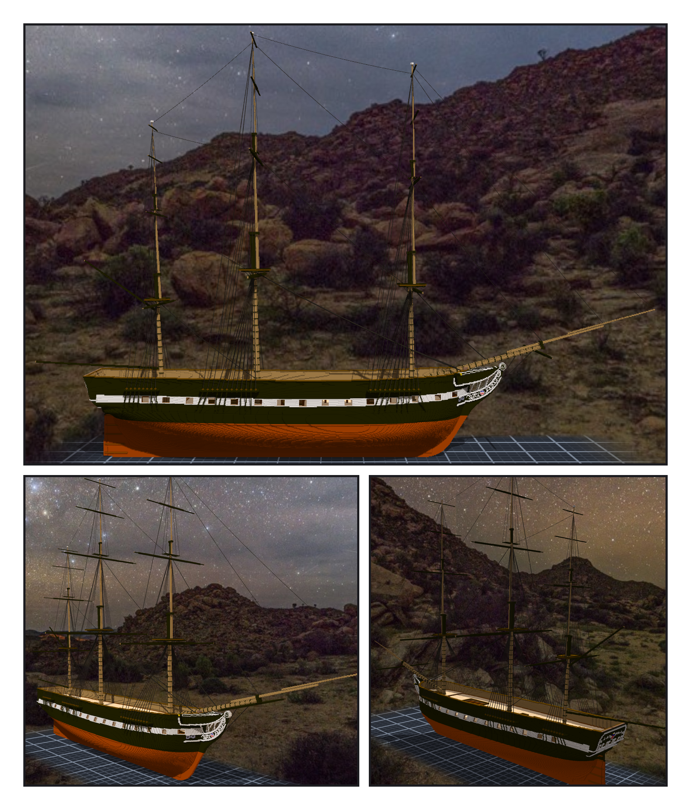
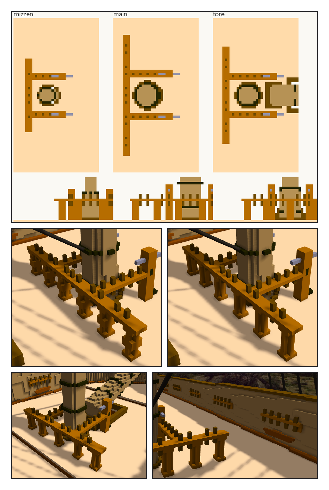
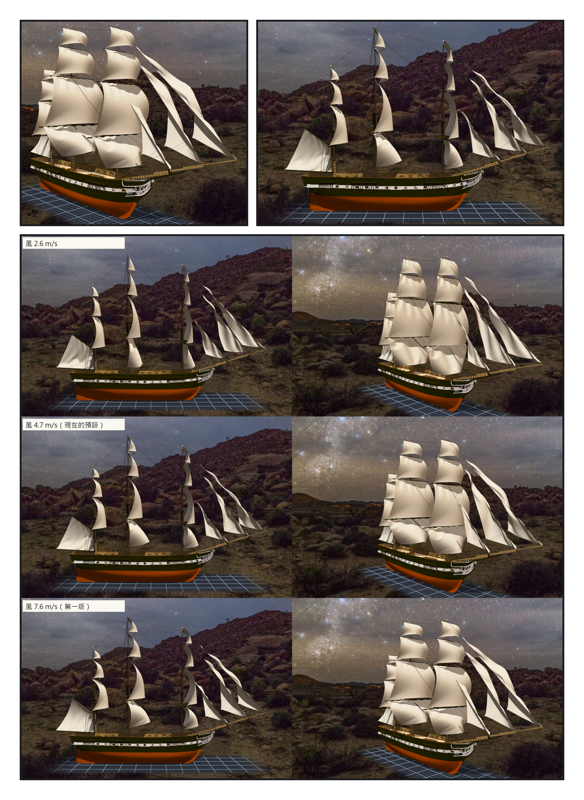
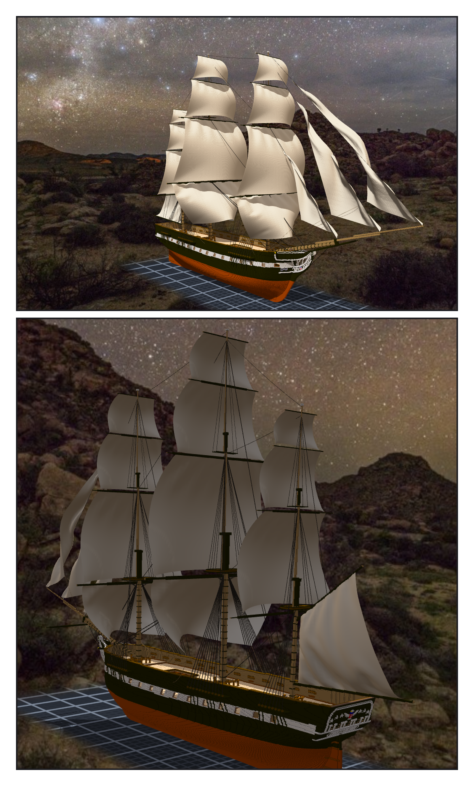

# 第 018 話〈第一批帆〉

## P1 — 一百三十三條繩

**P1-①**〔正側面・靜索〕
　字幕：「可以先試著掛一些跟帆沒有連接的繩子測試。」
　字幕：「繩的兩端要綁在有名字的點上。本小姐把三根桅一層一層印出剖面，從格子讀出 trestletrees、crosstrees、royal yard 在哪一格。」

**P1-②**〔從船頭斜看〕
　字幕：「先掛主桅一組。兩舷每一條都一樣長 —— 鏡像那一舷的 deadeye，真的翻過去了。」
　字幕：「backstays 只給了一點點鬆度，就垂了十九到三十七格。長而陡的繩，拉直。」

**P1-③**〔從船尾斜看〕
　字幕：「一百三十三條繩、一百三十四個點，斷掉的零條。」

---

## P2 — 綁它們的地方

**P2-①**〔新圖紙 17・俯視與從船尾往前看〕
　字幕：「一九七三年那張施工圖：U 形，開口朝前。桅後一根橫的，兩側兩根往前，前端各接一根 bitt。」

**P2-②**〔主桅・第一版〕
　字幕：「柱子腰上多一圈。渲出來一節一節，像串珠。」

**P2-③**〔主桅・拿掉之後〕
　字幕：「拿掉。」

**P2-④**〔前桅〕
　字幕：「前桅那一對 bitts 一放下去，中間剛好夾著 bowsprit 的根部。不是本小姐安排的，是兩組讀數自己對上的。」

**P2-⑤**〔舷牆的 pin rails〕
　字幕：「第一次只放了七根。現況已經有 channels 了，抓砲門的那把尺把整段都當成砲門；換一層高度，chain plates 又變成一欄一欄的假砲門。」
　字幕：「連續六欄以上才算。十四個，跟船身上的一樣。每舷十三根。」
　字幕：「測試ok 可以套用了。」

---

## P3 — 一格 0.03125 公尺

**P3-①**〔第一輪〕
　字幕：「掛帆試試吧。」
　字幕：「讀數寫著：一格 0.03125 m。組裝件是後來另開的作品，沒有記比例 —— 引擎用一公尺三十二格去換重力和風，力大了三・二倍。帆鼓成了降落傘。」

**P3-②**〔補上比例之後・正側面〕
　字幕：「正側面看，方帆是一條一條的彎弧。帆桁是正橫擺的，從這裡看到的剛好是帆的側緣。要像在航行，帆桁得轉一個角度。」

**P3-③**〔同一個角度，三種風〕
　字幕：「可以調整風力試試。」
　字幕：「二・六、四・七、七・六。預設定在四・七。」

---

## P4 — 第一批帆

**P4-①**〔從船頭斜看・風 4.7 m/s〕
　字幕：「十五面帆、三十二條帆腳索。course 的下角，綁在今天剛做好的 belaying pin 上。」

**P4-②**〔從船尾斜看〕
　字幕：「從後面看，帆是從背面鼓起來的；spanker 往左舷鼓 —— 風從右舷後方來。」
　字幕：「辛苦了，測試ok。」
