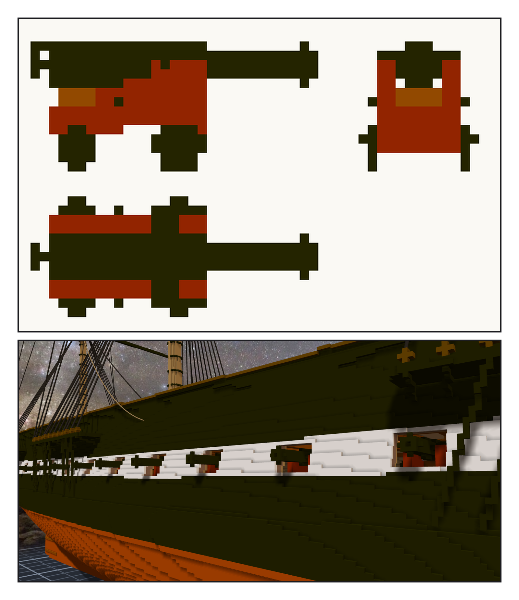
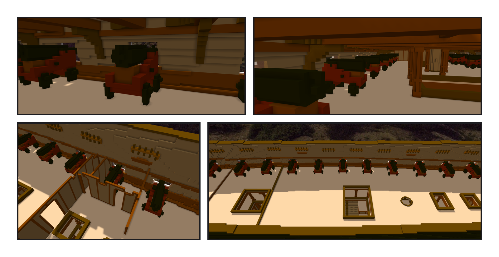
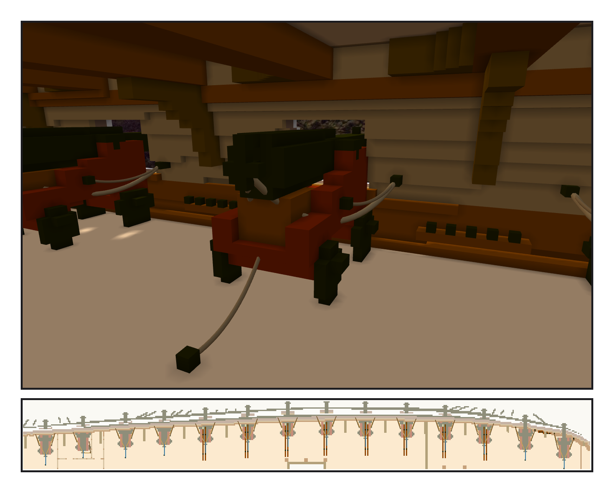
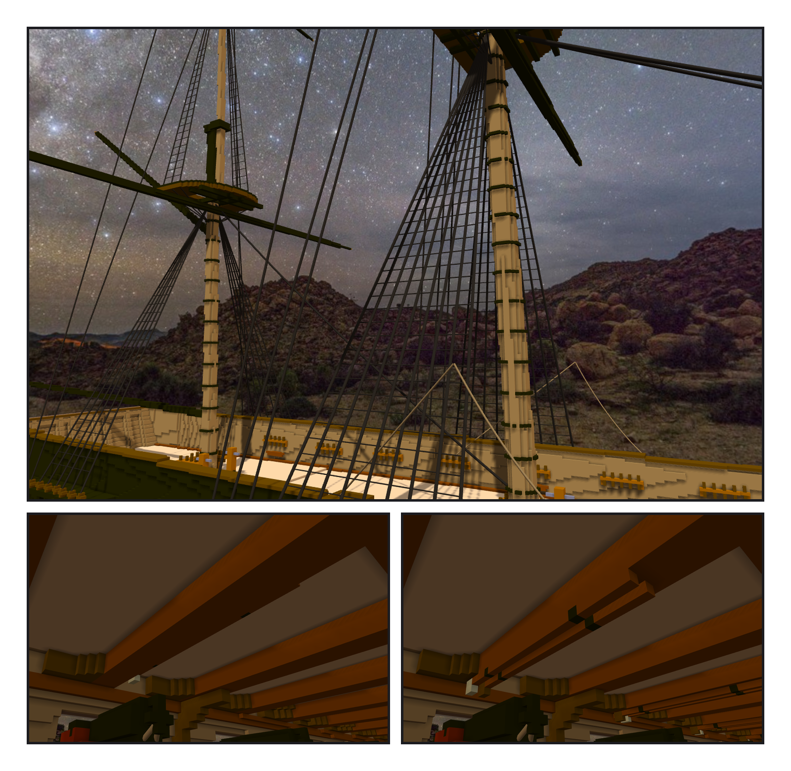

# 第 019 話〈一門砲，二十八次〉

## P1 — 只雕一門

**P1-①**〔新圖紙 18・一門砲：側面、砲口、俯視〕
　字幕：「接著開始裝飾細節吧，可以加炮了。」
　字幕：「關聯可以把同一件作品掛很多次，還可以鏡像。所以只要雕一門。」
　字幕：「這個大小的圓，在格子上只有幾種形狀。外徑二十吋和十九吋，是同一個圓 —— 所以挑會換形狀的那幾個半徑，讓每一段都看得出一個台階。」

**P1-②**〔從船外看〕
　字幕：「一排黑色的砲口，從白帶上一個一個伸出來。」

---

## P2 — 二十八門

**P2-①**〔近看一門〕
　字幕：「砲尾那一圈像一塊黑磚、輪子像一顆一顆黑球、砲架的紅偏亮橘。各改小、改薄、改暗一級。」

**P2-②**〔一整排〕
　字幕：「每一門先貼著船殼內面，撞到東西就往裡退一格。九門不動，五門退一格。」

**P2-③**〔艦長室〕
　字幕：「第二門在艦長室的側艙裡。輪子改窄以後，它剛好塞在兩道隔牆中間 —— 實船也是，砲就放在艙房裡。」

**P2-④**〔俯視一舷〕
　字幕：「船頭那個砲門，半寬只剩大約三十格，一門砲連砲架三十二格。兩舷的砲會在中線撞在一起。不放。」
　字幕：「所以是二十八門，不是三十門。」

---

## P3 — 量過繩，才釘環

**P3-①**〔砲具〕
　字幕：「接著做 breeching 繩以及其他細節吧，GO。」
　字幕：「每一個環放下去之前，先量繩：砲尾拉到環、cheek 拉到環，不准穿過別的東西。穿過自己的砲架不算 —— 實船的 breeching，本來就穿過 cheek 上的孔。」
　字幕：「breeching 留一點鬆。砲推出去的時候，它本來就垂著。」

**P3-②**〔新圖紙 19・俯視一舷〕
　字幕：「一百三十六條繩：每一門五條，艦長室那一門三條。」
　字幕：「我跟 Tim 說 garland 有十二條。從清單數：十一條。」

---

## P4 — 梯子與桿子

**P4-①**〔ratlines〕
　字幕：「接著做吧，GO。」
　字幕：「先試掛一條：整數座標是格心，帶小數的照原值。三百四十道，從 shrouds 的直線內插出來。」

**P4-②**〔rammer 與 sponge・第二輪〕
　字幕：「從上面看一對一對很整齊；從艙裡抬頭，幾乎一根都看不到 —— 貼在兩根橫樑之間，被三格深的橫樑擋住。」

**P4-③**〔掛在橫樑底下〕
　字幕：「實船是掛在橫樑底下的鉤子上。那就掛在橫樑底下。」
　字幕：「繩六百四十五條，一條都沒斷。」
