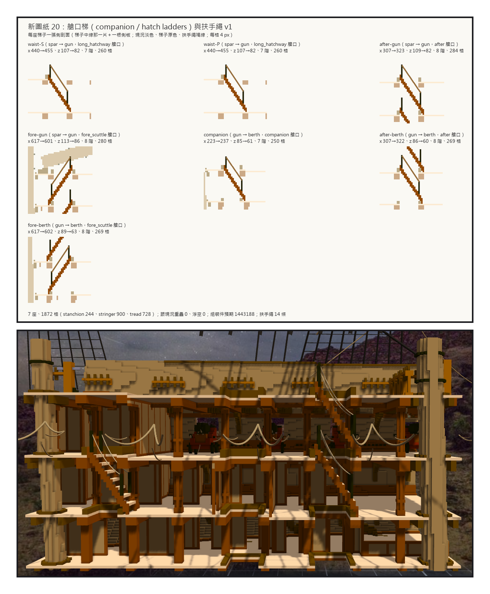
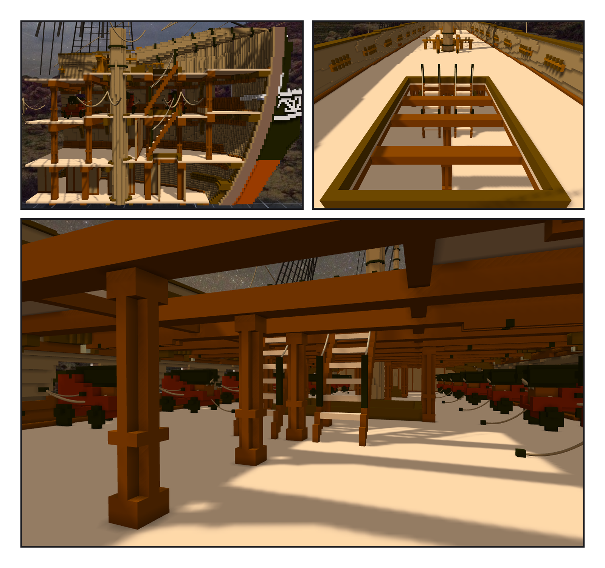

# 第 020 話〈從艙口下去〉

## P1 — 下一層同一處也是洞

**P1-①**〔新圖紙 20・每座梯子一張側剖面〕
　字幕：「接下來可以試著加樓梯嗎？（或是實際上船員是如何上下甲板的？）」
　字幕：「船上沒有樓梯間。甲板之間走的是艙口裡的陡梯：兩根側板、開放的踏板，上端扣在艙口圍板上，旁邊一條 man rope。」
　字幕：「每三格一階、往前兩格。」

**P1-②**〔船尾那一段的剖面〕
　字幕：「有的艙口四層上下對齊 —— 這一段的 after hatch 就是。下一層同一個位置也是洞，梯子要跨過下一層的圍板，腳落在洞外面。」
　字幕：「after 那兩座最後平行疊著：上面那座先放，佔住了反方向。」

---

## P2 — 讓它自己挑

**P2-①**〔船頭那一段的剖面〕
　字幕：「fore scuttle 正上方是 bowsprit 的根部，中線上離甲板只有六到九格。『頭頂淨空』原本量到甲板上面，把它也量進去了 —— 改成只量兩層甲板之間。」

**P2-②**〔從 spar deck 往下看 waist〕
　字幕：「waist 那一對分在中線兩側 —— 中線有柱子。」

**P2-③**〔從 gun deck 看〕
　字幕：「七座。orlop 那一層一座都放不下：after hatch 底下同一處也是洞、fore scuttle 底下是艙房、companion 的梯腳正對柱子。照實記下來。」
　字幕：「這次回報給 Tim 的數字，是先從 verify 檔讀回來才送出的。」
