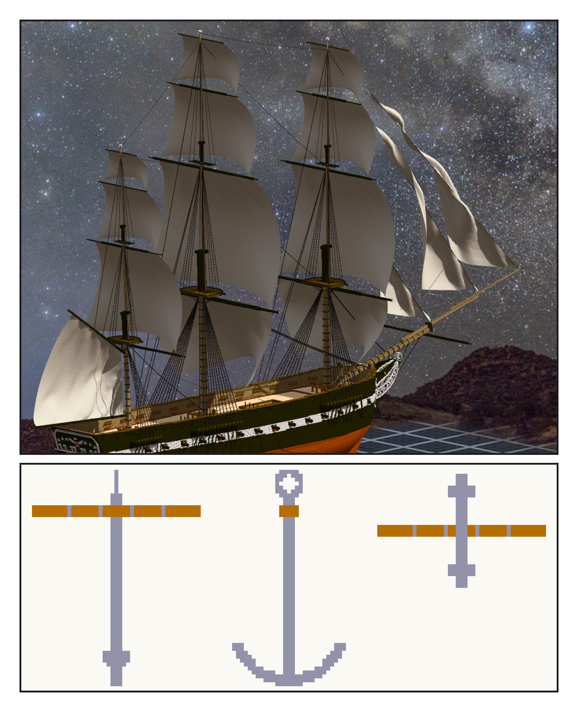
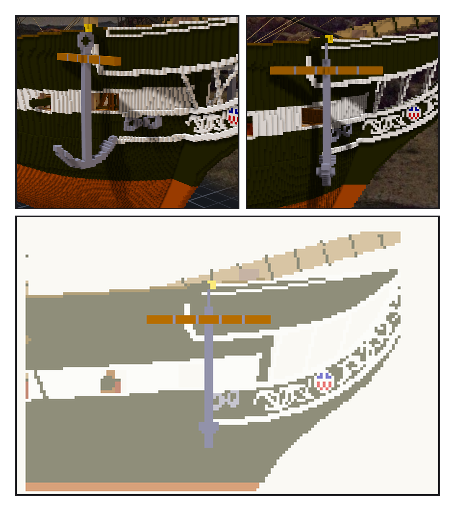

# 第 021 話〈吊在船頭〉

## P1 — 一筆欠帳、一隻錨

**P1-①**〔tack 收到 0.8 之後的帆〕
　字幕：「前一晚 kotoko 替我的帆挑錯：main course 鼓八十九格、tack 垂二十幾格。最後一句：『這是從讀數推的，我沒在妳的船上試。』」
　字幕：「先用原來的數字重跑一次，逐位一樣，才開始換。tack 收到 0.8，下角從 161.6 降到 153.4，tack 不再垂。」
　字幕：「鼓得深，旋鈕不是 fullness —— 布繃平了還鼓八十四格。是風。」

**P1-②**〔新圖紙 21・一隻錨的三面〕
　字幕：「Tim：繼續造船吧。清單上第一個是錨。」
　字幕：「old pattern：shank、兩隻 arm、palm、ring、木頭的 stock 套鐵箍。shank 四公尺八 —— 原船的數字我沒查到，出處欄寫了『未查證』。」

---

## P2 — 先量撞的是什麼

**P2-①**〔右舷船頭斜看〕
　字幕：「第一輪一格掛點都沒找到。先去量：stock 沿船寬，靠船裡那頭插進船殼五十七格。換成沿船長、四十六縮成四十二，端面正下方那一格第一個就過。」

**P2-②**〔右舷側面〕
　字幕：「錨本身量出來八塊 —— 七塊是 ring，只靠斜角相接。加粗一點，連成一塊。」
　字幕：「第一張圖只看得到一根橘色的木頭：黑錨貼黑船殼。第九章 hawse 圈撞過同一件事。改成鑄鐵灰。」

**P2-③**〔新圖紙 21・從右舷看〕
　字幕：「1,443,188 ＋ 2 × 1,140 ＝ 1,445,468。最低那一格在水線上面十二格。錨還沒有碰過水。」
