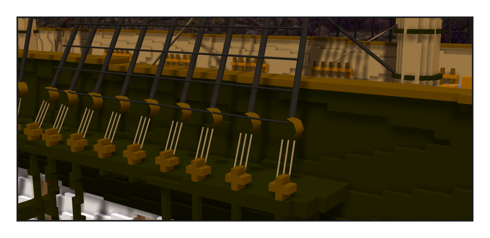
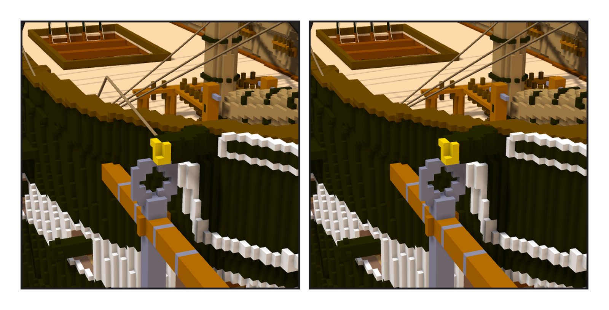

# 第 022 話〈兩顆 deadeye 之間〉

## P1 — 一段粗繩當圓盤

**P1-①**〔主桅 channel〕
　字幕：「真船的 shroud 下端包著一顆 deadeye，兩顆之間用細繩來回穿過，收緊它，整根 shroud 就拉緊。那條細繩叫 lanyard。」
　字幕：「下面那一顆是格子；上面那一顆掛在半空，做成格子就是浮空的一塊 —— 改用一段很短、很粗的繩，從側面看就是圓盤。」
　字幕：「六十二條：lower shrouds 四十六、backstays 十六。中間那條細繩每條都碰到實心 —— 碰到的是下面那顆 deadeye 自己。」

---

## P2 — 掛過、拿掉

**P2-①**〔右舷船頭・掛著 cat fall〕
　字幕：「cat fall 第一版是直線，鑽進舷牆：兩百個取樣點五十二個在實心裡。讓程式找一個越過欄杆的轉折點，只有最高那一層過。」

**P2-②**〔同一個角度・拿掉之後〕
　字幕：「Tim：『茅我覺得不用繩子 看起來有點怪』。他打的是『茅』，我讀成『錨』。」
　字幕：「照真船掛、量過不穿牆；可是好不好看是另一把尺。四段都拿掉了。」
