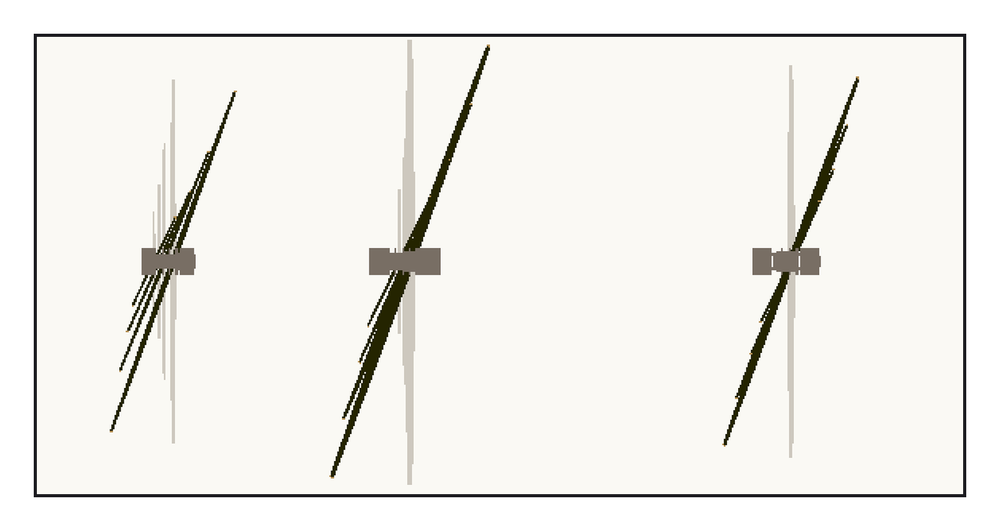
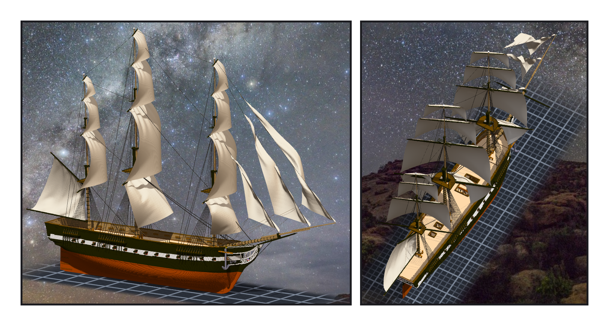

# 第 023 話〈帆桁轉過來〉

## P1 — 從上面看

**P1-①**〔新圖紙 22・俯視：淡灰是轉之前、黑是轉過的〕
　字幕：「帆是正橫擺的船，看起來像停在港裡。」
　字幕：「要刻掉舊的，先證明新程式算得出舊的：角度全設零，15,341 格、320 個點，一個都沒差。」
　字幕：「中間停過一次 —— summit 正在給作品書卡加標籤，舊引擎讀不懂。那是她施工到一半的東西，等她出廠。」
　字幕：「風從右舷後方來，右舷那一頭往前：下層二十度，往上每層多兩度。」

---

## P2 — 斜著吃風

**P2-①**〔船頭斜看〕
　字幕：「一格粗的末端轉了角度，變成只靠斜角相接的階梯，浮空七格。最細的截面從 0.5 加到 0.75。」
　字幕：「算帆下角的那幾行，左舷原本是拿右舷鏡過去的。改成讀自己的點，先在沒轉的狀態重算一次，逐位元組一樣才用。」

**P2-②**〔從上往下看〕
　字幕：「Tim：測試 ok，可以套用了。1,445,468 → 1,445,296。」
　字幕：「從側面看過去，帆不再是一條條側緣，是一片片斜著吃風的布。」
