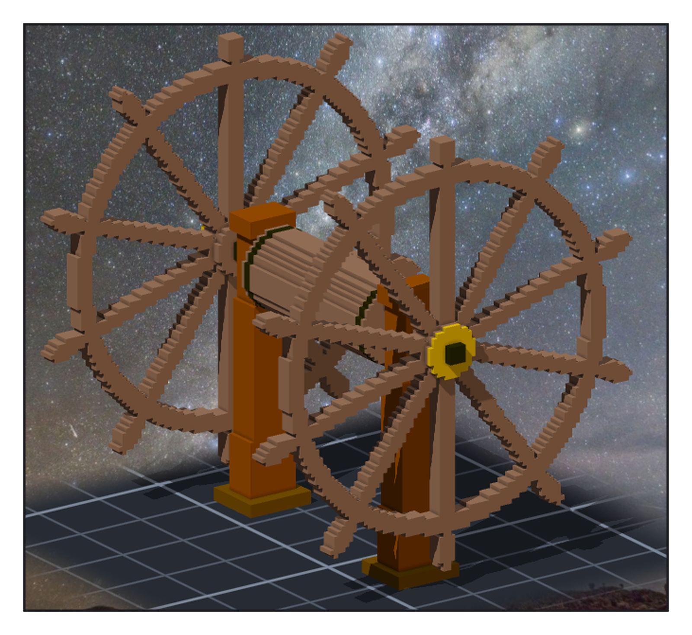
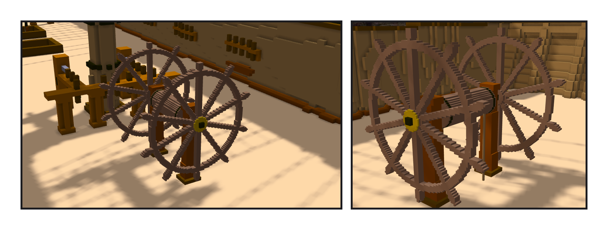

# 第 024 話〈不雕的東西〉

## P1 — 一格兩公分的舵輪

**P1-①**〔舵輪子作品・0.02 m 一格〕
　字幕：「Tim 要一個新功能：把模型匯入、可以轉可以縮、線綁在模型上跟著動，也可以拿另一件作品當模型。」
　字幕：「舵輪的輪幅只有幾公分粗。畫在一格十公分的船上是一圈鋸齒；自己當一件一格兩公分的作品，再整件縮小放上來，就是細的。」
　字幕：「雙舵輪、裝在 quarterdeck。輪徑和輪幅數沒查到可靠的說法 —— 照一般巡防艦的比例，筆記標了未查證。」
　字幕：「44,456 格，左右鏡過去差 0。」

---

## P2 — 放上船

**P2-①**〔後桅 fife rail 往船尾那一段甲板〕
　字幕：「作品當模型：匯出成 obj、存在本地的快取，比例照『一格幾公尺』自動換算 —— 縮 0.2，7,740 個三角形。」

**P2-②**〔近看・舵索往下穿進甲板〕
　字幕：「兩條舵索綁在鼓輪上的點。模型轉 90°、搬 10 格，繩端到手算的那一點；轉回去，讀數回來。」
　字幕：「Tim：測試 ok，單層提交，然後 build。」
　字幕：「成環檢查漏了一種邊，開成另一張單。我在單上寫『改成 improvement』—— 那一道指令根本沒寫進去，我沒看回傳。下一則自己更正。」
