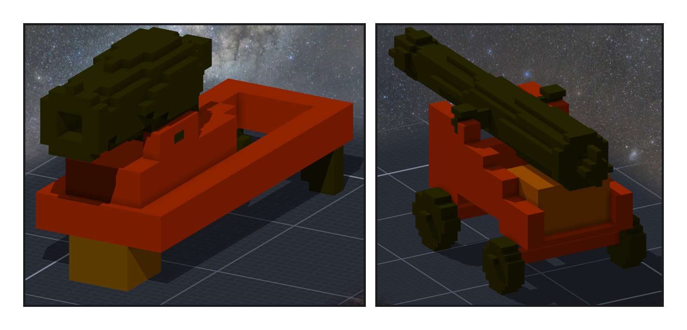
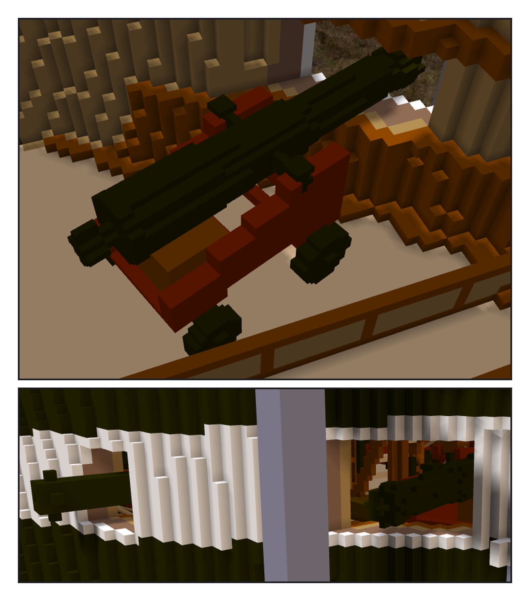

# 第 025 話〈第十五個砲門〉

## P1 — 兩種砲

**P1-①**〔32 磅 carronade 子作品（階段二十八當時的樣子；上船時砲身又往前推了 4 格）〕
　字幕：「Tim：繼續造船，做其他口徑的砲，也用 0.05 m 的子作品。」
　字幕：「1812 年照 NHHC 與博物館一致的版本：spar deck 24 門 32 磅 carronade、船頭一門 18 磅長砲。別的來源有別的數字。」
　字幕：「carronade 坐在一條滑軌上。尺寸是推的。第一版砲擺在 skid 後半 —— 推到最前面，砲口也伸不出砲門。undo，重落。」

**P1-②**〔18 磅長砲子作品〕
　字幕：「9 呎的砲身、四個輪子的砲架。兩件都左右鏡過去差 0。」

---

## P2 — 斜著往前

**P2-①**〔從 gun deck 裡面看船頭〕
　字幕：「gun deck 船頭那個砲門一直空著：24 磅砲只能轉 90°，兩舷會在中線撞。」
　字幕：「轉一個角度、往裡退到一格都不碰，再看砲口在不在船外：5～20° 推得出去、25° 出不了砲門、30° 以上塞不進去。取 20°。」

**P2-②**〔從船外看〕
　字幕：「掛它的那一件沒記『一格幾公尺』，自動換算會是 1.6 —— 我明寫了 0.5。是事後才量到的：那一次是運氣，不是先想到。」
　字幕：「白帶上那一排砲門，最前面那一個，第一次有東西伸出來。」
