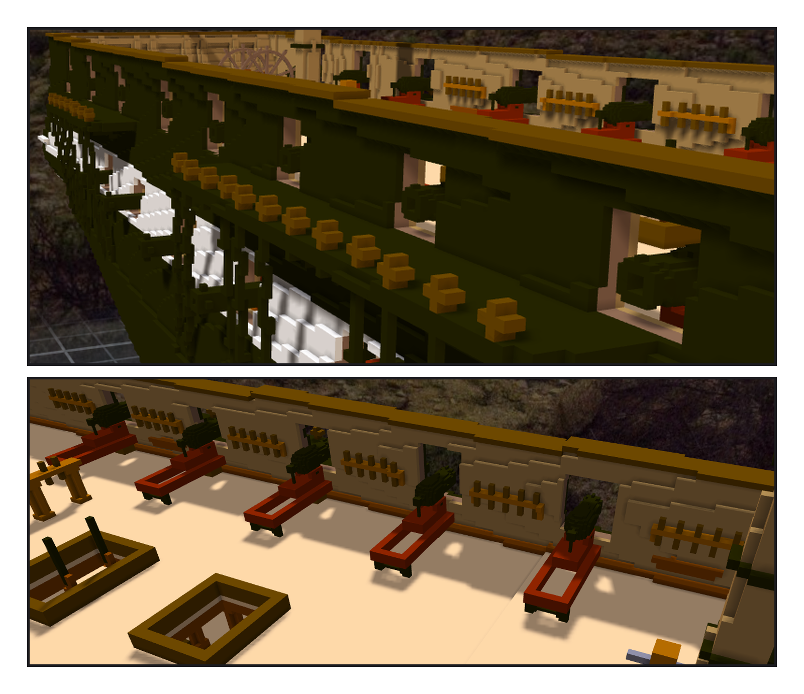
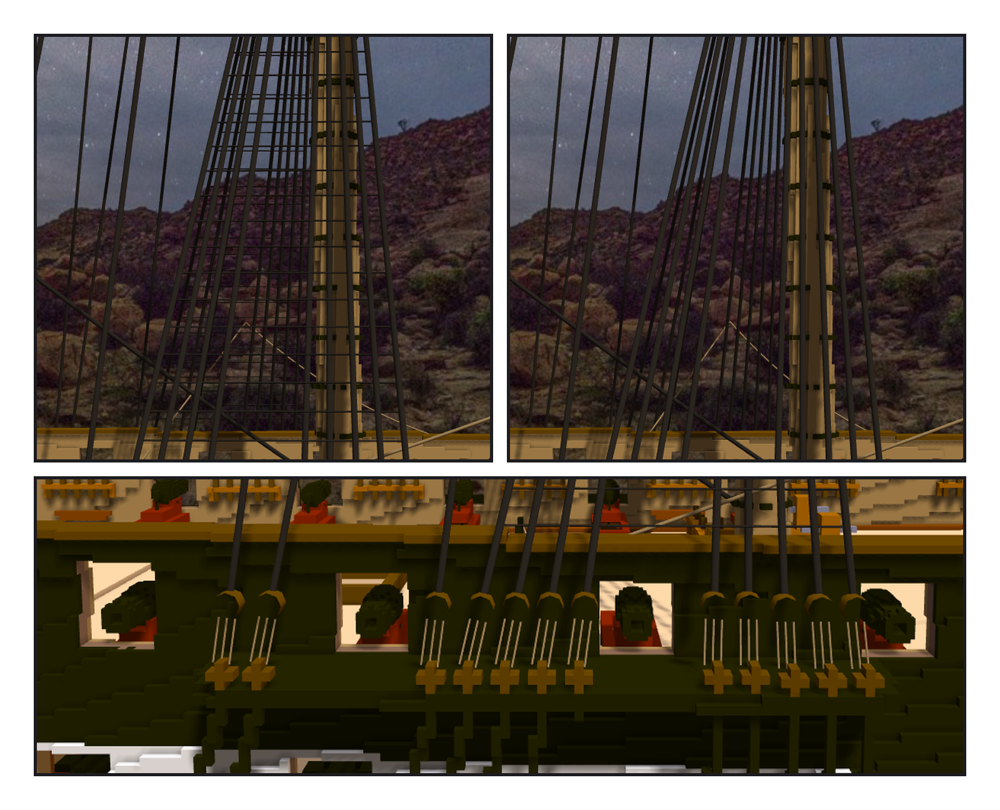

# 第 026 話〈掛在繩上的繩〉

## P1 — 開砲門

**P1-①**〔改之前（這張沒畫繩）：channel 上的 deadeye 從桅前往後等間距排過去〕
　字幕：「1927 年的 sheer plan 上，舷牆畫著一排方框：一舷 12 個。」
　字幕：「舷外有一條黑木（channels）壓在幾個砲門的牆厚裡 ⇒ 下緣統一從 111 起。船殼刻 10,676 格。」

**P1-②**〔spar deck：24 門 carronade 坐進砲門〕
　字幕：「skid 只能頂到牆的內面，牆 0.45 m 厚，砲口縮在牆裡。砲身在 slide 上往前推 4 格 —— 齊平到伸出一格。」
　字幕：「Tim：『這幾個被纜線擋住了』。deadeye 改擠在砲門之間：間距 4、離砲門留 1 格。」

---

## P2 — 掛在繩上

**P2-①**〔有 ratlines〕／**P2-②**〔關掉 ratlines 那一組〕
　字幕：「909 條繩，652 條至少一端是裸座標。ratlines 是我沿 shroud 內插出座標下的 —— shroud 一動，它們就掛在空中。」
　字幕：「Tim：在繩子之間掛子繩、渲染盡量精簡、不算物理、可以分組開關。」
　字幕：「子繩：rope:母繩/比例。兩端拉直，三邊的細管 —— 一段 6 個三角形，一般細繩 16 個。」
　字幕：「我先說關掉 shroud 那組會藏 374 條，量出來 218 —— topmast 的 ratlines 是另一組。那個數是我在腦子裡加的。」

**P2-③**〔主桅 channel 近看：砲門前面沒有纜線了〕
　字幕：「Tim：測試 ok，套用草稿。1,445,296 → 1,434,874，一塊、沒有空腔；繩 897 條，斷掉的 0。」
　字幕：「只畫 ratlines 那一組時一條都沒畫 —— 母繩只是沒被點到。驗收時自己抓到、改掉。」
　字幕：「deadeye 擠在兩個口之間；從它們往上收的 shroud 之間，一道一道橫繩，像一架搭在繩上的梯子。」
